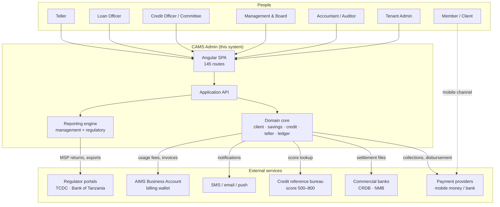

# 01 — System Overview

## 1. What this system is

**AIMSCAMS** (Alpha Integrated Management System — CAMS) is a multi-tenant, browser-based back
office for deposit-taking cooperative financial institutions in Tanzania — SACCOs, SACCOS-like
community groups, and small microfinance institutions (MFIs). Its requirements were
reconstructed from the *observed product*, Wakandi CAMS Admin.

It is not a banking core. It is the *operational shell* around a savings-and-credit core:

- it onboards members and groups and holds their KYC file,
- it originates, approves, disburses, services and provisions loans,
- it runs teller cash operations across branches and tills,
- it keeps a double-entry general ledger that every operational event posts into,
- it produces management reports **and the Tanzanian regulatory returns** required by
  TCDC (for SACCOs) and the Bank of Tanzania (for MFIs),
- it bills the tenant for platform usage through a prepaid wallet (WBA).

The reference tenant is **Mafanikio Financial Services Limited** (`MFSL MFI`, account
`101457`): **Module Type: Microfinance**,
**License: MSP2021**, **Mode: STANDARD**, **Stage: Live**, financial year **01-01 → 31-12**.

### Scale of the product as observed

| Dimension | Count |
|---|---|
| Distinct screens / routes | **145** |
| Screenshots analysed | 426 (108.9 MB) |
| Operational reports (Loan / Savings / Client / Statement / Transaction) | **36** |
| Regulatory returns (MSP01–MSP11, incl. SACCOS and MFI variants) | **17** |
| Accounting reports | **15** |
| Top-level navigation modules | **11** |
| Roles in the RBAC model | **17** |
| Loan product workflow stages | **4** (+ optional fee stage) |
| Teller transaction types | **11** client + **8** GL + **3** till + **2** bulk |

### The five things that make it hard

Most of the system is ordinary CRUD. Five areas are not, and they drive the architecture:

1. **Double-entry accounting with asynchronous posting.** The UI carries a banner:
   *"3 transaction(s) are submitted but not posted to accounting… Click Resubmit"*.
   Operational writes and ledger writes are two different transactions that must converge.
2. **Loan servicing maths.** Reducing-balance equal-instalment schedules, interest accrual
   on due date, arrears with holiday exclusion, NPA classification by days past due,
   provisioning, write-off and recovery.
3. **Guarantor fund blocking.** A guarantee reserves a *real* balance on another member's
   savings, and that reservation must be released exactly once.
4. **Regulatory reporting.** Returns are a fixed statutory shape with prior-period columns,
   validation rules, and a save-and-resubmit lifecycle.
5. **Multi-branch cash control.** Every till is a GL account. Cash must reconcile at close.

---

## 2. Evidence base

Everything in this specification is derived from the 426 PNG screenshots in `F:\Wakandi`,
captured from `cams.wakandi.co.tz` on 21–22 October 2026, plus the four XLSX import
templates and two PDF report exports in the same folder.

The screenshots were OCR'd locally (Windows.Media.Ocr, 426/426 processed, 3 text-empty),
then deduplicated per route into 145 documents totalling ~162 000 characters. Field labels,
table headers, enum values and ledger codes quoted in this spec are **verbatim from the
screens**, not reconstructed.

Where a statement is a design recommendation rather than an observation, it is marked
**(recommended)** or **(inferred)**.

Supporting artefacts:

```
cams-spec/
  ocr/            426 per-screenshot text dumps
  merged/         145 per-route deduplicated text files
  merged-index.json
  ocr-all.ps1     reusable OCR script
  merge.py        merge/dedupe script
  docs/           this specification
```

---

## 3. Actors and the permission model

### 3.1 Roles (17)

| Role | What they do in the system |
|---|---|
| **Admin** | Tenant configuration, users, roles, products, policies; usually also operational |
| **Managing Director** | Final credit sanction; policy approval |
| **Director** | Board-level oversight, sanctions |
| **Board Member** | Policy approval, credit committee |
| **Board Member Representative** | Delegated board approval |
| **CEO** | Executive oversight, approvals |
| **General Manager** | Cross-branch operations, approvals |
| **Branch Manager** | Branch-level approvals, staff supervision |
| **Credit Committee** | Collective credit sanction stage |
| **Credit Officer** | Eligibility & credit verification stage |
| **Loan Officer** | Origination, KYC & documentation stage, collections |
| **Client Manager** | Relationship owner for a portfolio of members |
| **Accountant** | Journal entries, reconciliation, financial statements |
| **Auditor** | Read-only across ledger and audit trail |
| **Teller** | Cash desk: deposits, withdrawals, repayments, till |
| **Support** | Assisted operations, troubleshooting |
| **Client** | End member (mobile/self-service surface, not this admin) |

Users hold **multiple roles simultaneously** — the user list shows entries such as
`Client Manager, Admin, Loan Officer, Credit Committee, Board Member, Accountant, …`.
Roles are therefore additive, and the effective permission set is the union. This matters:
the UI must never assume one role per user.

### 3.2 Permissions are `Entity : Action` strings

The roles screen exposes permissions as string tuples, for example:

```
Loan Account : Approve
Transaction : Reversal Approval
Settings Policy : Approve
```

Treat these as the canonical authorisation vocabulary. The `Action` vocabulary observed
includes at least `View`, `Create`, `Edit`, `Delete`, `Approve`, `Reject`, `Reversal Approval`,
`Disburse`, `Import`, `Export`. Build the permission catalogue as data, not as code branches.

### 3.3 Segregation of duties

The approval stages are role-gated, and the same user cannot normally occupy two consecutive
stages of one loan. Enforce this in the domain layer, not only in the UI.

---

## 4. Capability map — nine pillars

```
1. Client & Membership      members, groups, KYC, next of kin, income, assets, bank, MNO
2. Savings & Shares         savings products, share capital, reserves, interest payout
3. Credit                   origination, 4-stage approval, disbursement, servicing, provisioning
4. Transactions             teller, till, online collections, reversals, bulk
5. Accounting               chart of accounts, entries, ledger, fixed assets, 15 reports
6. Reporting & Regulatory   management reports + MSP01–MSP11 returns
7. Messaging                SMS/email/push templates, segments, campaigns, credit recharge
8. Import                   member / account / transaction bulk loads with field mapping
9. Platform Administration  tenant config, branches, products, policies, users, roles, billing
```

Each pillar is expanded screen-by-screen in **02-modules.md**.

---

## 5. System context



---

## 6. Tenancy and configuration model

The tenant is configured, not forked. Observed tenant-level settings:

| Setting | Observed value | Notes |
|---|---|---|
| Credit Union Name | MFSL MFI | Displayed in the top bar and on every report header |
| Registration Number | 178663-445 | Statutory registration |
| Tax Number (TIN) | 178663445 | Used on tax statements |
| Module Type | Microfinance | Selects the regulatory report family |
| License Number | MSP2021 | BoT microfinance service provider licence |
| Mode | STANDARD | Operating mode switch |
| Account Id | 101457 | Tenant identifier across the platform |
| KYC Status | Verified | Tenant-level KYC attestation |
| Stage | Live | Lifecycle: onboarding → live |
| Financial Year | 01-01 → 31-12 | Drives period control |
| Inter-Branch Ledger Code | configurable | Required for multi-branch postings |
| Transaction PIN | present | Step-up confirmation for sensitive actions |
| Online Collections | preferred savings product | Where unattributed online payments land |
| Appearance | dark mode, primary colour, UI scale | Per-tenant theming |

Two configuration facts are architecturally important:

1. **`Module Type` switches the regulatory regime.** The reports module carries *both*
   `MSP01 Report / MSP02 Report / …` (TCDC/SACCOS forms, prefix `TCDC-MSPxx`) *and*
   `MSP03 MFI Report / MSP09 MFI Report / …` (BoT forms, prefix `BOT-MSPxx-MFI`).
   One product, two statutory dialects.
2. **`Online Collections → preferred savings product`** routes unattributed inbound
   payments. If the reference is not an account number (e.g. a National ID) and the member
   has no account in the preferred product, the payment lands in **Need Attention** rather
   than being guessed. That is a first-class exception queue, not an error.

### Multi-branch

Branches carry name, code, address, region, district, ward, employee count, default flag,
and **opening hours with per-date holiday overrides**. Branch selection drives:
- the visible data set (branch scoping),
- the till/GL account used for cash,
- the inter-branch ledger code for cross-branch transactions.

---

## 7. Operating calendar and controls

| Control | How it works |
|---|---|
| Financial year | 01-01 → 31-12, configurable; used by every accounting report filter |
| Accounting periods | Entries list is scoped `from 01-Jan-2026 to 31-Dec-2026`; period close must block back-posting |
| Holiday calendar | `Settings → Policies → Holidays`; also used by loan arrears (`Exclude holidays on arrears`) |
| Branch opening hours | Weekly schedule + special dates; informs teller session validity |
| Till session | Teller opening float, denomination count, close and balance |
| Day end | Unposted-transaction queue must be drained before close |

---

## 8. Frontend stack as observed

From the served bundle (`cams_admin` webpack chunk):

- **Angular** (CLI webpack builder, webpack 5), **lazy-loaded routes** per module
- **PrimeNG** component library
- **RxJS** for async composition
- **TypeScript**
- Server-rendered shell is *not* used; this is a pure SPA against a JSON API

Two notes for the rebuild:

- `bypassSecurityTrustHtml` appears in the bundle. That is a **DOM-XSS escape hatch**, not a
  protection. If you reuse the pattern, sanitise at the source and keep a strict CSP.
- The `angular#bundler` Trusted Types policy is CLI boilerplate. It only enforces anything
  once a `Content-Security-Policy: require-trusted-types-for 'script'` header is served.

The 145-route surface is large because reports are routes, not because the app has 145
distinct workflows. Keep that distinction: ~35 routes carry real interaction, the rest are
parameterised viewers over a shared report renderer.

---

## 9. Design principles for the rebuild

1. **The ledger is the source of truth for money; the operational tables are the source of
   truth for intent.** Never derive a balance only from operational rows.
2. **Every money movement produces an entry document with a stable idempotency key.**
   Retries must be no-ops, not duplicates.
3. **Post asynchronously, reconcile continuously.** Operational commit and ledger post are
   separate transactions joined by an outbox and a visible exception queue.
4. **Products are data.** Interest method, accrual, charges, provisioning, GL mapping and
   approval stages are product configuration — not `if` statements.
5. **Periods are hard walls.** A closed period rejects new postings; corrections are
   explicit reversing entries dated in the open period.
6. **Reports are declarative.** One query/render pipeline, N definitions. The 53 operational
   reports and 15 financial reports share ~90% of their mechanics.
7. **Regulatory returns are versioned artefacts.** Shape, validation and mapping change with
   regulation; store the version with every submitted return.
8. **Multi-tenant from day one.** `tenant_id` on every row, row-level security, per-tenant
   theming and configuration; never a schema per tenant unless contractually required.
9. **The audit trail is a product feature.** Who approved, when, from which branch, with what
   before/after values. Auditors are a paying user role.
10. **Money is integer minor units in transport and `NUMERIC(18,2)` at rest.** Never float.

---

## 10. What to read next

| Document | Purpose |
|---|---|
| `02-modules.md` | Every screen, grouped by module, with capabilities and notable fields |
| `03-flows.md` | The 10 core business flows as Mermaid flowcharts, state machines and sequences |
| `04-architecture.md` | Target architecture, module boundaries, async posting, integrations, NFRs |
| `05-data-model.md` | ERD and entity dictionary, including the accounting mapping |
| `06-regulatory-reporting.md` | MSP01–MSP11 line-by-line mapping to internal data |
| `07-build-plan.md` | Phased delivery plan, epic breakdown, risks, MVP cut |
