# 03 — Core Flows

Eleven flows carry the system. Each is given as a Mermaid diagram plus the **rules you must
implement** — the diagram shows the happy path, the rules show what breaks in production.

---

## 1. End-to-end value chain

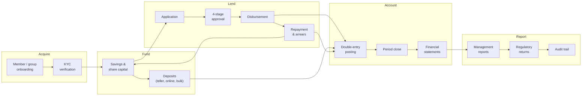

**Rule.** The loop `C4 → B1 → C1` is the business: savings fund loans, repayments refill
savings. Any design that treats savings and credit as separate systems will fail at
guarantor blocking and at repayment allocation.

---

## 2. Member onboarding (individual)

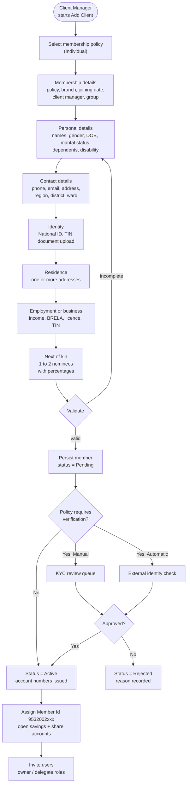

**Rules**

1. **Nominee percentages must total 100.** The membership policy allows 1–2 nominees.
2. **Member Id is generated, never entered.** Observed scheme: `9532002xxx`; loans
   `95323000xxx`; internal/GL `95329000xxx`.
3. **Dormancy** — 365 days without activity makes a member dormant; `Auto Active Upon
   Deposit = Yes` reactivates them on the next deposit.
4. **`Allow Withdraw = Yes`** on the policy controls whether savings can be withdrawn at all,
   independent of balance.
5. Group members are **not** independent clients — they are roster rows on the group, with a
   `Group Member Type` (chairperson, secretary, committee, ordinary).
6. KYC documents are capped at **5 MB** each and stored by reference, never in the database.

---

## 3. Group onboarding and member roster

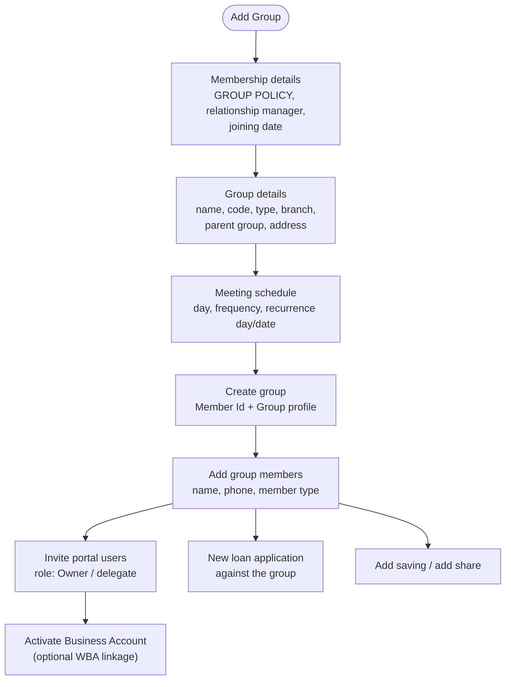

**Rules**

1. A group is a **single credit counterparty** in this product: loans are booked to the group,
   and the roster is evidence of membership, not a set of borrowers.
2. Group loans still require guarantors per product policy (`Minimum Number Of Guarantors`).
3. Group meeting schedule feeds collection scheduling and SMS reminders.

---

## 4. Loan lifecycle — state machine

```mermaid
stateDiagram-v2
    direction LR
    [*] --> Draft
    Draft --> Submitted : submit application
    Submitted --> Stage1 : route to first stage
    state "Stage 1 · KYC & Documentation" as Stage1
    Stage1 --> Stage2 : approve
    Stage1 --> Rejected : reject
    state "Stage 2 · Guarantor & Collateral" as Stage2
    Stage2 --> Stage3 : approve
    Stage2 --> Rejected : reject
    state "Stage 3 · Eligibility & Credit Verification" as Stage3
    Stage3 --> Stage4 : approve
    Stage3 --> Rejected : reject
    state "Stage 4 · Sanctions & Approval" as Stage4
    Stage4 --> Approved : sanction
    Stage4 --> Rejected : decline
    Approved --> Disbursed : disburse
    Disbursed --> Active : first schedule issued
    Active --> Delinquent : installment overdue beyond grace
    Delinquent --> Active : arrears cured
    Delinquent --> NPA : days past due over threshold
    NPA --> Active : recovered
    NPA --> WrittenOff : write off approved
    Active --> Rescheduled : reschedule approved
    Rescheduled --> Active : new schedule issued
    Active --> Closed : fully paid
    Closed --> [*]
    WrittenOff --> [*]
    Rejected --> [*]
```

**Rules**

1. **Four sequential stages, each with a default role and assignee** copied from the product
   at submission time (not at approval time — policies change).
2. **Editing is only allowed before the first approval.** After that, changes require
   resubmission and invalidate prior approvals.
3. **Rejection at any stage is terminal for that application**; the member reapplies.
4. **An optional `Fee & Payments` stage** exists between sanction and disbursement for
   products that charge upfront.
5. **`Product Policy Version` is stamped on the loan.** A later policy edit must not
   retroactively change a booked loan.
6. **Disbursement is the accounting event**, not approval. Approval creates intent;
   disbursement moves money and books the entry.
7. **Top-up, reschedule, write-off, interest waiver and close are separate commands**, each
   with its own approval and its own ledger effect. Do not implement them as field edits.

---

## 5. Loan application — approval sequence

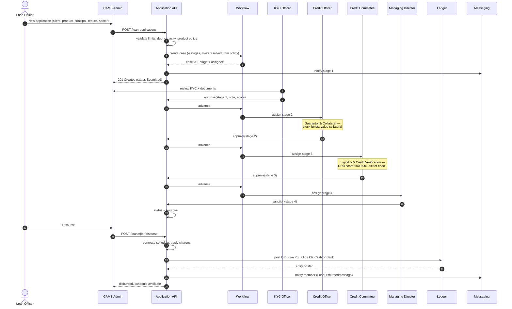

**Rules**

1. **Each stage records:** approver, role, decision, note, score, timestamp, and the exact
   policy version used. The UI shows `Pending / Approved`, `Previous Step / Current Step`,
   `Approval history`, `Notes`, `Score history`, `Audit history`, `Documents`.
2. **The same user may not approve two consecutive stages** of one loan (segregation of duties).
3. **Guarantor blocking happens at stage 2**, before sanction — otherwise you sanction a loan
   with no cover.
4. **Charges are created at disbursement** per `Payment Mode`:
   `Payment Upon Processing And Disbursement` (e.g. 5% loan management fee),
   `Payment Upon Loan Repayment`, `Payment Upon Delayed Repayment` (penalty 0.5% of current due).
5. **Notification templates exist for the lifecycle:** `LoanDisbursedMessage`,
   `LoanRepaymentMessage`, `LoanRepaymentAdminMessage`, `LoanDisbursedWithFeeMessages`.

---

## 6. Guarantor blocking and release

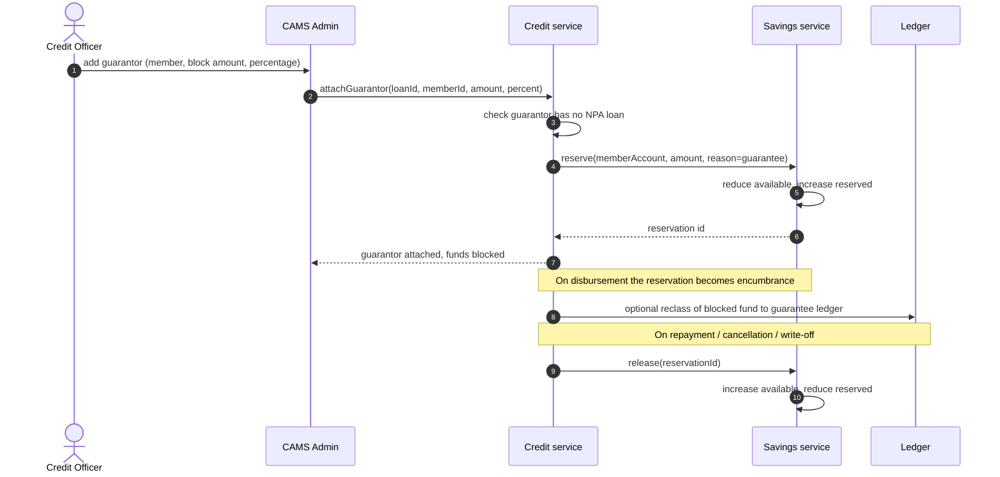

**Rules**

1. **Blocked funds are not a display concept.** They reduce withdrawable balance; the member
   statement shows `Blocked Fund`.
2. **Release must be exactly-once.** Key releases off the reservation id, not off loan status.
3. A guarantor with an NPA loan cannot guarantee (the credit screen shows
   `Insider Relationship` and risk flags for exactly this reason).
4. `Collateral Ratio` (e.g. 150%) constrains the total cover, and collateral is valued from
   the member's **Assets** tab or the fixed-asset register.
5. The `GuarantorsReport` must reconcile reserved amounts back to savings balances.

---

## 7. Loan repayment and allocation

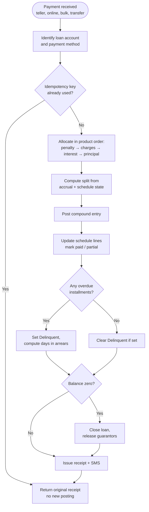

**Rules**

1. **Allocation order is product configuration**: `Charges, Interest and Principal` is the
   observed default. Never hardcode.
2. **Interest is accrued separately from billed.** A repayment reverses the accrued interest
   receivable (`1505`) and recognises income (`4001`/`4005`) in the same entry.
3. **Overpayment** is not negative principal — it posts to `2004 Overpayments` and can be
   refunded or offset.
4. **Advance payments** follow `Advance Payments Adjustment` = `Adjust Next Installment`.
5. **Early settlement** uses `Pre-closure Interest Calculation` and must not double-charge.
6. **`Recalculate Interest On Repayment` / `On Accrual`** are product switches — respect them
   or the schedule will drift.
7. The observed entry for a bank repayment: **Dr 1205 Staff Loan + Dr 4005 Interest Income,
   Cr 1005 Bank NMB**. The direction is unusual (income debited) but it is what the ledger
   shows; verify against your own accounting policy before copying.

---

## 8. Teller transaction with asynchronous accounting posting

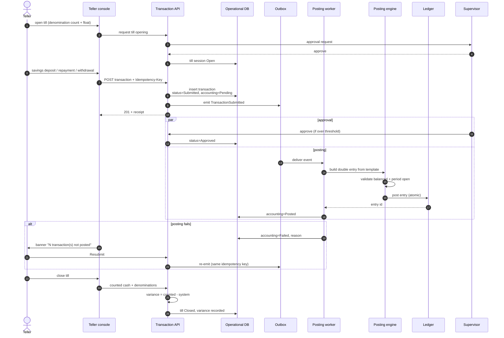

**Rules**

1. **Two-phase commit is not available across services; use an outbox.** Operational insert
   and outbox insert happen in one database transaction.
2. **Idempotency key = (transaction number) or client-supplied UUID.** Re-submission must
   produce the same ledger entry, not a second one.
3. **Posting is atomic per entry**: header + lines, balanced, period open, ledger active.
4. **The banner is a first-class UI element.** It names the count and offers `Resubmit`.
5. **Till variance is a real accounting difference.** Route it to a cash-shortage/overage
   ledger; never silently adjust.
6. **Denominations are captured at open and close** so a physical cash count can be audited.

---

## 9. Till session state

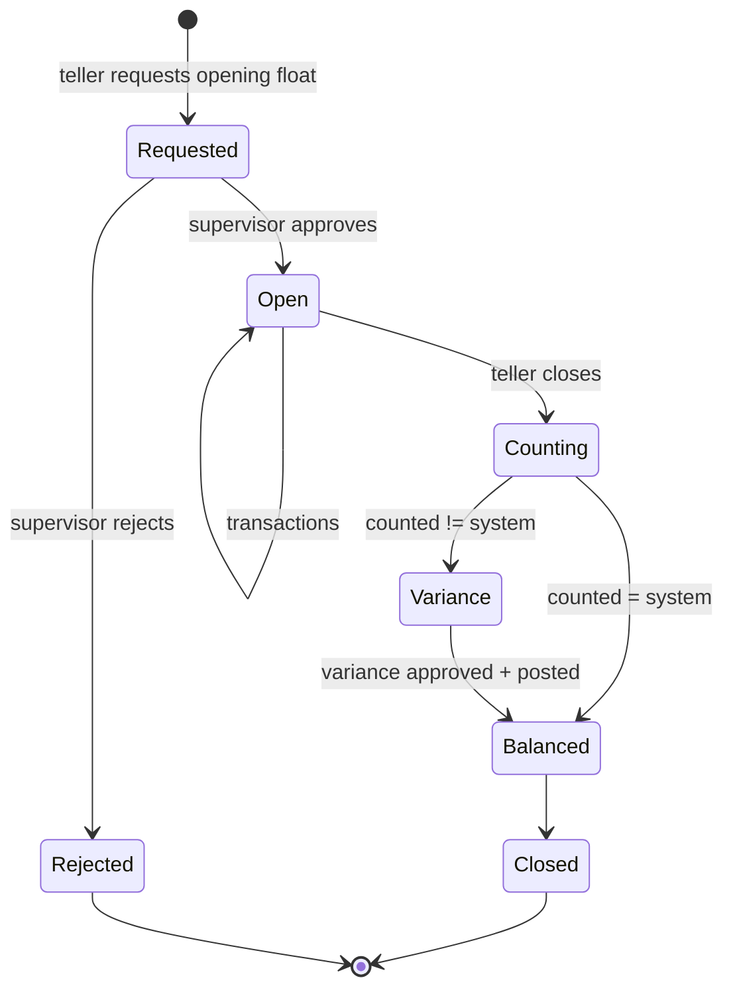

**Rules.** One open session per teller per branch at a time. A teller cannot transact without
an open session. Till balances map to dedicated GL accounts (`1010 TELLERS`, `1011 Teller 2`,
`1012 Teller 1`), not to the vault.

---

## 10. Online collection and reconciliation

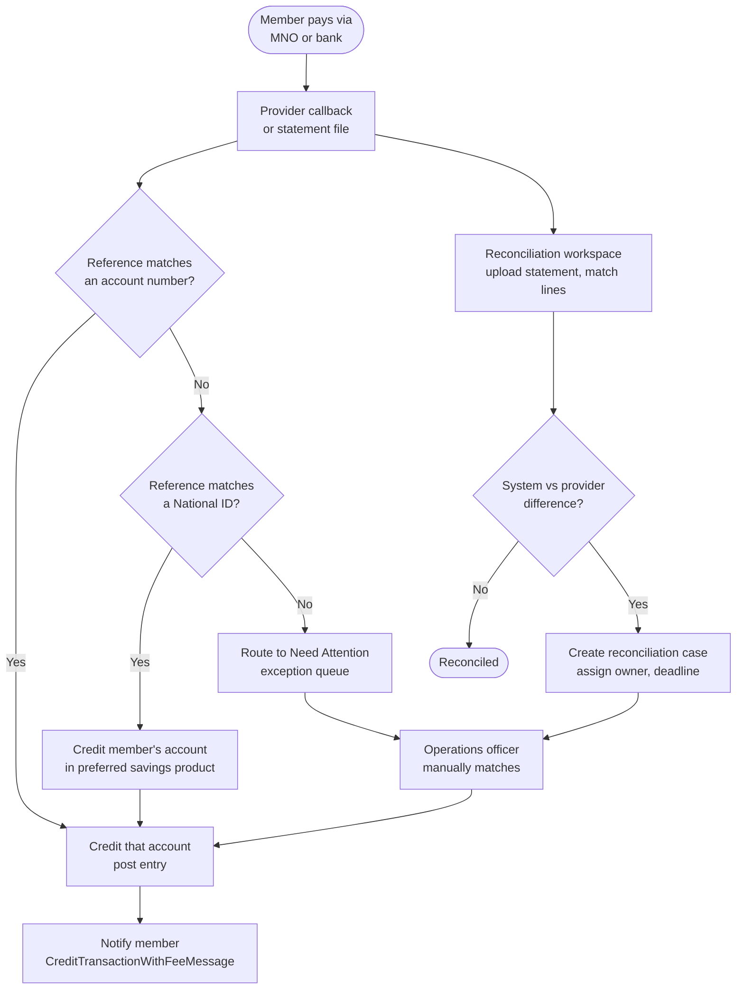

**Rules**

1. **Never guess an account from a partial reference.** Unmatched money goes to an explicit
   queue, not to a suspense account that nobody watches.
2. Provider callbacks are **at-least-once**. Deduplicate on provider transaction id.
3. Statement upload (`1792648401240_statement.xlsx` shape) is the fallback path when
   callbacks fail; both paths must converge on the same matcher.
4. Fees on inward payments split between member and SACCO per `Fee Settings`.

---

## 11. Bulk import

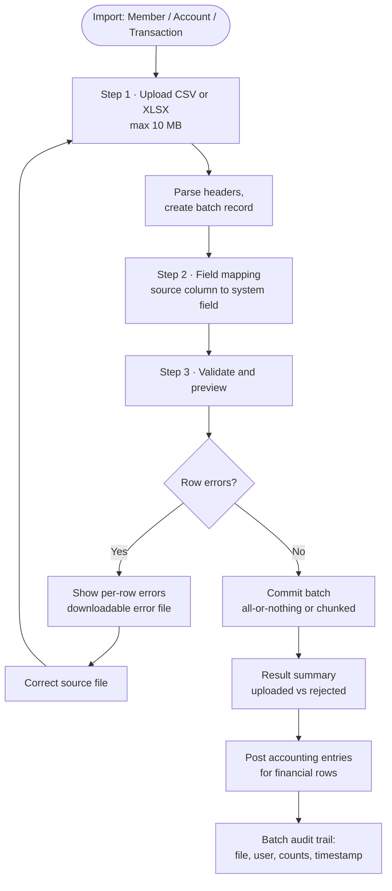

**Rules**

1. **Validate before committing.** The preview step exists because partial imports corrupt
   balances.
2. **Transaction import must post accounting**, otherwise the tenant's ledger drifts on day one.
3. **Batch is re-runnable**: a failed batch is retried or rolled back as a unit.
4. Templates are part of the product: `Member Template`, `Account_Standard_Template.xlsx`,
   `Transaction_Template.xlsx`.
5. 1 061-member imports are normal; design for 10 000 rows without a browser timeout.

---

## 12. Period close and regulatory return

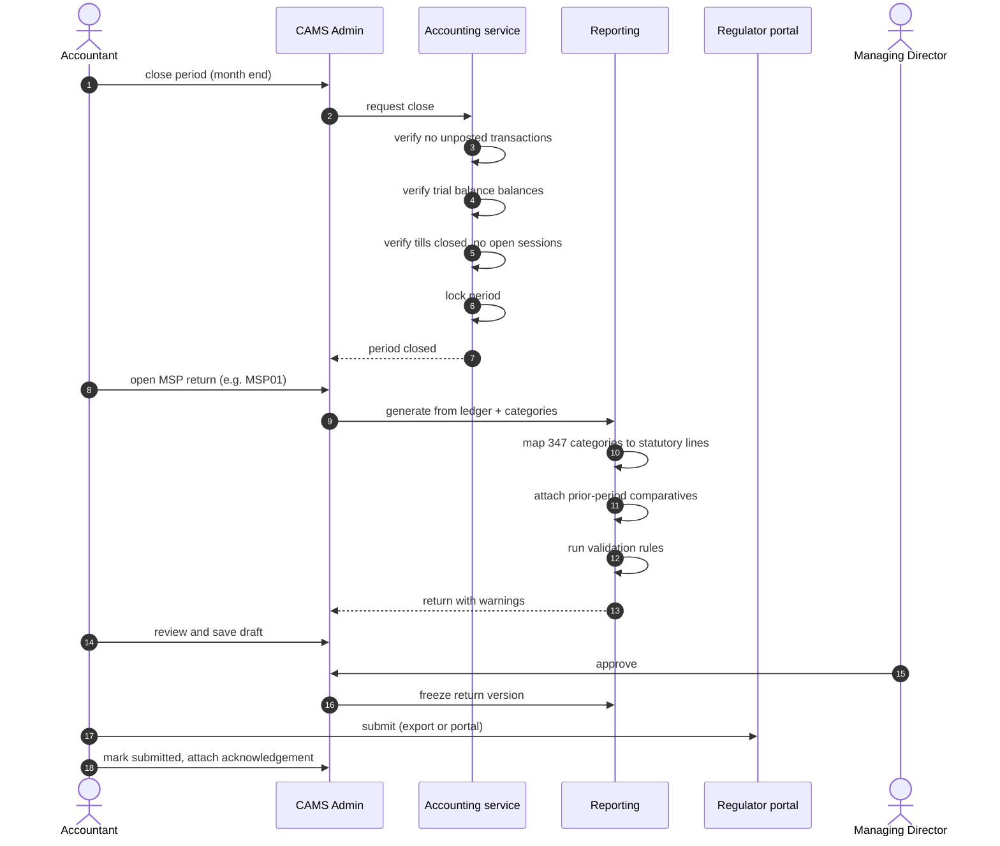

**Rules**

1. **Close is gated on the unposted queue being empty.** That is the whole reason the
   banner exists.
2. **Returns are generated, then frozen.** A submitted return keeps its data snapshot and
   template version; later ledger changes do not mutate it.
3. **Validation is explicit**: totals must tie to the trial balance, prior-period columns
   must be populated, and required schedules must be complete.
4. **`Saved Reports`** on every MSP screen implies drafts are persisted per period, and
   regenerating does not overwrite a submitted version.
5. Regulator differs by `Module Type`: TCDC forms (`TCDC-MSPxx`) for SACCOs, BoT forms
   (`BOT-MSPxx-MFI`) for MFIs.

---

## 13. Flow-to-module traceability

| Flow | Primary modules | Key entities |
|---|---|---|
| Member onboarding | Client, Settings/Policies | Client, MembershipPolicy, NextOfKin, Document |
| Group onboarding | Client | Client (group), GroupMember, ClientUser |
| Loan lifecycle | Accounts/Loans, Requests | LoanApplication, LoanStage, Loan |
| Approval sequence | Requests, Messaging | Approval, Assignment, Notification |
| Guarantor blocking | Accounts/Loans, Accounts/Savings | Guarantor, Reservation, Collateral |
| Repayment allocation | Transactions, Accounting | Transaction, ScheduleLine, LedgerEntry |
| Teller + posting | Transactions/Teller, Accounting | TillSession, Transaction, OutboxEvent, PostingRule |
| Till state | Transactions/Teller | TillSession, Denomination |
| Online reconciliation | Transactions/Online | PaymentIntent, ProviderTxn, ReconCase |
| Bulk import | Import | ImportBatch, ImportRow, FieldMapping |
| Period close / return | Accounting, Reports/MSP | Period, Return, ReturnLine, ValidationRule |
