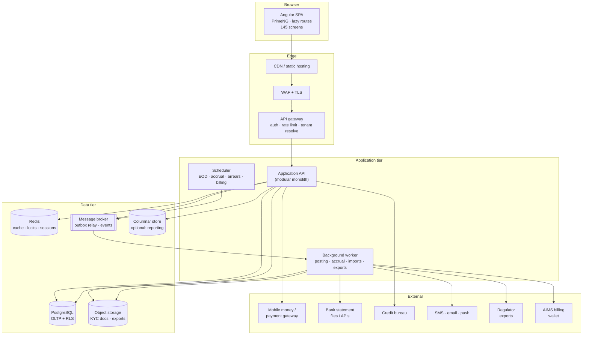

# 04 — Target Architecture

This document specifies the architecture you should build for AIMSCAMS, not the one the
observed product implements. It is
constrained by the flows in `03-flows.md` and the screen surface in `02-modules.md`, but it
makes explicit decisions so you do not rediscover them mid-build.

---

## 1. Architecture drivers

Ranked by how much damage they do if ignored:

| # | Driver | Consequence if ignored |
|---|---|---|
| 1 | Money must balance, always | Ledger drift, failed audit, regulatory rejection |
| 2 | Operational write ≠ ledger write | Cut-over freeze or silent imbalance (hence the banner) |
| 3 | Products are configurable | 20 products become 20 code branches |
| 4 | Multi-branch, multi-tenant | Data leakage; cash reconciles to the wrong branch |
| 5 | Statutory returns are fixed-shape | Reports become bespoke; every regulation change is a release |
| 6 | Approvals are the product | Segregation of duties collapses; fraud risk |
| 7 | Periods are hard walls | Back-posting corrupts closed statements |
| 8 | The audit trail is a saleable feature | Auditors can't sign off; you lose the segment |
| 9 | Reporting is 37% of the screens | Reporting becomes the critical path anyway |
| 10 | Bulk data is the entry path | Every tenant migration takes weeks |

---

## 2. Architecture style — decisions

### 2.1 Modular monolith first, extracted services only where forced

**DECISION.** Build a **modular monolith** with strict in-process module boundaries plus
**one worker process** for asynchronous work (posting, accrual, notifications, imports,
report export). Do not start with microservices.

Why: the domain is transactionally coupled. A loan disbursement touches credit, savings,
charges, ledger and notifications in one atomic business act. Distributed transactions across
nine services is how these systems die. The modules have clear boundaries, so extraction later
is mechanical if a module earns it (candidates: reporting, messaging, billing).

### 2.2 One database, tenant-scoped rows, row-level security

**DECISION.** Single PostgreSQL cluster, `tenant_id` on every business table, enforced with
RLS *and* application-level scoping. Not schema-per-tenant, not database-per-tenant.

Why: 100+ tenants of a few thousand members each. Schema-per-tenant makes migrations
unmanageable; database-per-tenant triples operating cost. Large tenants (100k+ members) can be
moved to a dedicated cluster later without changing the model.

### 2.3 Ledger-first, event-driven posting

**DECISION.** Operational module commits and **outbox row** in one transaction. A worker
consumes the outbox, builds a balanced entry from a **posting rule**, and posts it atomically.
Each entry carries a deterministic `idempotency_key` and a `source_type/source_id`.

### 2.4 Ledger is append-only

**DECISION.** No `UPDATE` on posted entries or lines. Corrections = reversing entry + new
entry. `status` may flip Posted → Reversed, but amounts never change.

### 2.5 Reports are definitions, not screens

**DECISION.** One report engine: `definition (SQL/query spec) → executor → renderer (grid,
CSV, XLSX, PDF)`. All 53 operational reports and 15 financial reports are definitions.

### 2.6 Regulatory returns are versioned artefacts

**DECISION.** A return instance is generated, validated, frozen on submission, and stored with
its template version + data snapshot. Regeneration creates a new version, never mutates a
submitted one.

### 2.7 Rejected alternatives

| Alternative | Why rejected |
|---|---|
| Event sourcing the whole domain | Operational complexity for little gain; append-only ledger already gives auditability |
| Microservices first | Transactional coupling; team size; reporting needs joins |
| DynamoDB / document store as system of record | Financial reporting is relational; reconciliation queries are join-heavy |
| Read-only replica as reporting DB | Report filters hammer it; use a warehouse/OLAP path for heavy reports |
| Stored procedures for business logic | Untestable, unversioned, hard to review |
| A generic "workflow BPMN" engine | 4 fixed stages + a request queue; BPMN is overkill |

---

## 3. Container view



---

## 4. Module boundaries

Each module owns its tables. A module may call another module's **application service** or
subscribe to its events; it may never read another module's tables directly.

| Module | Owns | Depends on | Publishes |
|---|---|---|---|
| **Identity & Access** | `user`, `role`, `permission`, `user_role`, `session`, `pin` | Tenant | `UserCreated`, `RoleChanged` |
| **Tenant & Org** | `tenant`, `branch`, `branch_hours`, `holiday`, `tenant_setting` | — | `BranchCreated`, `PeriodOpened` |
| **Client** | `client`, `group_member`, `client_user`, `kyc_document`, `next_of_kin`, `income`, `residence`, `client_asset`, `bank_account`, `mno_account`, `membership_policy` | Tenant, Identity | `ClientActivated`, `KycApproved`, `MemberDormant` |
| **Catalog** | `product_loan`, `product_savings`, `product_charge`, `interest_rate`, `provisioning_rule`, `credit_policy`, `policy_version` | Tenant | `PolicyApproved`, `ProductChanged` |
| **Savings** | `savings_account`, `savings_txn`, `share_account`, `reservation` | Client, Catalog, Ledger | `DepositPosted`, `WithdrawalPosted`, `FundsReserved`, `FundsReleased` |
| **Credit** | `loan_application`, `application_stage`, `approval`, `loan`, `schedule_line`, `repayment`, `guarantor`, `collateral`, `charge`, `write_off`, `reschedule` | Client, Catalog, Savings, Ledger | `ApplicationSubmitted`, `LoanApproved`, `LoanDisbursed`, `RepaymentReceived`, `LoanClosed`, `LoanWrittenOff` |
| **Transactions** | `transaction`, `till_session`, `denomination`, `reversal`, `bulk_batch`, `request` | Savings, Credit, Ledger | `TransactionSubmitted`, `TransactionApproved`, `TillClosed` |
| **Ledger** | `gl_account`, `gl_group`, `gl_category`, `journal_entry`, `journal_line`, `period`, `posting_rule`, `outbox` | Tenant | `EntryPosted`, `EntryReversed`, `PeriodClosed` |
| **Payments** | `payment_intent`, `provider_txn`, `recon_case`, `statement_import` | Savings, Credit, Ledger | `PaymentMatched`, `PaymentUnmatched` |
| **Reporting** | `report_definition`, `report_run`, `regulatory_template`, `return_instance`, `return_line` | Ledger (read), all (read models) | `ReportGenerated`, `ReturnSubmitted` |
| **Messaging** | `message_template`, `segment`, `message_log`, `credit_balance`, `campaign` | Client | `MessageSent`, `MessageFailed` |
| **Import** | `import_batch`, `import_row`, `field_mapping` | Client, Savings, Credit, Transactions | `ImportCommitted` |
| **Billing (WBA)** | `wba_wallet`, `wba_invoice`, `wba_settlement`, `fee_setting` | Ledger | `InvoiceIssued`, `WalletToppedUp` |
| **Audit** | `audit_event` | — (append only) | — |

**Dependency rule.** `Ledger` depends on nothing except Tenant. Everything may depend on
Ledger; Ledger depends on no business module. If you invert that, the ledger becomes a
second business layer and the reporting model rots.

---

## 5. Layering inside a module

```
modules/credit/
  api/            controllers, DTOs, guards (thin)
  application/    use cases, transactions, orchestration
  domain/         entities, value objects, invariants, domain events
  infrastructure/ repositories, adapters, SQL
  readmodels/     query services for list/detail screens
```

| Layer | May do | May not do |
|---|---|---|
| `api` | Validate shape, map DTO, authorise | Contain business rules |
| `application` | Coordinate a use case, open a transaction, emit events | Reach into another module's tables |
| `domain` | Enforce invariants, compute schedules, allocate money | Touch I/O |
| `infrastructure` | Persist, call providers | Decide business outcomes |
| `readmodels` | Compose cross-module views | Mutate |

### The use-case shape

```ts
// application/disburseLoan.ts
async function disburseLoan(cmd: DisburseLoanCommand, ctx: RequestContext) {
  return db.tx(async (tx) => {
    const loan = await credit.repo.getForUpdate(cmd.loanId, ctx.tenantId, tx);
    loan.ensureCanDisburse();                       // domain invariant
    const schedule = scheduleFactory.build(loan, loan.policyVersion); // pure
    const charges = chargeFactory.onDisbursement(loan);              // pure

    await credit.repo.saveSchedule(loan.id, schedule, tx);
    await savings.releaseReservations(loan.id, tx);
    await outbox.emit(new LoanDisbursed(loan, schedule, charges), tx); // posting later

    return { loanId: loan.id, firstDueDate: schedule.firstDue };
  });
}
```

Note what is **absent**: no ledger calls, no SMS calls, no HTTP. Those are consequences,
delivered through the outbox.

---

## 6. The posting engine

This is the highest-risk component. Build it first, test it hardest.

### 6.1 Data model

```
posting_rule (id, tenant_id, event_type, product_type, product_id,
              debit_account, credit_account, amount_selector, priority, active)

journal_entry (id, tenant_id, branch_id, entry_no, entry_date, period_id,
               entry_type, status, source_type, source_id,
               idempotency_key UNIQUE, narration, comment, created_by, posted_at)

journal_line  (id, entry_id, line_no, gl_account_id, dr_cr, amount, member_id, loan_id)
```

`SUM(debit) = SUM(credit)` per entry is enforced by a deferred constraint trigger, not by
hope.

### 6.2 Entry templates

| Event | Debit | Credit | Notes |
|---|---|---|---|
| Savings deposit | Cash / Teller / Bank | Member savings liability | Product decides the liability ledger |
| Savings withdrawal | Member savings liability | Cash / Teller / Bank | Blocked funds not debitable |
| Share purchase | Cash / Bank | `3404 Share Capital` | Equity, not liability |
| Loan disbursement | `1201/1202/1203/1205` portfolio | Cash / Bank | Product-configurable |
| Loan repayment | Cash / Bank | Portfolio + interest income + charges | Compound; allocation order from product |
| Interest accrual | `1505 Interest Receivable` | `4001/4005` | Batch, month-end |
| Loan management fee | Cash / Bank | `4101` | 5% of principal, at disbursement |
| Penalty | Cash / Bank | `4104` | 0.5% of current due |
| Write-off | `5004` | Portfolio | Plus reversal of accrued interest |
| Provision | Provision expense | Provision liability | By classification bucket |
| GL expense | Expense ledger | Cash / Bank | Manual entry |
| Contra / transfer | Destination ledger | Source ledger | Branch inter-ledger code |
| Reversal | Mirror of original | Mirror of original | New entry, links `reversed_entry_id` |

> **Verify before copying.** The observed repayment entry shows
> `Dr 4005 Interest Income` alongside `Dr 1205 Staff Loan` and `Cr 1005 Bank`. Debiting an
> income account for a repayment is not standard. Establish your own accounting policy with
> the tenant's accountant and encode *that*, not the screenshot.

### 6.3 Guarantees the engine must provide

1. **Idempotency** — replaying an event never creates a second entry.
2. **Balance** — per-entry debits equal credits, enforced at the database level.
3. **Period guard** — reject posting into a closed period; surface a specific error code.
4. **Account guard** — reject posting to an inactive ledger or a control account that
   requires a sub-ledger.
5. **Branch guard** — the branch on the entry must match the branch on the source document,
   except for explicit inter-branch entries which use the inter-branch ledger code.
6. **Atomicity** — header + lines + outbox status committed together.
7. **Reversibility** — any posted entry can be reversed with a full mirror; partial reversal
   is a new adjusting entry.
8. **Observability** — every failure records `event_type`, `source_id`, `rule_id`, `reason`,
   and is visible in the unposted queue.

### 6.4 Failure handling

```
pending → (worker picks) → posting → posted
                    ↓
                 failed → (retry with backoff, max N) → dead-letter → manual resubmit
```

The `Resubmit` button re-emits the event with the **same** idempotency key. That is safe by
construction: if the first attempt actually succeeded but the acknowledgement was lost, the
second attempt is a no-op.

---

## 7. Loan engine

### 7.1 Schedule generation

Inputs: principal, nominal rate per period, number of periods, first due date, grace,
interest method, charges, rounding mode.

Methods to support (all product-selectable):

| Method | Use |
|---|---|
| `Reducing Balance With Equal Installment` | Default observed |
| Reducing balance, equal principal | Common SACCO variant |
| Straight line / flat | Regulated disclosure variants |
| Balloon | Product flag `Balloon Payment` |
| Interest-only with bullet | Seasonal / agricultural |

```
EMI = P × r × (1+r)^n / ((1+r)^n − 1)
```
with `r = 0` handled as `P / n`, and rounding applied to the *last* installment to absorb the
residual so `SUM(principal) = P` exactly.

### 7.2 Accrual

Product controls: `Configure Type = Accrual|Cash`, `Accrual Interest Calculation Term =
On Due Date|Daily`, `Accrue interest after maturity`.

Run as a scheduled job, per loan, writing `accrual` rows and an outbox event for the
`1505 → 4001` posting. Idempotent per (loan, period, date).

### 7.3 Arrears and NPA

```
days_past_due = business_days_between(due_date, as_of)
                excluding holidays if product.exclude_holidays
```

| Bucket | Days past due (observed provisioning rates) |
|---|---|
| Current / Performing | 0 |
| Watch | 1–30 |
| Substandard | 31–90 (25%) |
| Doubtful | 91–180 (50%) |
| Loss | 181–360 / >360 (100%) |

The MSP03 return shows exactly these buckets with 1% / 5% / 25% / 50% / 100% rates. Make the
buckets and rates **data**, per product, because the two regulators use different grids.

`Number Of Days Before Becoming NPA` and `Number of Grace Period Before Moving Into Arrear`
are product fields; honour them in the classifier.

### 7.4 Commands to model explicitly

`disburse`, `repay`, `topUp`, `reschedule`, `writeOff`, `waiveInterest`, `close`,
`markDelinquent`, `releaseGuarantors`. Each has its own permission, its own approval (where
required), and its own posting rule. They are never field updates on `loan`.

---

## 8. Workflow and approvals

Two mechanisms, deliberately separate:

**A. Loan stage workflow** — fixed four-stage chain, product-configured roles.
Table `application_stage(application_id, seq, role_id, assignee_id, status, decided_at,
decided_by, note, score)`.

**B. Request queue** — everything else that needs a second pair of eyes: till open/close,
transfers, reversals, GL entries above threshold, write-offs not covered by credit workflow,
fee waivers.

```
request (id, tenant_id, branch_id, type, payload_json, amount,
         status, current_assignee, created_by, approved_by, approved_at,
         rejected_reason, cancelled_reason)
```

Both write to the same `approval` audit shape so the auditor sees one timeline.

**Invariants**

- A user cannot approve their own request.
- A user cannot approve two consecutive loan stages.
- Approval is idempotent (double-click must not double-approve).
- Approvals are immutable once recorded; reversing a decision requires a new decision record.

---

## 9. Reporting architecture

```
report_definition
  key, name, family, parameters_schema, query_spec,
  columns_spec, default_sort, permission, regulator, version
        │
        ▼
report_run (async for large)  →  result set (temp table / file)
        │
        ▼
renderer: grid | CSV | XLSX | PDF
```

Design points:

1. **Parameter schema is declared, not coded per screen.** The filter bar (date preset,
   branch, region, product, officer) is generated from it. That is how you get 53 reports
   without 53 filter implementations.
2. **Row-level security flows through**: a branch manager's report cannot include another
   branch, even by URL manipulation.
3. **Large exports run in the worker** and land in object storage with a signed link.
4. **Regulatory returns are a different renderer**: fixed layout, prior-period column,
   validation panel, `Save`, `Saved Reports`, `Submit`, `Clear`.
5. **Freeze on submit.** Snapshot the generated lines + template version.
6. **`347 categories`** is the mapping table between the chart of accounts and statutory
   lines. Treat it as a first-class entity (`gl_category` with `parent_category`), not a
   lookup buried in SQL.

---

## 10. Integration layer

| Integration | Direction | Pattern | Notes |
|---|---|---|---|
| Mobile money / payment gateway | bidirectional | webhook in, REST out, signed | at-least-once; dedupe on provider txn id |
| Bank statements | inbound | file upload (XLSX/CSV) | reconciliation workspace |
| Bank disbursement | outbound | file or API | batch approval before send |
| Credit bureau (CRB) | outbound | REST | score 500–800 stored on application |
| SMS / email / push | outbound | provider API | credit-metered; see Billing |
| AIMS billing (WBA) | outbound | internal service | wallet, invoices, settlements |
| Regulator | outbound | export / portal upload | no live API assumed |

Every adapter sits behind a port (`PaymentProviderPort`, `NotificationPort`,
`CreditBureauPort`) with a sandbox implementation. Never call a provider from a domain object.

**Idempotency and retries are mandatory on every outbound call.** The provider will time out
after doing the work.

---

## 11. Security and compliance

### 11.1 Authentication and authorisation

- OIDC/OAuth2 with short-lived access tokens + rotating refresh tokens
- MFA available for privileged roles (Admin, MD, Accountant)
- **Transaction PIN** for sensitive actions — observed as a tenant setting and `Update PIN`
- Permission checks at the **application service** boundary, not only in the router
- Role union semantics (multi-role users)

### 11.2 Data protection (Tanzania)

The Personal Data Protection Act 2022 applies. Practical requirements:

- lawful basis recorded per processing purpose,
- consent captured for marketing (the Messages module distinguishes Marketing from
  Transactional — that distinction is a legal control, keep it),
- data subject access and erasure workflows (erasure must respect statutory record retention),
- breach notification process,
- data localisation expectations checked with counsel before hosting outside Tanzania,
- processor agreements with SMS/payment providers.

### 11.3 Application security

| Control | Implementation |
|---|---|
| Tenant isolation | `tenant_id` + RLS + integration tests that attempt cross-tenant reads |
| Branch isolation | scoped queries; explicit `branch_id` predicate |
| Audit trail | append-only `audit_event`, actor + IP + before/after |
| File upload | type sniffing, size cap (5 MB KYC), antivirus scan, private bucket, signed URLs |
| XSS | no `bypassSecurityTrustHtml`; sanitise; strict CSP |
| Trusted Types | serve `Content-Security-Policy: require-trusted-types-for 'script'` if you adopt the Angular bundler policy |
| Secrets | managed store, rotated; never in the SPA bundle |
| Rate limiting | per user and per IP on auth and money-moving endpoints |
| Reversal control | separate permission + approval, never a delete |

### 11.4 Financial controls

- four-eyes on policy approval, write-off, interest waiver, manual GL
- immutable ledger
- period lock
- till reconciliation before close
- unposted-transaction queue visible on the dashboard
- daily trial-balance check as a scheduled job that alerts on imbalance

---

## 12. Non-functional targets

| Dimension | Target |
|---|---|
| Concurrent users | 200 per tenant, 2 000 platform-wide |
| p95 read (list screen) | < 400 ms |
| p95 write (transaction) | < 800 ms |
| Posting latency (event → posted) | p95 < 2 s, p99 < 10 s |
| Report (100k rows) | < 5 s interactive; larger → async export |
| Import | 10 000 rows < 60 s, resumable |
| Availability | 99.9% monthly |
| RPO / RTO | 15 min / 4 h |
| Retention | financial records 7+ years; audit 7+ years |
| Backup | PITR + nightly full, restore tested quarterly |

---

## 13. Deployment topology

```
prod
 ├── static SPA (CDN, immutable assets, tenant theming at runtime)
 ├── api (N replicas, stateless, behind WAF + LB)
 ├── worker (M replicas, queue-consumers, no inbound traffic)
 ├── scheduler (single leader via advisory lock)
 ├── postgres (primary + synchronous standby, PITR to object storage)
 ├── redis (managed, HA)
 ├── object storage (versioned, private, lifecycle rules)
 └── broker (managed, DLQ configured)
```

Environments: `dev` → `staging` (anonymised copy, provider sandboxes) → `prod`.
Every release is a blue/green or rolling deploy with backwards-compatible migrations
(expand → migrate → contract), because the worker and API are never at the same version
during a rollout.

---

## 14. Observability

| Signal | What to instrument |
|---|---|
| Traces | every request; span per module hop; trace id echoed in the UI error |
| Metrics | posting queue depth, failed postings, unposted count per tenant, report duration, provider error rate, till variance |
| Logs | structured, tenant + user + branch + correlation id; never log PAN/PIN/ID numbers |
| Alerts | ledger imbalance (P1), posting dead-letter > 0 (P1), provider callback failure spike (P2), report p95 regression (P3) |
| Business dashboards | daily transaction volume, loans disbursed, arrears ratio, wallet balance per tenant |

The single most important alert: **`SUM(debit) != SUM(credit)` or an entry failing the balance
constraint**. That pages someone at 3 a.m.

---

## 15. Testing strategy

| Layer | Approach |
|---|---|
| Domain | pure unit tests for schedule generation, allocation, arrears buckets, provisioning |
| Posting | golden-file tests: event in → exact double entry out |
| Property-based | random repayment sequences must never produce negative principal or unbalanced entries |
| Integration | real PostgreSQL (Testcontainers), outbox → worker → posted |
| Contract | OpenAPI schema tests between SPA and API |
| Regression | replay a year of anonymised tenant transactions; balances must match |
| Import | a synthetic 1 000-member file and a statement file, generated to the reference tenant's shape |
| E2E | Playwright over the 10 flows in `03-flows.md` |
| Security | cross-tenant access attempts, privilege escalation, IDOR on loan/account ids |

**Non-negotiable test:** for every posted entry, `SUM(debit) = SUM(credit)`; for every loan,
`SUM(schedule.principal) = disbursed principal`; for every savings account,
`closing = opening + credits − debits − reserved` reconciled to the ledger.

---

## 16. Repository layout

```
cams/
  apps/
    admin/                 Angular SPA
    api/                   NestJS application (or .NET equivalent)
    worker/                background consumers
  libs/
    domain/                pure domain models + engines (no I/O)
    contracts/             shared DTOs, OpenAPI, permission catalogue
    ui/                    design system, report grid, filter bar
  db/
    migrations/
    seeds/                 roles, permissions, CoA template, MSP categories
  docs/                    this specification
  ops/
    docker/ · k8s/ · terraform/
```

`libs/domain` is the crown jewel: schedule engine, allocation engine, arrears classifier,
posting rule resolver. It has zero framework imports and 100% unit coverage on money paths.

---

## 17. Reference stack

**Default (recommended for velocity and hiring in the region):**

| Concern | Choice |
|---|---|
| SPA | Angular 18+ standalone components, signals, PrimeNG, Tailwind for layout |
| API | NestJS (TypeScript), Zod/class-validator, OpenAPI |
| ORM | Prisma or Drizzle with explicit SQL for reports |
| DB | PostgreSQL 16 |
| Cache / locks | Redis |
| Broker | RabbitMQ (or Postgres-based queue for the first version) |
| Files | S3-compatible object storage |
| Jobs | BullMQ |
| Auth | Keycloak or Auth0 (OIDC) |
| Observability | OpenTelemetry → Grafana/Tempo/Loki |
| CI/CD | GitHub Actions, migrations gated by expand/contract checks |

**Alternative:** .NET 8 (ASP.NET Core + EF Core) if the team is Microsoft-centric; the
architecture is unchanged. Java/Spring is also viable but heavier for a team of this size.

**Do not** put business logic in the SPA. Angular's job here is data entry, validation
feedback, and rendering — the same rules must exist server-side.

---

## 18. Build order implied by the architecture

1. Tenant, branch, identity, permission catalogue
2. Chart of accounts, periods, posting engine, outbox, unposted queue
3. Client + KYC + membership policy
4. Savings + shares + reservations
5. Loan product + schedule engine + application workflow
6. Teller + till + transactions
7. Reporting engine + the 15 financial reports
8. Regulatory returns
9. Import
10. Messaging, Requests, WBA billing
11. Campaigns (unknown scope)

Details, estimates and the MVP cut are in `07-build-plan.md`.
