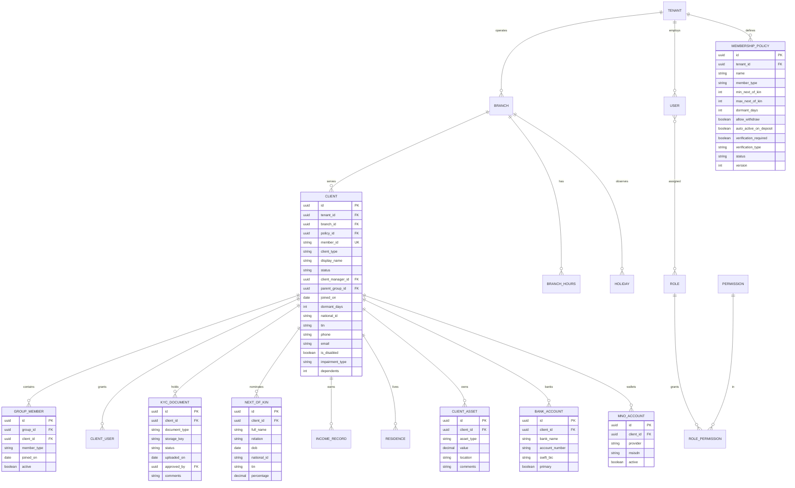
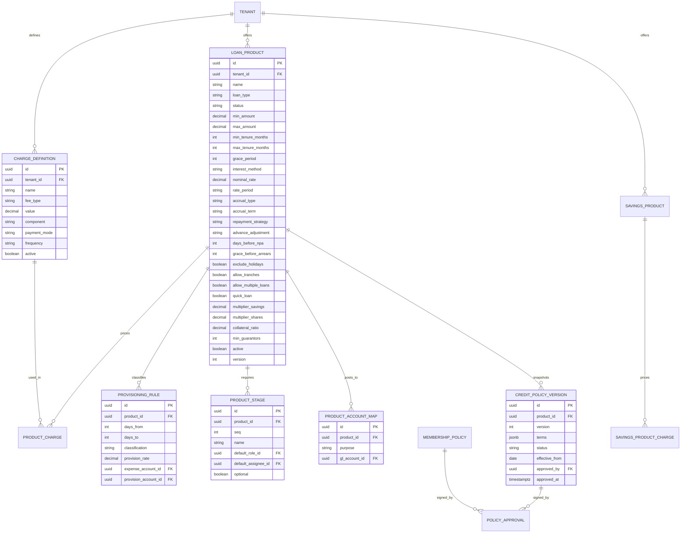
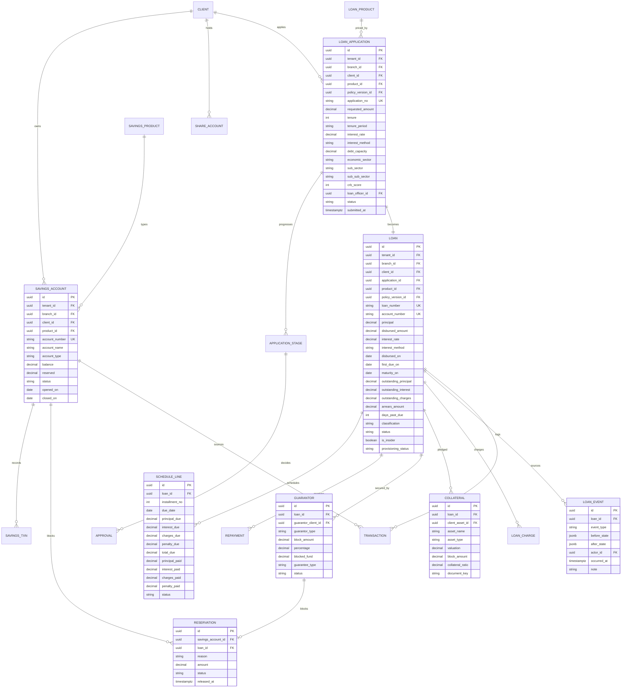
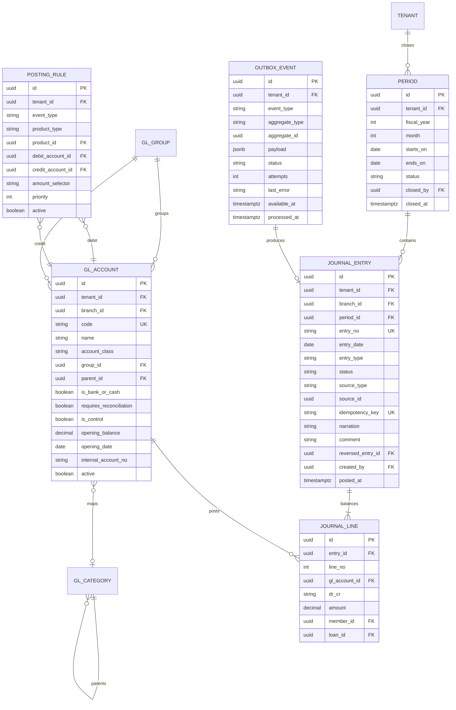
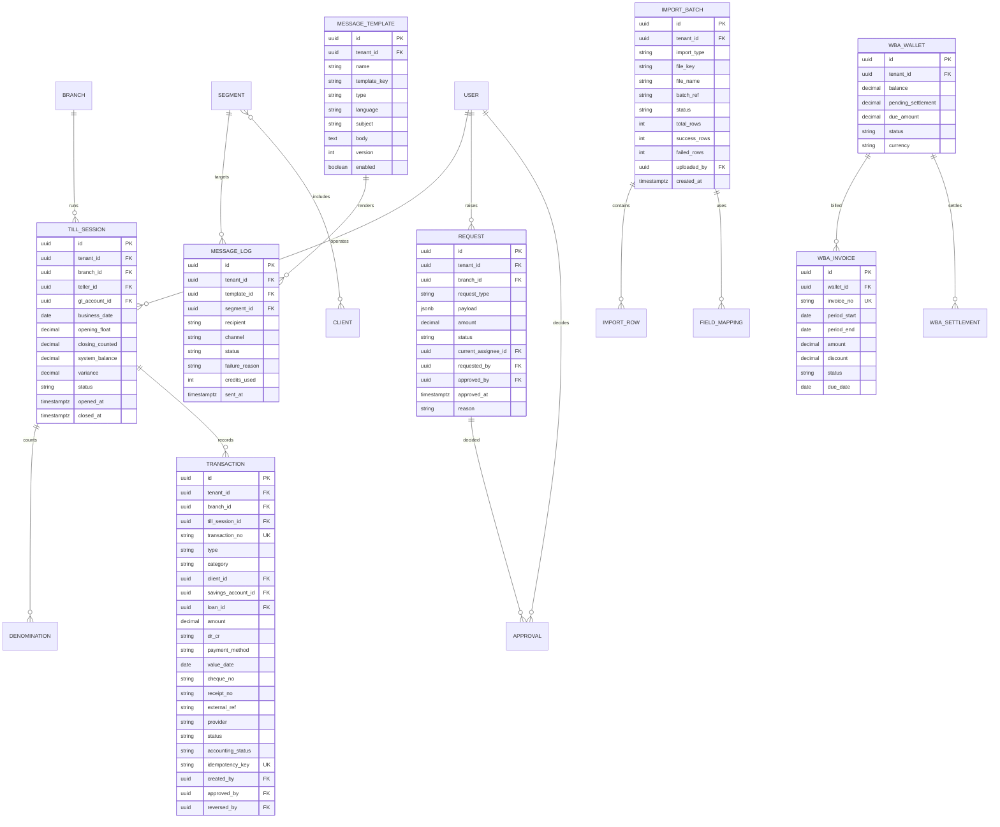

# 05 — Data Model

Five ERDs, then the entity dictionary, enums, numbering rules and constraints.

Conventions used throughout:

- every business table carries `tenant_id` (omitted from the diagrams for readability),
- money is `NUMERIC(18,2)`, never floating point,
- timestamps are `TIMESTAMPTZ` in UTC; business dates are `DATE` in Africa/Dar_es_Salaam,
- primary keys are UUIDs; account/entry numbers are separate human-readable business keys,
- deletes are soft (`deleted_at`) except in the ledger, which never deletes.

---

## 1. Party, membership and KYC



**Rules**

- `CLIENT` is a single table holding both individuals and groups (`client_type =
  INDIVIDUAL | GROUP`). A group is a counterparty; `GROUP_MEMBER` is a roster, not a set of
  separate clients.
- `member_id` is unique per tenant and immutable. Never reuse a deleted member's number.
- `NEXT_OF_KIN.percentage` must sum to 100 per client — enforce with a deferred constraint or
  a domain check at save.
- `CLIENT.status ∈ {Pending, Active, Dormant, Inactive, Rejected}`.
- KYC documents live in object storage; only `storage_key` is in the database.

---

## 2. Products, policies and configuration



**Rules**

- `PRODUCT_ACCOUNT_MAP.purpose ∈ {LoanPortfolio, Accrued, InterestIncome,
  LossesWrittenOff, Overpayment, LoanSuspense}` — exactly the six observed mappings.
- `CREDIT_POLICY_VERSION` is immutable once `Approved`. Loans store `policy_version_id`.
- `PROVISIONING_RULE` overlaps are forbidden; validate at save.
- Deleting a product is forbidden if any account references it; deactivate instead.

---

## 3. Savings, credit and servicing



**Rules**

- `SAVINGS_ACCOUNT.available = balance − reserved`, computed and never stored as a separate
  mutable field without a reconciliation job.
- `RESERVATION.status ∈ {Active, Released, Consumed}`; release is idempotent on `id`.
- One `LOAN` per `LOAN_APPLICATION`; reapplication creates a new application.
- `SCHEDULE_LINE` is replaced, not mutated, on reschedule — old rows are archived with a
  `schedule_version`.
- `GUARANTOR.blocked_fund` must equal the linked `RESERVATION.amount` at all times.
- `LOAN.classification ∈ {Performing, Watch, Substandard, Doubtful, Loss}` recomputed nightly.

---

## 4. Ledger and posting



**Rules**

- `journal_line.dr_cr ∈ {D, C}`; `SUM(amount where D) = SUM(amount where C)` per entry.
- `journal_entry.idempotency_key` is globally unique per tenant. This single constraint is
  what makes resubmission safe.
- `period.status ∈ {Open, Closing, Closed, Locked}`; posting requires `Open`.
- `entry_no` scheme observed: `31953200001057`, `30953200001054` — a prefix plus a sequence.
- `GL_ACCOUNT.is_control = true` means a sub-ledger must exist for the line; do not allow
  direct manual posting.
- A reversal is a new entry with `reversed_entry_id` pointing at the original; the original's
  `status` becomes `Reversed`.

---

## 5. Operations: teller, requests, messaging, import, billing



**Rules**

- One `TILL_SESSION` with `status = Open` per teller per branch. Enforce with a partial unique
  index.
- `TRANSACTION.status` and `TRANSACTION.accounting_status` are independent (see
  `03-flows.md §8`).
- `REQUEST` is polymorphic by `request_type` + `payload`; every type also gets an `APPROVAL`
  row so the audit timeline is uniform.
- `MESSAGE_LOG.credits_used` reconciles against the WBA wallet and the credit balance.
- `IMPORT_BATCH` is all-or-nothing at commit unless the tenant opts into chunked mode.

---

## 6. Entity dictionary — decision-critical columns

### Client

| Column | Type | Notes |
|---|---|---|
| `member_id` | text | `9532002xxx`; generated, immutable, unique per tenant |
| `client_type` | enum | `INDIVIDUAL`, `GROUP` |
| `status` | enum | `Pending`, `Active`, `Dormant`, `Inactive`, `Rejected` |
| `client_manager_id` | uuid | Relationship owner; drives portfolio reports |
| `parent_group_id` | uuid | Group membership for an individual |
| `national_id` | text | Unique per tenant when present; used for online payment matching |
| `dormant_days` | int | Copied from policy at activation (365 observed) |
| `is_disabled` / `impairment_type` | bool / text | Regulatory reporting dimension |

### Loan

| Column | Type | Notes |
|---|---|---|
| `account_number` | text | `95323000xxx` |
| `outstanding_principal` | numeric | Maintained by schedule updates + nightly reconciliation |
| `days_past_due` | int | Recompute nightly; excludes holidays when product says so |
| `classification` | enum | Provisioning bucket |
| `policy_version_id` | uuid | Audit-critical; never null |
| `is_insider` | bool | MSP06 insider-lending return |

### Journal entry

| Column | Type | Notes |
|---|---|---|
| `idempotency_key` | text | Unique; source of resubmission safety |
| `source_type` / `source_id` | text / uuid | Which operational document caused this |
| `entry_type` | enum | `Receipt`, `Payment`, `Journal` (observed) |
| `status` | enum | `Posted`, `Reversed`, `Archived` |

### Savings account

| Column | Type | Notes |
|---|---|---|
| `balance` | numeric | Ledger-backed |
| `reserved` | numeric | Sum of active reservations; guarantee blocking |
| `account_type` | enum | `Primary`, product-defined |
| `account_number` | text | Members also hold a shorter share/savings suffix |

---

## 7. Enumerations (canonical)

```
ClientType          INDIVIDUAL | GROUP
ClientStatus        Pending | Active | Dormant | Inactive | Rejected
MembershipPolicyStatus  Draft | In Progress | Resubmitted | Approved | Rejected

LoanStatus          Draft | Submitted | InReview | Approved | Disbursed | Active
                    | Delinquent | NPA | Rescheduled | Closed | WrittenOff | Rejected
ApplicationStageStatus  Pending | Approved | Rejected | Skipped
InterestMethod      ReducingBalanceEqualInstallment | ReducingBalanceEqualPrincipal
                    | StraightLine | Balloon | InterestOnly
AccrualType         Accrual | Cash
AccrualTerm         OnDueDate | Daily
RepaymentStrategy   ChargesInterestPrincipal | InterestPrincipalCharges | ...
Classification      Performing | Watch | Substandard | Doubtful | Loss

SavingsAccountStatus  Active | Dormant | Closed | Frozen
ReservationStatus     Active | Released | Consumed
ReservationReason     Guarantee | Collateral | Lien | MinimumBalance

TransactionCategory   Client | GeneralLedger | Till | Bulk
TransactionStatus     Submitted | Approved | Rejected | Reversed | Cancelled
AccountingStatus      Pending | Posted | Failed

EntryType           Receipt | Payment | Journal
EntryStatus         Posted | Reversed | Archived
PeriodStatus        Open | Closing | Closed | Locked

RequestStatus       Pending | Approved | Rejected | Cancelled
MessageChannel      SMS | Email | Push
MessageType         Transactional | Marketing | Notification
MessageStatus       Queued | Sent | Delivered | Failed

ImportStatus        Uploaded | Mapping | Validating | Committed | Failed | RolledBack
WalletStatus        Active | Low | Suspended
InvoiceStatus       Draft | Issued | Paid | Overdue | Void
```

---

## 8. Numbering and identifiers

| Object | Pattern | Example |
|---|---|---|
| Client / member | `9532` + `002` + seq | `9532002374` |
| Loan account | `95323` + seq | `953230000172` |
| Internal / GL account | `95329` + seq | `953290000041` |
| Ledger code | 4-digit class + seq | `1201`, `4005`, `5502` |
| Journal entry | prefix + seq | `31953200001057` |
| Transaction | prefix + seq | `30953200001027` |
| Fee/expense txn | `509532…` / `309532…` | observed in Fees Income / Expense reports |
| WBA invoice | `TZ-` + seq | `TZ-001045` |
| Loan number (per branch) | seq | `91`, `118` |
| Import batch | generated ref | `N/A` when absent |

Sequences must be **per tenant** and allocated transactionally. Gaps are acceptable; reuse is
not.

---

## 9. Indexing and performance

Minimum index set (beyond primary keys):

```sql
-- tenant scoping on everything hot
(tenant_id, branch_id, created_at DESC)

-- client lookup by business id and identity
UNIQUE (tenant_id, member_id)
        (tenant_id, national_id) WHERE national_id IS NOT NULL
        (tenant_id, phone)

-- loan servicing
(tenant_id, status, maturity_on)
        (tenant_id, loan_officer_id)
        (tenant_id, days_past_due) WHERE status IN ('Active','Delinquent','NPA')
UNIQUE  (loan_id, schedule_version, installment_no)

-- savings
UNIQUE  (tenant_id, account_number)
        (savings_account_id, created_at DESC)

-- transactions
UNIQUE  (tenant_id, transaction_no)
UNIQUE  (tenant_id, idempotency_key)
        (tenant_id, accounting_status) WHERE accounting_status <> 'Posted'
        (tenant_id, value_date, type)

-- ledger
UNIQUE  (tenant_id, entry_no)
        (tenant_id, period_id, entry_date)
        (gl_account_id, entry_date)
UNIQUE  (tenant_id, idempotency_key)

-- reports
        (tenant_id, branch_id, disbursed_on)
        (tenant_id, product_id, classification)
```

Partition `journal_line` and `transaction` by month once a tenant exceeds ~5 million rows.

---

## 10. Integrity constraints worth writing down

1. `journal_entry` balance: deferred constraint trigger asserting Dr = Cr.
2. `journal_line` amount > 0 (direction is carried by `dr_cr`).
3. `schedule_line`: `principal_due >= 0`, paid ≤ due per component.
4. `loan`: `SUM(schedule.principal_due) = disbursed_amount` per active schedule version.
5. `savings_account`: `reserved >= 0` and `balance >= 0` unless product allows overdraft.
6. `guarantor`: `SUM(block_amount) <= loan.principal` (product policy may be stricter).
7. `reservation`: one active reservation per (`loan_id`, `savings_account_id`).
8. `till_session`: at most one `Open` per (`teller_id`, `business_date`).
9. `next_of_kin`: `SUM(percentage) = 100` per client.
10. `period`: no `journal_entry` with `entry_date` outside an `Open` period.
11. `approval`: no duplicate (`stage_id`, `decided_by`) — prevents double approval.
12. `client`: `status = Active` requires at least one KYC document when policy requires
    verification.
