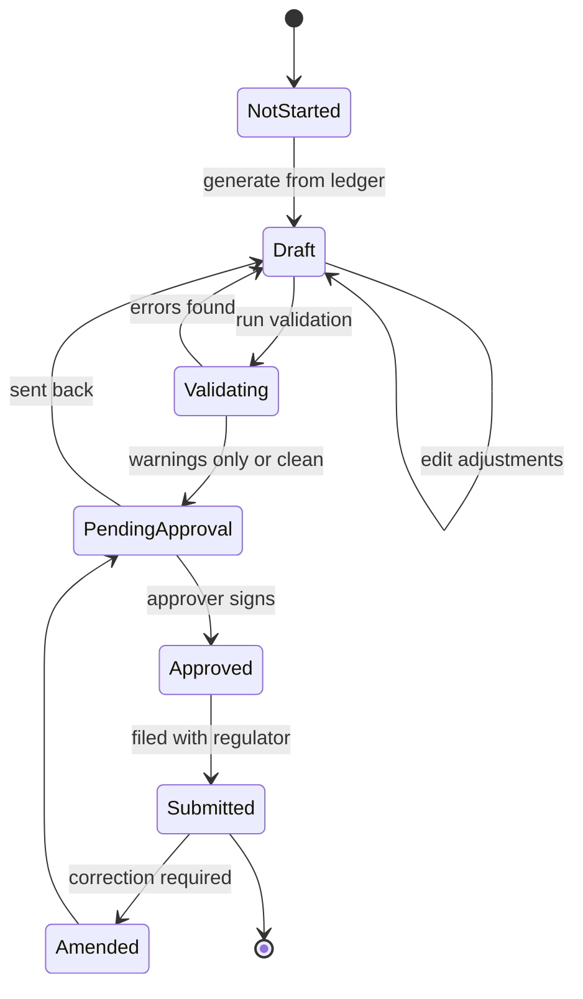

# 06 — Tanzanian Regulatory Reporting

This is the part of the product that cannot be improvised. A SACCO that cannot file its
returns on time is not a SACCO in good standing, and that is the buyer's primary risk.

The screenshots show **two statutory dialects of the same eleven return numbers**:

| Dialect | Regulator | Codes on the form | Tenant setting |
|---|---|---|---|
| SACCOS | Tanzania Cooperative Development Commission (TCDC) | `TCDC-MSP01`, `TCDC-MSP05`, `TCDC Form 16-20`, `TCDC Form 16-6`, `TCDC Form 16-35`, `TCDC Schedule 01` | `Module Type = Sacco` |
| MFI | Bank of Tanzania (BoT) | `BOT-MSP03-MFI`, `BOT-MSP04-MFI`, `BOT-MSP05-MFI`, `BOT-MSP09-MFI`, `BOT-MSP10-MFI`, `BOT Form MSP2-03` | `Module Type = Microfinance` |

**The numbers do not mean the same thing across dialects.** In the SACCOS set, `MSP05` is
*loans disbursed* and `MSP09` is *capital adequacy*. In the MFI set, `MSP05` is *liquid
assets* and `MSP09` is *loans disbursed*. Do not build one `MSP05` screen and parameterise
it by tenant — build a **template registry keyed by (dialect, return code, version)**.

---

## 1. Return calendar

| Return | SACCOS title | MFI title | Frequency |
|---|---|---|---|
| MSP01 | Statement of financial position (TCDC Form 16-20) | — | Monthly (Cat B) / Quarterly (Cat A) |
| MSP02 | Statement of comprehensive income | — | Monthly |
| MSP03 | Sectoral classification of loans | Sectoral classification of loans (BoT MSP2-03) | Quarterly |
| MSP04 | Interest rate structure | Interest rate structure (BoT MSP2-04) | Quarterly |
| MSP05 | Loans disbursed by gender / sub-sector | Computation of liquid assets (BoT MSP2-05) | Monthly / Quarterly |
| MSP06 | Loans to insiders and related parties (Form 16-1) | — | Monthly |
| MSP07 | Geographical distribution of branches, employees and loans by age (MSP3-10) | — | Monthly |
| MSP08 | Computation of liquid assets (Form 16-6, autofilled) | — | Monthly |
| MSP09 | Capital adequacy (Form 16-6) | Loans disbursed during the quarter (BoT MSP2-09) | Monthly / Quarterly |
| MSP10 | Complaint report (Form 16-35) | Geographical distribution, branches/employees/loans by age (BoT MSP2-10) | Monthly / Quarterly |
| MSP11 | Deposits and loans in banks and financial institutions (Schedule 01) | — | Monthly |

`MSP03` also exists in three SACCOS variants — `MSP03 Type1`, `MSP03 Type2`, `MSP03 MFI` —
which differ in provisioning-rate grid and collateral treatment. Treat "Type1/Type2" as
**template variants**, not as different returns.

Every screen carries `Submit`, `Clear`, `Save`, `Saved Reports`. Reports are therefore
**draftable, resumable and historical**.

---

## 2. What each return requires from the core system

### MSP01 — Statement of financial position

The longest form. Its structure defines your chart-of-accounts taxonomy. Sections and lines
(abridged to the line items a builder must map):

**Earning assets**
- Short-term loans (≤ 1 year)
- Medium-term loans (1–3 years)
- Long-term loans (> 3 years)
- Loan participations
- *(less allowance for loan losses)*
- **Total net loans**
- Government securities ≤ 30 days / > 30 days
- Investments in banks and other financial institutions ≤ 30 / > 30 days
- Investment in other SACCOS or second-tier organisations
- Other investments, non-financial investments
- **Total net earning assets**

**Non-earning assets — cash and cash equivalents**
- Cash on hand
- Current accounts with banks and other financial institutions
- Other non-earning deposits
- Balances with mobile money networks (M-Pesa, Tigo Pesa)
- Agent banking account balances (Wakala)
- **Total non-earning cash**

**Non-earning assets — fixed assets**
- Land, buildings, furniture/fixtures/equipment, other fixed assets, leasehold improvements
- Revaluation of fixed assets
- *(less accumulated depreciation)*
- **Total net fixed assets**

**Non-earning assets — other**
- Receivables ≤ 30 / > 30 days, accrued income on loans, accrued income on investments,
  other accrued income, prepaid expenses, internal receivables, assets in liquidation,
  suspense accounts, *(less allowance for other asset losses)*

**Liabilities**
- Short/long-term borrowings from other SACCOs and second-tier organisations
- Short/long-term borrowings from banks and financial institutions
- **Total funds**
- Interest-bearing deposits: savings accounts, term deposits, special savings, other savings
- **Total savings and deposits**
- Non-interest-bearing: payables ≤ 30 days, other payables, accrued interest payable on
  savings, accrued interest payable on external credit, taxes payable, internal payable,
  other liabilities

**Capital**
- Member shares, voluntary shares, other shares
- Fixed asset revaluation reserve
- Transitory capital
- Donations and grants (cash only)
- Reserve funds
- Retained earnings (prior years)
- Profit/loss for the current year
- **Total equity**

Plus an off-balance-sheet line: unfunded member lines of credit and other commitments.

**Mapping from the observed chart of accounts**

| MSP01 block | Source |
|---|---|
| Short/medium/long-term loans | `1201/1202/1203/1205` split by `maturity_on − as_of` |
| Allowance for loan losses | provision sub-ledger derived from `PROVISIONING_RULE` |
| Cash on hand | `1002 Cash on Hand` + open teller balances `1010/1011/1012` |
| Bank current accounts | `1003 BANK CRDB`, `1005 BANK NMB` |
| Mobile money balances | MNO float ledger(s) |
| Accrued income on loans | `1505 Interest Receivable` |
| Fixed assets | `1701/1702/1706` less accumulated depreciation |
| Taxes payable | `2001` |
| Other payables | `2005` |
| Member shares | `3404 Share Capital` |
| Reserve funds | equity fund ledgers (Statutory Reserve, Insurance Fund, …) |
| Retained earnings / current year | period close results |
| Interest income (MSP02) | `4001/4002/4004/4005` |
| Fees and penalties (MSP02) | `4101/4103/4104` |
| Operating expenses (MSP02) | `5xxx` groups |

> The `347 categories` found in `Settings → Accounting → Manage categories` are the
> statutory line taxonomy (`Short Term Loans`, `Medium Term Loans`, `Total Net Loans`,
> `Government Securities Less 30Days`, …). That table is the bridge. Build it as data and the
> returns become queries instead of spreadsheets.

### MSP02 — Statement of comprehensive income

Interest income (on loans, government securities, deposits in financial institutions, other
SACCOS, other investments), interest expense (borrowings, member savings and deposits, other),
**net interest income**, commissions and fees, penalties, other non-interest income,
**gross operating income**, operating expenses (salaries, personnel, occupancy, operations,
professional fees, depreciation, maintenance, other), **operating income**,
loan loss provisions, provisions for investments and other losses, extraordinary
income/expenses, donations and grants, prior-period adjustments, **profit before tax**,
tax provisions, **profit after tax**, dividends paid on shares.

Requires: expense categorisation at posting time (not at report time), and a mapping from
`5xxx` ledgers to the eight statutory expense buckets.

### MSP03 — Sectoral classification of loans

Rows: **Agriculture, Hotels and Restaurants, Other Services, Personal/Private, Trade**.
Columns: gross loans, provision rate, provision amount, cash collateral/insurance/savings,
net provision, total net amount, number of borrowers.

Then a **days-past-due grid**: `0–5`, `6–30`, `31–60`, `61–90`, `91–180`, `181–360`,
`> 360` (SACCOS) or `0–30`, `31–90`, `91–180`, `181–365`, `> 365` (MFI Type1/Type2), with
provision rates **1% / 5% / 25% / 50% / 100%**.

Also reports `Ratio of non-performing loans to gross loans`.

**Data requirement:** every loan needs `economic_sector`, `sub_sector`, `sub_sub_sector`
(mandatory at application), plus collateral and insurance values.

### MSP04 — Interest rate structure

Type of loan × number of borrowers × outstanding amount × nominal rate (straight line) ×
nominal rate (reducing balance) × weighted average rates.

**Data requirement:** store the rate *and the method* per loan, plus the weighted-average
calculation. Straight-line and reducing-balance rates must both be derivable.

### MSP05 (SACCOS) — Loans disbursed

Rows by **sub-sector**, columns split **male / female**, plus total loans disbursed for the
month. Requires gender on the client and economic sector on the loan.

### MSP05 (MFI) — Computation of liquid assets

Available liquid assets: cash in hand, balances with banks and FIs, balances with
microfinance service providers, MNO float, treasury bills (unencumbered), other government
securities ≤ 1 year, private securities ≤ 1 year, other liquid assets maturing within 12
months. Then total assets, minimum liquid assets, excess, **liquid asset ratio (A/B)**.

### MSP06 — Loans to insiders and related parties

Rows: **Directors, Employees, Managers, Total**. Columns: number of loans, amount, savings /
deposits / voluntary shares. Requires the `is_insider` flag and an insider category on the
client, plus the `Insider Relationship` field already present on the loan screen.

### MSP07 — Geographical distribution

Rows by **geographical area** (e.g. `ARUSHA CBD`, `Dar es Salaam`, `NYAMAGANA`), with council
type (`CC` city, `MC` municipal, `DC` district, `TC` town). Columns: number of branches
(including HQ), number of employees, number of loans and outstanding amounts split by
**female/male × up to 35 / above 35**.

**Data requirement:** branch region + council type; employee records per branch; client
gender and DOB.

### MSP08 — Computation of liquid assets (SACCOS)

Available liquid assets (cash in hand, current accounts, receivables ≤ 30 days, government
securities ≤ 30 days, investments ≤ 30 days, MNO balances, agent banking balances, other
liquid assets), short-term liabilities (savings and deposits, payables ≤ 30 days, short-term
borrowings), minimum liquidity, excess, **liquidity ratio** against the 15% regulatory floor
and the 15% PEARLS target.

Marked *"This return is autofilled from other returns"* — implement it as a **derived
return** that reads MSP01 and MSP11 rather than re-querying the ledger, so the numbers tie by
construction.

### MSP09 (SACCOS) — Capital adequacy

Core capital (member shares, voluntary shares, other shares, revaluation reserve, transitory
capital, donations and grants, reserve funds, retained earnings, current-year profit/loss),
institutional capital, net institutional capital, total assets, and three ratios:
**core capital 8%**, **institutional capital 6%**, **net institutional capital 6%**.

### MSP09 (MFI) — Loans disbursed during the quarter

Split male/female, count and amount. Simpler than the SACCOS version; another reason not to
share a template key.

### MSP10 (SACCOS) — Complaint report

Opening complaints, new complaints, resolved by institution, resolved by other parties
(courts, TCDC), unresolved at end, referred to TCDC, referred to courts.

**This return has no data source in the observed system.** Either it is filled manually on
the form, or a complaints register must be built. Note it as a gap.

### MSP10 (MFI) — Geographical distribution

Same shape as MSP07 with quarterly period and compulsory-savings column.

### MSP11 — Deposits and loans in banks and financial institutions

Per institution: deposits, loans, borrowings; then totals for banks/FIs, agent banking
(Wakala), mobile money networks, lending to SACCOS/second tier, borrowing from SACCOS/second
tier, and total exposures (net loan exposure, net deposit exposure).

---

## 3. Data the core must capture (build it in from day one)

Returns are impossible to backfill. These fields must exist before the first loan is booked:

| Requirement | Where it lives | Needed by |
|---|---|---|
| Gender | `client.gender` | MSP05, MSP07, MSP09, MSP10 |
| Date of birth | `client.dob` | Age buckets in MSP07/MSP10 |
| Disability | `client.is_disabled`, `impairment_type` | Cross-cutting reporting |
| Region, district, ward | `client.residence`, `branch` | MSP07/MSP10 |
| Council type (CC/MC/DC/TC) | `branch.council_type` | MSP07/MSP10 |
| Economic sector (3 levels) | `loan_application` | MSP03, MSP05 |
| Insider flag + category | `client.insider_type` / `loan.is_insider` | MSP06 |
| Interest method + nominal rate | `loan.interest_method`, `interest_rate` | MSP04 |
| Collateral value + type | `collateral` | MSP03 net provision |
| Insurance premium | `loan_insurance` | MSP03, LoanInsuranceReport |
| Maturity date | `loan.maturity_on` | MSP01 term split |
| Classification + days past due | nightly job | MSP03, provisioning |
| Expense category | `gl_account.category` | MSP02 |
| Bank/MNO balances | `gl_account` + `bank_account` | MSP01, MSP08, MSP11 |
| Branch employee count | `branch.employee_count` | MSP07/MSP10 |

**Rule.** If a field is required by a statutory return, it is mandatory at data entry — not
optional with a default. Missing sector is the single most common cause of unfilable returns.

---

## 4. Return lifecycle



**Rules**

1. `Draft` is regenerable; `Submitted` is immutable.
2. Every state change records actor, timestamp, note.
3. A `Submitted` return stores a **data snapshot** and a `template_version`.
4. `Amended` produces a new version with a reason; the original stays visible.
5. Validation runs a declarative rule set (see below), not ad-hoc code in the controller.

---

## 5. Validation rules

| Rule | Type | Applies to |
|---|---|---|
| Assets = Liabilities + Equity | hard | MSP01 |
| Gross loans − allowance = net loans | hard | MSP01 |
| Cash on hand + bank + MNO = total cash line | hard | MSP01, MSP08 |
| Net interest income = interest income − interest expense | hard | MSP02 |
| Gross operating income = net interest + non-interest income | hard | MSP02 |
| Profit before tax = operating income ± provisions ± extraordinary | hard | MSP02 |
| Sum of sector rows = total gross loans | hard | MSP03 |
| Sum of bucket rows = total outstanding | hard | MSP03 |
| Age/gender cells reconcile to loan totals | hard | MSP07, MSP10 |
| Prior-period column populated | soft | all |
| Liquidity ratio ≥ 15% | advisory | MSP08 |
| Core capital ratio ≥ 8% | advisory | MSP09 |
| Institutional capital ratio ≥ 6% | advisory | MSP09 |
| NPL ratio disclosed | soft | MSP03 |
| No `PENDING` classification on loans | soft | MSP03 |

"Hard" means the return cannot be submitted. "Advisory" means it is highlighted for
management but a regulator may still receive it. Encode severity, do not encode policy
judgement.

---

## 6. Implementation blueprint

### 6.1 Template schema

```json
{
  "key": "TCDC-MSP01",
  "dialect": "TCDC",
  "returnCode": "MSP01",
  "version": "1.0.0",
  "frequency": ["MONTHLY", "QUARTERLY"],
  "effectiveFrom": "2025-01-01",
  "sections": [
    {
      "key": "EARNING_ASSETS",
      "label": "Earning Assets",
      "lines": [
        { "key": "ST_LOANS", "label": "Short-term Loans (<= 1 year)",
          "type": "MONEY", "source": "query:loans.byTerm.short",
          "category": "SHORT_TERM_LOANS" },
        { "key": "ALLOWANCE", "label": "(Less the Allowance for Loan Losses)",
          "type": "MONEY", "source": "query:provision.total", "sign": -1 },
        { "key": "TOTAL_NET_LOANS", "label": "Total Net Loans",
          "type": "FORMULA", "formula": "SUM(ST_LOANS, MT_LOANS, LT_LOANS, PARTICIPATIONS, ALLOWANCE)" }
      ]
    }
  ],
  "validations": [
    { "id": "BALANCE_SHEET", "severity": "HARD",
      "expression": "TOTAL_ASSETS == TOTAL_LIABILITIES + TOTAL_EQUITY" }
  ],
  "columns": ["AMOUNT_CURRENT", "AMOUNT_PREVIOUS", "NOTES"]
}
```

### 6.2 Source types

| Type | Meaning |
|---|---|
| `query:` | A named, parameterised, tenant-scoped query in the reporting module |
| `formula:` | Arithmetic over other lines in the same return |
| `manual:` | User-entered, stored on the return instance |
| `derived:` | Reads another return instance (MSP08 ← MSP01/MSP11) |
| `constant:` | Tenant constant (e.g. MSP code, institution name) |

### 6.3 Mapping layer

```
gl_account.category_id ──► gl_category.code ──► return_line.category
loan.economic_sector ────► sector taxonomy ──► MSP03 rows
client.gender + dob ─────► age/gender grid ──► MSP05/07/09/10 columns
branch.region + council ─► geographic grid ─► MSP07/MSP10 rows
```

The `gl_category` tree (347 rows observed) is the single most valuable configuration asset in
the product. Own it, version it, and test it.

### 6.4 Rendering

The screen shape is fixed across all 17 returns:

```
┌ header: institution, MSP code, form title, "as at" date ──────────────┐
│ period selector │ Submit │ Clear │ Save │ Saved Reports │
├ body: sections → lines × [notes | current | previous] ───────────────┤
├ footer: validation panel (errors/warnings) ──────────────────────────┤
└ actions: Download PDF/Excel, Attach acknowledgement ─────────────────┘
```

Build it once as a `RegulatoryReturnRenderer` driven by the template. Seventeen templates,
one component.

---

## 7. Test strategy for returns

1. **Golden datasets.** Build a tenant with one loan per sector, per term bucket, per
   classification, per gender/age band, plus insiders, plus MNO/bank balances. Assert every
   return cell.
2. **Cross-return ties.** MSP08 lines must equal the corresponding MSP01/MSP11 lines.
3. **Period rollover.** Prior-period column must equal last period's submitted current column.
4. **Regeneration safety.** Regenerate a submitted return → no change to the submitted record.
5. **Rounding.** Totals must equal the sum of lines; a 0.01 discrepancy fails the return.
6. **Dialect isolation.** An MFI tenant must not see SACCOS `MSP05`/`MSP09`, and vice versa.

---

## 8. Gaps to resolve with the regulator or the client

Recorded honestly, because guessing here is expensive:

1. **MSP10 SACCOS complaint report** has no internal data source in the observed product.
2. **MSP11 counterparties** require a bank/institution register that is not visible in the
   settings screens.
3. **Provision rate grids** differ between SACCOS, MFI Type1 and MFI Type2. Obtain the current
   statutory grid rather than inferring it from the sample data.
4. **Submission channel** is not visible — assume export + portal upload, not an API.
5. **Council type (CC/MC/DC/TC)** is not in the branch form; it must be added.
6. **PEARLS ratios** appear in MSP08/MSP09 footnotes but are not fully rendered; confirm
   whether they are required disclosures.
