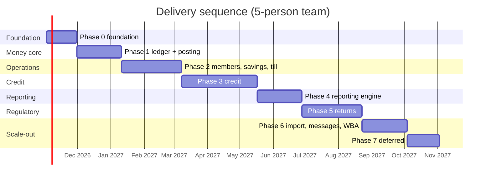

# 07 — Build Plan

A plan for a team that has to ship a comparable system without rediscovering the domain.
Sizes are person-weeks for a competent engineer who knows the codebase, including tests but
not including review latency.

---

## 1. What "done" means

The system is done when a SACCO can run a full month in it:

1. onboard members and groups, verify KYC,
2. open savings and share accounts, take deposits at the till,
3. originate, approve, disburse and service loans, block guarantors, collect repayments,
4. close tills daily and reconcile cash,
5. post everything to a balanced ledger and close the month,
6. produce the financial statements **and** file the returns to TCDC or BoT,
7. prove all of it to an auditor from the audit trail.

Anything that is not on that path is phase 7+ work.

---

## 2. Team shape

| Role | Count | Notes |
|---|---|---|
| Tech lead / architect | 1 | Owns module boundaries and the posting engine |
| Backend engineers | 2–3 | Domain-heavy; one should own ledger + credit |
| Frontend engineers | 2 | Angular; one owns the report/grid framework |
| Product/BA with SACCO domain knowledge | 1 | **Non-negotiable.** Without this, allocation and returns will be wrong |
| QA engineer | 1 | Property-based + regression on money paths |
| DevOps | 0.5 | IaC, CI, environments |
| Part-time accountant/auditor adviser | 0.2 | Reviews the chart of accounts, allocation order, and every return |

Smallest viable team: **5 people** (1 lead, 2 backend, 1 frontend, 1 domain BA/QA hybrid).
Comfortable: **8**.

Timeline at 5 people: **9–11 months** to the end of phase 5, with an MVP at month 4–5.
At 8 people: **6–7 months**.

---

## 3. Delivery principles

1. **Vertical slices, not horizontal layers.** Every phase ships screens a teller can use.
2. **The ledger ships first.** It is the hardest thing to retrofit and everything reports from
   it.
3. **Every slice includes its report.** If you build disbursement without
   `LoanDisbursementReport`, you will rebuild it later.
4. **Configuration before features.** Product/policy engines before the third product.
5. **One report renderer, one filter bar, one grid.** The 68 reports must not become 68
   bespoke components.
6. **No feature without a permission.** Add the `Entity : Action` string at the same time as
   the endpoint.
7. **No feature without an audit event.** Same commit.
8. **Prove bulk import early.** A synthetic 1 000-member file in month 2, not month 8. The
   system starts greenfield; import exists for future tenants arriving with spreadsheets.

---

## 4. Phases

### Phase 0 — Foundation (4 weeks)

| Deliverable | Detail |
|---|---|
| Repo, CI, environments | dev/staging/prod, PR checks, migration gating |
| Auth & tenancy | OIDC login, tenant resolution, `tenant_id` + RLS, branch scoping |
| RBAC | 17 roles seeded, `Entity : Action` permission catalogue, multi-role unions |
| Shell UI | nav, branch selector, period chip, theming (dark mode, primary colour, UI scale) |
| Audit trail | append-only `audit_event`, actor/branch/IP/before-after |
| Observability | traces, structured logs, error tracking, health checks |
| Design system | grid, filter bar, form controls, status chips, money input |

**Exit:** a user can log in, switch branch, and see an empty, audited, permission-filtered app.

### Phase 1 — Money core (6 weeks)

| Deliverable | Detail |
|---|---|
| Chart of accounts | tree, groups, 4-digit codes, bank/cash flag, opening balances |
| 347 category taxonomy | `gl_category` tree + mapping from accounts |
| Periods | open/close/lock, financial year 01-01 → 31-12 |
| Posting engine | rules, entry builder, balance constraint, period guard, idempotency |
| Outbox + worker | event → entry, retries, dead letter |
| Unposted queue | the banner, resubmit, failure reasons |
| Journal screens | entries list, entry detail, ledger drilldown |
| Trial balance | the first real report, and the health check for everything else |

**Exit:** a manually created journal entry posts, balances, appears in the trial balance, and
cannot be posted twice or into a closed period.

### Phase 2 — Members, savings, teller (8 weeks)

| Deliverable | Detail |
|---|---|
| Client + KYC | wizard (6 steps), documents, nominees, income, residence, assets, bank, MNO |
| Membership policy | versioned, approved, drives dormancy/verification/nominee limits |
| Groups | group profile, roster, meeting schedule |
| Client 360 | profile tabs + account cards (the composed read model) |
| Savings products | minimum balance, max txn, guarantor/collateral flags, charges, GL code |
| Savings accounts | open, deposit, withdraw, statement, interest payout |
| Shares | share account, deposit/withdrawal to `3404` |
| Reservations | blocked funds, release, member statement shows `Blocked Fund` |
| Teller console | 11 client types, session open/close, denominations, receipt |
| Till | opening float approval, balance, variance posting |
| Transaction list | all-transactions, filters, exports |
| Reversals | request → approve → mirrored entry |

**Exit:** a teller opens a till, takes a savings deposit and a share purchase, closes the till
with a cash count, and the ledger and trial balance agree.

### Phase 3 — Credit (10 weeks)

| Deliverable | Detail |
|---|---|
| Loan product | full config surface (terms, interest, repayments, arrears, guarantors, charges, stages, GL map) |
| Credit policy | versioned approved snapshot; loans stamped with `policy_version_id` |
| Schedule engine | reducing balance equal instalment + 3 variants, rounding to exact principal |
| Application wizard | 5 steps incl. economic sector 3 levels, payment destination, documents |
| 4-stage workflow | roles/assignees from policy, approve/reject, notes, scores, audit history |
| Guarantors | block funds, collateral valuation, ratio check, release on close |
| Disbursement | charges, posting, schedule issue, notification |
| Repayments | allocation order, compound posting, partials, advance payments |
| Servicing | top-up, reschedule, write-off, interest waiver, close, delinquent |
| Accrual & arrears | scheduled jobs, holiday exclusion, NPA threshold, provisioning |
| Loan screens | list, detail (8 tabs), schedule, repayments, guarantors, documents, history |

**Exit:** a loan is originated, approved through four stages, disbursed, repaid partially,
falls into arrears, is classified, provisioned, and finally closed — with every posting
reconciling.

### Phase 4 — Reporting engine and financial statements (6 weeks)

| Deliverable | Detail |
|---|---|
| Report engine | definition registry, parameter schema, executor, async export |
| Renderer | grid + CSV/XLSX/PDF, saved views, branch scoping |
| Accounting reports | all 15 (TB, financial position, income statement, cash book, cash flow, journal book, GL book, ledger statement, monthly/comprehensive TB, notes, owner's equity, corporate tax, assets, reconciliation) |
| Operational reports | the 25 loan reports (start with the 8 that customers ask for) |
| Client/savings/statement/transaction reports | 11 more |
| Scheduled reports | email/portal delivery, per-tenant subscriptions |

**Exit:** the accountant closes the month and produces a full financial statement pack without
touching Excel.

### Phase 5 — Regulatory returns (8 weeks)

| Deliverable | Detail |
|---|---|
| Template registry | (dialect, code, version), JSON templates |
| Line sources | `query`, `formula`, `manual`, `derived`, `constant` |
| Renderer | one component, 17 templates, prior-period columns |
| Validation engine | HARD/ADVISORY rules, validation panel |
| Lifecycle | draft → validate → approve → submit → amend, with snapshots |
| SACCOS set | MSP01–MSP11 (TCDC dialect) |
| MFI set | MSP03/04/05/09/10 (BoT dialect) |
| Cross-return ties | MSP08 derived from MSP01 + MSP11 |
| Certification | golden dataset per return, signed off by the accountant adviser |

**Exit:** a full month of returns is generated, validated, approved and exported, and ties to
the trial balance.

### Phase 6 — Operations at scale (6 weeks)

| Deliverable | Detail |
|---|---|
| Import | member/account/transaction, 3-step wizard, mapping, validation, batch audit |
| Requests | unified request centre, assignees, approve/reject/cancel |
| Messages | templates, segments, sends, logs, credits |
| WBA billing | wallet, invoices, top-up, settlement, fee settings |
| Fixed assets | asset types, register, depreciation posting |
| Offline statements | provider statement import + reconciliation workspace |
| Online collections | payment intents, callbacks, matching, Need Attention queue |

### Phase 7 — Deferred / unknown

- **Campaigns** (navigation present, no screens captured) — thin scheduler over segments.
- **Services** (screen captured empty) — integration registry UI.
- **Client self-service portal / mobile** — separate product surface.
- **Multi-currency**, **Islamic finance products**, **agent banking module** — only if a
  customer pays for it.

---

## 5. Sequencing

Critical path: **ledger → savings → credit → returns**. Everything else can absorb a slip.

Hard dependencies worth stating:

| Must exist before | Because |
|---|---|
| Ledger before any money screen | Otherwise balances are derived in the UI |
| Reservations before guarantors | Guarantee is a reservation |
| Schedule engine before disbursement | Schedule is created at disbursement |
| Category taxonomy before MSP01 | Returns read categories, not raw accounts |
| Period close before returns | Returns are per closed period |
| Import before first real tenant | Tenants arrive with spreadsheets |

---

## 6. Epic backlog with estimates

| # | Epic | Phase | Size | Person-weeks |
|---|---|---|---|---|
| 1 | Auth, tenancy, RLS, branch scoping | 0 | M | 3 |
| 2 | RBAC + permission catalogue | 0 | M | 2 |
| 3 | App shell, theming, design system | 0 | M | 3 |
| 4 | Audit trail | 0 | S | 1 |
| 5 | Chart of accounts + groups | 1 | M | 2 |
| 6 | Category taxonomy (347 rows) | 1 | M | 2 |
| 7 | Periods + close/lock | 1 | M | 2 |
| 8 | Posting engine + rules | 1 | L | 5 |
| 9 | Outbox, worker, retries, DLQ | 1 | L | 4 |
| 10 | Unposted queue + resubmit UI | 1 | S | 1.5 |
| 11 | Journal screens + trial balance | 1 | M | 3 |
| 12 | Client + KYC wizard | 2 | XL | 7 |
| 13 | Membership policy engine | 2 | M | 3 |
| 14 | Groups + roster | 2 | M | 2 |
| 15 | Client 360 read model | 2 | M | 3 |
| 16 | Savings products + accounts | 2 | L | 5 |
| 17 | Shares | 2 | S | 1.5 |
| 18 | Reservations (guarantor blocking) | 2 | M | 3 |
| 19 | Teller console (client types) | 2 | XL | 6 |
| 20 | Till sessions + denominations + variance | 2 | L | 4 |
| 21 | Reversals + approval requests | 2 | M | 2.5 |
| 22 | Loan product configuration | 3 | XL | 7 |
| 23 | Credit policy versioning | 3 | M | 3 |
| 24 | Schedule engine (4 methods) | 3 | L | 5 |
| 25 | Application wizard + sector codes | 3 | L | 5 |
| 26 | 4-stage workflow + approvals | 3 | L | 5 |
| 27 | Guarantors + collateral | 3 | M | 3 |
| 28 | Disbursement + charges | 3 | M | 3 |
| 29 | Repayment allocation | 3 | L | 4 |
| 30 | Servicing commands (top-up, reschedule, write-off, waive, close) | 3 | L | 5 |
| 31 | Accrual, arrears, NPA, provisioning jobs | 3 | L | 5 |
| 32 | Loan screens (8 tabs) | 3 | L | 5 |
| 33 | Report engine + renderer | 4 | XL | 7 |
| 34 | 15 accounting reports | 4 | L | 5 |
| 35 | 25 loan reports | 4 | L | 5 |
| 36 | 11 other operational reports | 4 | M | 2.5 |
| 37 | Regulatory template registry + lifecycle | 5 | XL | 6 |
| 38 | 11 SACCOS returns | 5 | XL | 7 |
| 39 | 5 MFI returns + dialect isolation | 5 | L | 4 |
| 40 | Import (3 types) | 6 | L | 5 |
| 41 | Requests centre | 6 | M | 2 |
| 42 | Messages + segments + credits | 6 | L | 4 |
| 43 | WBA billing | 6 | M | 3 |
| 44 | Fixed assets | 6 | M | 2.5 |
| 45 | Online collections + reconciliation | 6 | L | 4 |
| 46 | Campaigns | 7 | S | 1.5 |
| 47 | Services registry | 7 | S | 1 |
| 48 | Hardening, pen test, perf, import rehearsal | 7 | L | 5 |

**Total ≈ 175 person-weeks** of engineering. At 5 engineers × 44 productive weeks ≈ 220
person-weeks available in a year, so the schedule has ~20% slack for the unknown — which is
about right for a domain this regulated.

---

## 7. MVP cut line

Ship this first; it is sellable and it proves the architecture.

**In:** Phase 0 + Phase 1 + Phase 2 + loan origination through disbursement + repayment +
schedule + trial balance + financial position + income statement + MSP01 + MSP02.

**Out (explicitly):** write-off/reschedule/top-up, provisioning automation, 20 of the 25 loan
reports, imports beyond members, messaging, WBA, campaigns, online collections.

**Why this cut:** a SACCO will sign for "we can run our members, our savings, our loans, and we
can file MSP01 and MSP02". Those two returns are the monthly obligation. Everything else is
retention.

MVP timeline: **~4.5 months** with 5 people.

---

## 8. Risk register

| # | Risk | Likelihood | Impact | Mitigation |
|---|---|---|---|---|
| 1 | Accounting policy wrong (the observed repayment direction anomaly) | High | High | Engage the accountant adviser in week 1; write a posting policy doc; golden tests |
| 2 | Regulatory line mapping incomplete | High | High | Template registry + validate against a real filed return before build |
| 3 | Guarantor reservation released twice | Medium | High | Idempotent release keyed on reservation id; property tests |
| 4 | Scope creep from 145 screens | High | Medium | Phase gates; the "done" definition in §1 is the contract |
| 5 | Domain knowledge gap (no SACCO BA) | Medium | High | Hire or contract one; do not substitute with screenshots |
| 6 | Bulk import quality | Medium | Medium | Synthetic 1 000-member file in month 2; per-row error reporting |
| 7 | Report sprawl | Medium | Medium | One engine, definitions not components; reject bespoke reports |
| 8 | Unknown modules (Campaigns, Services) | Certain | Low | Defer; design extension seams |
| 9 | Multi-tenant leakage | Low | Critical | RLS + cross-tenant tests in CI + pen test |
| 10 | Posting backlog under load | Medium | High | Queue depth alerting, DLQ, resubmit; load test at 10× |
| 11 | Provider integration surprises (mobile money) | High | Medium | Adapter + sandbox first; never block the core on a provider |
| 12 | Team lacks financial-systems experience | Medium | High | The posting engine and schedule engine get the strongest engineers |
| 13 | Rounding drift | Medium | High | Integer minor units internally; last-instalment residual absorption; daily TB check |
| 14 | Key-person dependency on ledger | Medium | High | Two people on the ledger; documented ADRs |
| 15 | Regulator changes a form | Medium | Medium | Versioned templates; no hardcoded layout |

---

## 9. Quality gates

A phase does not close until:

- [ ] every money path has property-based tests (no negative principal, no unbalanced entry)
- [ ] `SUM(debit) = SUM(credit)` holds across the whole seeded dataset
- [ ] a loan's `SUM(schedule.principal) = disbursed principal`
- [ ] savings `closing = opening + credits − debits − reserved` and ties to the ledger
- [ ] every new endpoint has an `Entity : Action` permission and a cross-tenant test
- [ ] every new state change writes an audit event
- [ ] every new screen is keyboard-navigable and has empty/loading/error states
- [ ] the phase's reports exist and are covered by a golden test
- [ ] a demo runs end-to-end from a fresh seed without manual SQL

---

## 10. First 30 days, concretely

| Week | Work |
|---|---|
| 1 | Hire/contract the SACCO domain adviser. Write the **posting policy** (all 14 event templates, Dr/Cr, allocation order). Set up repo, CI, staging. |
| 2 | Tenant, branch, auth, RLS, permission catalogue. Seed the 17 roles and the `Entity : Action` catalogue from `02-modules.md §12.7`. |
| 3 | Chart of accounts + the 347 category tree. Import the observed CoA as the seed template. Periods. |
| 4 | Posting engine: rules, builder, balance constraint, idempotency, period guard. First golden test: a savings deposit produces exactly two lines. |

Do not start the UI beyond the shell until week 5. The first month is the ledger.

---

## 11. Effort summary

| Phase | Weeks (5-person team) | Cumulative |
|---|---|---|
| 0 Foundation | 4 | 4 |
| 1 Money core | 6 | 10 |
| 2 Members, savings, teller | 8 | 18 |
| 3 Credit | 10 | 28 |
| 4 Reporting | 6 | 34 |
| 5 Regulatory | 8 | 42 |
| 6 Scale-out | 6 | 48 |
| 7 Deferred/hardening | 4 | 52 |

≈ **12 months** end-to-end at 5 people, **~4.5 months to MVP**, with phase 5 (returns) being
the point at which the product becomes genuinely sellable to a Tanzanian SACCO.
