# AIMS CAMS — System Blueprint

**Complete page inventory, information architecture, system flows, and the new System Logs module.**

| | |
|---|---|
| Product | AIMS CAMS — SACCO / microfinance back office (Tanzania) |
| Reference corpus | `F:\Wakandi` — 426 PNG screenshots, 4 XLSX templates, 2 PDF exports |
| Tenant modelled | MFSL MFI · `101457` · Module Type `Microfinance` · Licence `MSP2021` · FY `01-01 → 31-12` |
| Routes captured | **145** across **11 navigation modules** |
| Pages specified here | **147** — 145 captured routes + Dashboard (in navigation, never screenshotted) + System Logs (new) |
| Stack | **Deliberately undecided** — you choose it. This document separates *what* from *how*. |
| Status | Blueprint for review. Nothing implemented from this document yet. |

---

## Contents

1. [How this document was produced](#1-how-this-document-was-produced)
2. [What the system is](#2-what-the-system-is)
3. [Who uses it — actors and permissions](#3-who-uses-it--actors-and-permissions)
4. [Information architecture](#4-information-architecture)
5. [Page templates](#5-page-templates)
6. [Complete page inventory](#6-complete-page-inventory)
7. [New page — System Logs](#7-new-page--system-logs)
8. [System architecture](#8-system-architecture)
9. [End-to-end flows](#9-end-to-end-flows)
10. [Cross-cutting rules](#10-cross-cutting-rules)
11. [Data entities at a glance](#11-data-entities-at-a-glance)
12. [Known gaps and open questions](#12-known-gaps-and-open-questions)
13. [Suggested build sequence](#13-suggested-build-sequence)

---

## 1. How this document was produced

The corpus is 426 screenshots of a live SACCO/MFI back office, captured 21–22 October 2026.
Every screenshot was OCR'd locally and de-duplicated per route into **145 route documents
(~162 000 characters)**. That text layer is the primary evidence for the field names, table
columns, enum values and ledger codes quoted here.

**Honest limitation.** My model cannot render images, so I did not visually inspect the PNGs in
this session. The full-corpus read was done through the OCR text layer plus
`merged-index.json` (route → screenshot count → character count). 423 of 426 screenshots
produced text; the 3 that produced nothing are all the same screen
(`MemberVerificationReport`), whose columns are reconstructed from the KYC tab.

Two consequences:

- Everything factual below about *what exists on which screen* is evidence-backed.
- Everything about *visual styling* (pixel sizes, colours) is **not** re-measured here. Those
  were measured separately in the browser in the earlier UI-polish work and live in the
  front-end styles, not in this document.

Where I recommend something rather than report it, it is marked **(recommended)**.

---

## 2. What the system is

A multi-tenant, browser-based back office for deposit-taking cooperatives and microfinance
institutions. It is not a banking core — it is the operational shell around a
savings-and-credit core:

- onboard members and groups and hold their KYC file,
- originate, approve, disburse, service and provision loans,
- run teller cash operations across branches and tills,
- keep a double-entry general ledger that every operational event posts into,
- produce management reports and the Tanzanian statutory returns (TCDC and BoT dialects),
- bill the tenant for platform usage through a prepaid wallet.

### Scale as observed

| Dimension | Count |
|---|---|
| Distinct screens / routes | 145 |
| Screenshots analysed | 426 (108.9 MB) |
| Navigation modules (top level) | 11 |
| Roles in the RBAC model | 17 |
| Operational report pages (Loan, Savings, Client, Statement, Transaction) | 36 |
| Regulatory returns (MSP01–MSP11, SACCOS + MFI variants) | 17 |
| Total report pages (incl. 2 hub screens) | 53 |
| Accounting / financial reports | 15 |
| Loan approval stages | 4 (+ optional fee stage) |
| Teller transaction types | 10 client + 8 GL + 3 till + 2 bulk |
| GL categories mapped to statutory lines | 347 |

### The five hard parts

Most of the product is ordinary CRUD. These five drive the architecture:

1. **Double-entry accounting with asynchronous posting.** Operational writes and ledger writes
   are separate transactions that must converge. The reference product ships a visible banner:
   *"3 transaction(s) are submitted but not posted to accounting… Click Resubmit."*
2. **Loan servicing maths.** Reducing-balance equal-instalment schedules, accrual on due date,
   arrears with holiday exclusion, NPA classification by days past due, provisioning,
   write-off and recovery.
3. **Guarantor fund blocking.** A guarantee reserves a real balance on another member's
   savings, and that reservation must be released exactly once.
4. **Regulatory reporting.** Fixed statutory shapes with prior-period columns, validation
   rules, and a save / freeze / submit lifecycle, in two regulator dialects.
5. **Multi-branch cash control.** Every till is a GL account. Cash must reconcile at close.

---

## 3. Who uses it — actors and permissions

### 3.1 Roles (17)

| Role | Job in the system |
|---|---|
| **Admin** | Tenant configuration, users, roles, products, policies |
| **Managing Director** | Final credit sanction; policy approval |
| **Director** | Board-level oversight, sanctions |
| **Board Member** | Policy approval, credit committee |
| **Board Member Representative** | Delegated board approval |
| **CEO** | Executive oversight, approvals |
| **General Manager** | Cross-branch operations, approvals |
| **Branch Manager** | Branch-level approvals, staff supervision |
| **Credit Committee** | Collective credit sanction stage |
| **Credit Officer** | Eligibility and credit verification stage |
| **Loan Officer** | Origination, KYC and documentation stage, collections |
| **Client Manager** | Relationship owner for a portfolio of members |
| **Accountant** | Journal entries, reconciliation, financial statements |
| **Auditor** | Read-only across ledger and audit trail |
| **Teller** | Cash desk: deposits, withdrawals, repayments, till |
| **Support** | Assisted operations, troubleshooting |
| **Client** | End member (mobile self-service, not this back office) |

Users hold **multiple roles at once**. Effective permissions are the **union** of the roles.
The UI must never assume one role per user.

### 3.2 Permission model

Permissions are `Entity : Action` strings. Observed actions:

```
View · Create · Edit · Delete · Approve · Reject
Reversal Approval · Disburse · Import · Export
```

Examples rendered on the roles screen:

```
Loan Account : Approve
Transaction : Reversal Approval
Settings Policy : Approve
```

Build the catalogue as **data**, not as code branches. Checks belong at the application-service
boundary, not only in the router.

### 3.3 Segregation of duties

- The same user cannot approve two consecutive stages of one loan.
- A user cannot approve their own request.
- Reversals need a separate permission **and** a second approver.
- Approvals are immutable once recorded; reversing a decision creates a new decision record.

---

## 4. Information architecture

### 4.1 Sitemap

```mermaid
flowchart TB
    ROOT["AIMS CAMS"]

    ROOT --> D["Dashboard"]
    ROOT --> M["Members"]
    ROOT --> A["Accounts"]
    ROOT --> T["Transactions"]
    ROOT --> G["Accounting"]
    ROOT --> R["Reports"]
    ROOT --> O["Operations"]
    ROOT --> S["Administration"]

    M --> M1["Client list"]
    M --> M2["Add client wizard"]
    M --> M3["Add group wizard"]
    M --> M4["Member 360 profile"]

    A --> A1["Loan applications"]
    A --> A2["Loan accounts"]
    A --> A3["Savings and shares"]

    T --> T1["Teller console"]
    T --> T2["Online collections"]
    T --> T3["All transactions"]
    T --> T4["Reconciliation"]

    G --> G1["Chart of accounts"]
    G --> G2["Journal entries"]
    G --> G3["Ledger entries"]
    G --> G4["Fixed assets"]
    G --> G5["Financial reports"]

    R --> R1["Loan reports"]
    R --> R2["Savings reports"]
    R --> R3["Client reports"]
    R --> R4["Statements"]
    R --> R5["Transaction reports"]
    R --> R6["Statutory returns"]

    O --> O1["Requests"]
    O --> O2["Messages"]
    O --> O3["Campaigns"]
    O --> O4["Import"]

    S --> S1["Settings"]
    S --> S2["Business account"]
    S --> S3["Users and roles"]
    S --> S4["System logs"]
```

### 4.2 Proposed navigation (8 groups, was 15 flat items)

The reference product's sidebar had 11 flat items. Our current shell has 15, which forces the
nav to scroll and breaks the "no scrolling" rule. Group them:

| # | Top-level item | Children | Why grouped |
|---|---|---|---|
| 1 | **Dashboard** | — | Single landing surface |
| 2 | **Members** | Clients · Groups · Member 360 | One counterparty domain |
| 3 | **Accounts** | Applications · Loans · Savings & Shares | All accounts, one mental model |
| 4 | **Transactions** | Teller · Online · All transactions · Reconciliation | Movement of money |
| 5 | **Accounting** | Chart of accounts · Entries · Ledger · Assets · Financial reports | The books |
| 6 | **Reports** | Operational · Statements · Statutory returns | Read-only viewers |
| 7 | **Operations** | Requests · Messages · Campaigns · Import | Back-office errands |
| 8 | **Administration** | Settings · Users & Roles · Business account · **System Logs** | Configuration and oversight |

Result: **8 top-level rows**, every one of the 15 existing destinations still reachable in at
most two clicks. This is the "group related items under collapsible parents" question from the
earlier UI brief — here it is answered.

### 4.3 Page ID scheme

Every page gets a stable two-letter module code plus a sequence number, so screens, tests,
permissions and logs can refer to the same thing:

```
DB  Dashboard          CL  Client / Members      AC  Accounts
TX  Transactions       GL  Accounting            RQ  Requests
MS  Messages           CP  Campaigns             RP  Reports
IM  Import             WB  Business Account      ST  Settings
SL  System Logs (new)
```

---

## 5. Page templates

145 screens are not 145 designs. They collapse into six templates. Build the template, then the
page is a configuration of it.

| Template | Used by | Fixed anatomy |
|---|---|---|
| **T1 · List** | Client list, loan list, savings list, entries, users, imports, logs | Title bar + primary action → filter bar → table → row actions → pagination → empty state |
| **T2 · Wizard** | Add client, add group, loan application, import | Step rail → one step per card → inline validation → back/next → review → submit |
| **T3 · Detail with tabs** | Member 360, loan detail, application detail, template editor | Header (identity + status + key actions) → tab strip → tab content → side panel for history |
| **T4 · Report viewer** | 36 operational + 17 statutory + 15 financial | Parameter panel (date preset, branch, region, product, officer) → Submit / Clear → result grid → Download → saved reports |
| **T5 · Transaction console** | Teller, till, online, reversal, GL entry | Type selector → amount and allocation context → payment method → confirmation → receipt |
| **T6 · Settings editor** | Products, policies, branches, roles, accounting | Section nav → field groups → validation → save + audit note |

### 5.1 Shared page behaviour

- **Every list** remembers filters in the URL, so a filtered view is shareable and survives
  refresh.
- **Every money field** shows TZS, right-aligned, 2 decimals, grouping separators.
- **Every destructive or financial command** is a named command, not a field edit, and is
  permission-checked server-side.
- **Every screen** that changes money shows the posting status (`Pending` / `Posted` /
  `Failed`) somewhere reachable — the operational and accounting axes are separate.
- **Every table** exports CSV/XLSX/PDF through the same export pipeline.

---

## 6. Complete page inventory

All 145 observed routes, grouped by module, plus the new System Logs page. Route slugs are the
URL segments after the tenant host; they are the best handle when cutting vertical slices.

### 6.1 DB — Dashboard (1 page)

| ID | Route | Page | Purpose |
|---|---|---|---|
| DB-01 | `dashboard` | Dashboard | Entry point after login. Tenant identity, branch context, KPI tiles, funds-in/out, portfolio composition, unposted-transactions banner |

Not captured in the corpus (present in navigation). The KPI set that belongs here, from the
reference dashboard and the downstream reports: total members, outstanding loan principal,
principal in arrears, clients in arrears, portfolio at risk, savings and shares balance,
till status, unposted transaction count.

---

### 6.2 CL — Client / Members (4 pages, 1 with 13 tabs)

| ID | Route | Page | Purpose and key actions |
|---|---|---|---|
| CL-01 | `clients` | Client list | Search by Member Id; filters Type / Status; columns Member Id, Full Name, Type, Status, National Id, Reference Number, Phone, Email, Address; actions Add Client, Add Group, Add Filters, ClientActivationLink |
| CL-02 | `clients-create` | Add Client (6 steps) | Membership → Personal → Contact → Identity → Residence → Employment + next of kin |
| CL-03 | `clients-create-group` | Add Group (3 steps) | Membership details → Group details → Meeting schedule |
| CL-04 | `clients-group-1789` | Member / Group 360 profile | Full profile shell with type-specific tabs and product snapshot cards |

**CL-02 field groups**

| Step | Fields |
|---|---|
| Membership | `Policy*`, `Reference Number`, `Client Manager*`, `Date of Joining*`, `Branch*`, `Group` |
| Personal | `First Name*`, `Middle Name`, `Surname*`, `Gender*`, `Date of Birth*`, `Marital Status`, `Nationality`, `Number Of Dependents`, `Person With Disability`, `Impairment Type` |
| Contact | `Phone Number*`, `Email ID`, `Country code`, `Address Line 1..3`, `Region / State*`, `District / City*`, `Area / Ward`, `Pincode / Zip`, `House Number`, `Country` |
| Identity | `National ID Number`, `Tax Number (TIN)`, document upload |
| Residence | Region / District / Ward / Address / Pincode, `+ Add Residence` |
| Employment | Employment vs Business; `Company Name`, `Company Address`, `Monthly Income`, `Business Address`, `Business Registration Number (BRELA)`, `Business License Number`, `TIN Number`, `Business Turn Over`, `Contract Type` |
| Next of kin | `Nominee1 Name`, `DOB`, `Relation`, `ID Number`, `Tax Number`, `Percentage`; `Nominee2 …` (1–2 allowed, percentages must total 100) |

**CL-03 group fields** — `Policy*` (`GROUP POLICY`), `Reference Number`, `Relationship Manager*`,
`Date of Joining`; `Group name*`, `Group Code`, `Group Type`, `Branch*`, `Parent group`, address;
`Group Meeting Day`, `Frequency`, `Recurrence Day`, `Recurrence date`.

**CL-04 tabs (13)**

| Tab | Content |
|---|---|
| Details | Member Id, Type, Policy, Reference Number, Group Name, Member Type, Branch, Status, Client Manager, contact and membership blocks |
| KYC | Document list with type, upload date, comments; `+ Add KYC`, `Approve KYC`; 5 MB per file |
| Income | Employment / business record, monthly income, turnover |
| Residence | One or more addresses |
| Assets | Collateral-eligible asset register: `Type*`, `Value*`, `Location`, `Comments` |
| Bank | `Bank Name*` (CRDB, NMB, …), `Account Number*`, `BIC/Swift code` |
| Members | Group roster: name, phone, member type; `+ Add Group Member`, `+ Invite User` |
| Users | Portal users attached to the member/group with `Role` |
| Charges | Ad-hoc member charges: `Charges Type*`, `Amount*`, `Creation Date`, `Due Date`, `Outstanding Days`, `Outstanding Amount` |
| History | Audit-style timeline of profile changes |
| Statement | Date-ranged statement with `Submit`, `Print`, `Download` |
| Transaction | Member transaction ledger |
| MNO | Mobile money wallets linked to the member; `+ Add MNO` |

Group profiles add: `Total Members`, `Meeting Schedule`, `+ New loan application`,
`+ Add saving`, `+ Add share`, `Deactivate`, `Activate Business Account`.

---

### 6.3 AC — Accounts (13 pages)

**Loan applications (5)**

| ID | Route | Page | Purpose |
|---|---|---|---|
| AC-01 | `account-loan-application` | Application list | Search, status filter, pending queue |
| AC-02 | `account-loan-application-create` | New application (5 steps) | Details → Additional → Next of kin → Payment destination → Documents |
| AC-03 | `account-loan-application-details-39` | Application detail | Stage timeline, approvals, documents |
| AC-04 | `account-loan-application-details-124` | Application detail (second sample) | Same template, different data |
| AC-05 | `account-loan-application-edit-39` | Edit application | Editable only before first approval |

AC-02 step 1 fields:

`Client*`, `Product*`, `Principal*`, `Tenure*`, `Tenure Period*`, `Grace Period`,
`Interest Rate*`, `Interest Calculation Method*`, `Interest On Grace Period`,
`Installment Start Date*`, `Loan Officer*`, `Debt Capacity`, `Economic Sector*`,
`Sub-Economic Sector`, `Sub-Sub Economic Sector`, `Description`.

> `Economic Sector → Sub → Sub-Sub` is the axis of the MSP03 sectoral return. Capture it as a
> three-level code list, not free text.

**Loan accounts (7)**

| ID | Route | Page |
|---|---|---|
| AC-06 | `account-loan` | Loan list — tabs `Active`, `New`, `Closed`; filters Loan Officer, Product, Status |
| AC-07 | `account-loan-details-118-summary` | Loan detail — Summary |
| AC-08 | `account-loan-details-118-schedule` | Repayment schedule |
| AC-09 | `account-loan-details-118-repayments` | Repayment history |
| AC-10 | `account-loan-details-118-guarantors` | Guarantors and collateral |
| AC-11 | `account-loan-details-118-documents` | Documents |
| AC-12 | `account-loan-details-118-transactions` | Loan transaction ledger |

Loan detail also carries a **History** tab (present in the reference, not separately captured).

Summary shows: product policy version, nominal rate per month, debt capacity, provisioning
status, principal, interest, charges, balance, disbursement and expiry dates.
Actions: `Online repayment`, `Edit`, `Loan Top-Up`, `Reschedule Loan`, `Write Off`,
`Interest Waive Off`, `Close loan`, `Delinquent`.

Guarantors tab fields: `Member / Others`, `Block Amount`, `Percentage`, `Blocked Fund`,
`Guarantee Type`, `Minimum Number Of Guarantors`.
Collateral fields: `Asset Name`, `Type`, `Current Valuation`, `Block Amount`, `Comment`,
`Document`, `Collateral Ratio`.

**Savings and shares (1)**

| ID | Route | Page | Purpose |
|---|---|---|---|
| AC-13 | `account-saving` | Savings list + new saving modal | Filter Product / Member ID / Status; columns Account Number, Member Name, Product, Type, Creation Date, Status. Modal: `Client/Member*`, `Product*`, `Account Name`, `Creation Date` |

Savings account types observed: `Primary`, plus per-product accounts. Products may be marked
`Allowed As Guarantor`, `Allowed As Collateral`, `Allowed Multiple Accounts`,
`Allow Interest Payout`.

---

### 6.4 TX — Transactions (6 pages)

| ID | Route | Page | Purpose |
|---|---|---|---|
| TX-01 | `transaction-teller-transaction` | Teller console | The operational heart — 29 screenshots, four transaction categories |
| TX-02 | `transaction-teller-transaction-request` | Teller approval request | Approve or reject a queued teller action |
| TX-03 | `transaction-teller-transaction-history` | Teller history | Per-teller session and transaction history |
| TX-04 | `transaction-online-transaction` | Online collections | Initiate an online transaction, choose provider, capture reference |
| TX-05 | `transaction-online-payment-reconciliation` | Reconciliation workspace | Upload provider or bank statement, match lines, resolve unmatched |
| TX-06 | `transaction-all-transaction` | All transactions | Unified ledger with the unposted-transactions banner and `Resubmit` |

**TX-01 categories**

| Category | Types |
|---|---|
| Client transaction (10 observed) | `Shares Deposit`, `Shares Withdrawal`, `Savings Deposit`, `Savings Withdrawal`, `Loan Repayment`, `Disburse Loan`, `Loan Application Fee`, `Apply Fee/Penalty`, `Reverse Fee/Penalty`, `Error Correction` |
| General ledger (8) | `Record Receipt`, `Record Payment`, `Other Income`, `Record Expense`, `Pay Corporate Tax`, `Journal Entry`, `Bank/Cash Transfer (Contra)`, `Reverse General ledger entry` |
| Till administration (3) | `Till Opening`, `Till Balance`, `Transfer` |
| Bulk (2) | `Bulk Deposit` (savings + shares across many members), `Bulk New Loan Disbursement` |

**Till** — state `Open` / `Closed`, current balance as `DR`. Opening captures denominations
`10000 · 5000 · 2000 · 1000 · 500 · 200 · 100 · 50`, computed float total, assignee, reason,
and is submitted as an approval request. Closing compares counted cash to system balance.

**Common transaction fields** — `Client / Member*`, `Account*`, `Transaction Type*`, `Amount*`,
`Payment Method`, `Transaction Date`, `Value Date`, `Cheque Number`, `Receipt Number`,
`Transaction Reference Code`, `Comment / Narration`, `External ID`, `Provider`.

**Two status axes** (must be two columns, never one):

| Axis | Values |
|---|---|
| Operational | `Submitted`, `Approved`, `Reversed`, `Cancelled` |
| Accounting | `Pending`, `Posted`, `Failed` |

---

### 6.5 GL — Accounting (23 pages)

**Core (6)**

| ID | Route | Page | Purpose |
|---|---|---|---|
| GL-01 | `accounting-chart-of-accounts` | Chart of accounts | Tree + ledger detail; 347 categories beneath it |
| GL-02 | `accounting-entries` | Journal entries | List + entry detail with balanced lines |
| GL-03 | `accounting-ledger-entries` | Ledger entries | Per-ledger drilldown |
| GL-04 | `accounting-assets` | Asset types | Categories for the fixed-asset register |
| GL-05 | `accounting-fixed-asset` | Fixed asset register | Acquisition, valuation, depreciation, disposal |
| GL-06 | `accounting-reports` | Financial report hub | Entry point to the 15 financial reports |

Chart-of-accounts fields: `Ledger name*`, `Ledger code*`, `Opening Balance`, `Opening Date`,
`Bank or cash account`, `Reconciliation`, `Category`, `Group`, `Parent group*`, `Group Code`.

Entry columns: `Entry ID`, `Date`, `Entry Type` (`Receipt` / `Payment` / `Journal`), `Status`
(`Posted` / `Archived`), `Ledger Code`, `Ledger Name`, `Debit`, `Credit`, `Narration`,
`Comment`. Filters: date range, type, status. Exports PDF / CSV / Excel.

Observed compound entry:

```
Entry 31953200001057 · 12-Oct-2026 · Receipt · Posted
  1005 BANK NMB          Cr 155,036.96
  4005 INTEREST INCOME   Dr  24,500.00
  1205 STAFF LOAN        Dr 130,536.96
Narration: ATILIO OBADIA MTOKOMA [953230000113] | Teller - Bank - Repayment
```

**Financial reports (15) + support screens (2)**

| ID | Route | Report |
|---|---|---|
| GL-07 | `accounting-reports-TrialBalanceReport` | Trial Balance |
| GL-08 | `accounting-reports-ComprehensiveTrialBalance` | Comprehensive Trial Balance |
| GL-09 | `accounting-reports-MonthlyTrialBalance` | Monthly Trial Balance |
| GL-10 | `accounting-reports-FinancialPositionReport` | Financial Position |
| GL-11 | `accounting-reports-IncomeStatementReport` | Income Statement |
| GL-12 | `accounting-reports-CashFlowStatement` | Cash Flow Statement |
| GL-13 | `accounting-reports-CashBook` | Cash Book |
| GL-14 | `accounting-reports-GeneralLedgerBook` | General Ledger Book |
| GL-15 | `accounting-reports-LedgerStatementReport` | Ledger Statement |
| GL-16 | `accounting-reports-JournalBook` | Journal Book |
| GL-17 | `accounting-reports-OwnersEquity` | Owner's Equity |
| GL-18 | `accounting-reports-Assets` | Assets |
| GL-19 | `accounting-reports-notes-of-account` | Notes of Account |
| GL-20 | `accounting-reports-CorporateTaxStatement` | Corporate Tax Statement |
| GL-21 | `accounting-reports-Reconciliation` | Reconciliation |
| GL-22 | `accounting-reports-reconcile-statement` | Reconcile statement |
| GL-23 | `accounting-reports-reconcile-statement-settings` | Reconciliation settings |

---

### 6.6 RQ — Requests (1 page)

| ID | Route | Page | Purpose |
|---|---|---|---|
| RQ-01 | `requests` | Request centre | Tabs `Total`, `Active`, `Pending`, `All`, `Approved`, `Rejected`, `Cancelled`, `Assigned Requests` |

Columns: `Request Type`, `Amount`, `Current Assignee`, `Request Status`, `Approved by`,
`Approval Date`, `Created Date`, `Request by User`.

One polymorphic request entity with a typed payload serves: till open/close and transfers,
transaction reversals, fee/penalty reversals, GL entries above threshold, write-offs and
interest waivers not covered by the credit workflow.

---

### 6.7 MS — Messages (8 pages)

| ID | Route | Page | Purpose |
|---|---|---|---|
| MS-01 | `messages-message-logs` | Delivery logs | Date, Recipient, Type, Message Type, Template, Sending Status, Credits, Company |
| MS-02 | `messages-template-list` | Templates | 70 templates; Name, Template Key, Type, Version, Costing, Status; enable/disable |
| MS-03 | `messages-template-list-create-3793` | Template editor | Per-language tabs (English / Swahili); Email subject + body, SMS text with character count, Push title + body |
| MS-04 | `messages-segment-list` | Segments | Name, Alias, Date, Enable/Disable |
| MS-05 | `messages-segment-list-create` | Create segment | `Name*`, `Description`, `Create Filters` → filter builder |
| MS-06 | `messages-send-message` | Send message | `Type*`, `Template*`, `Segment*`, `Company*`, `Test Message` |
| MS-07 | `messages-users-list` | Message users | 1 207 entries; Name, Phone, Email ID; per-user SMS/email toggles |
| MS-08 | `messages-recharge-credits` | Recharge credits | `Credit*`, `Description`, `WBA Balance`, `Total cost`, `Buy Credits` |

Template types: `Account`, `User`, `Notification`, `Transaction`, `Invitation`, `Marketing`,
`Jobs`. Channels: Email, SMS, Push. Message types: Transactional, Marketing, Notification.
The Transactional / Marketing split is a **legal control**, not a label.

---

### 6.8 CP — Campaigns (0 pages captured)

Present in navigation, no screens. **Unbuilt / unknown.** If required, it is a thin scheduler
over the segment + template primitives that already exist in Messages.

---

### 6.9 RP — Reports (55 routes: 2 hubs + 53 report pages)

Every report page shares one anatomy: filter bar (date preset, branch, region, product,
officer), `Submit`, `Clear`, result grid, `Download`, and for statutory returns a validation
panel and `Saved Reports`.

**Loan reports (25)**

| ID | Route | Report | Answers |
|---|---|---|---|
| RP-01 | `reports-loan` | Loan report hub | Landing for the loan family |
| RP-02 | `ActiveLoanReport` | Active loans | Live loans with principal, interest, outstanding, arrears |
| RP-03 | `AllLoanReport` | All loans | Every loan regardless of status |
| RP-04 | `PendingLoanApplications` | Pending applications | Pipeline with stage, assignee, requested amount |
| RP-05 | `LoanDisbursementReport` | Disbursements | Disbursements in a period |
| RP-06 | `LoanRepaymentReport` | Repayments | Split principal / interest / charges |
| RP-07 | `LoanOutstandingReport` | Outstanding | Opening, repaid, outstanding, arrears per loan |
| RP-08 | `LoanArrearsReport` | Arrears | Days in arrears, principal in arrears %, interest and penalty in arrears |
| RP-09 | `LoanAgingReport` | Aging | Buckets Performing, Watch, Substandard, Doubtful, Loss |
| RP-10 | `PortfolioRiskReport` | Portfolio risk | PAR per loan, arrears rate, last repayment |
| RP-11 | `SummarizedPortfolioAtRiskReport` | Portfolio at risk | Portfolio-level PAR, active borrowers, overdue amounts |
| RP-12 | `RiskClassificationOfAssets` | Risk classification | Provisioning class per asset and the rule applied |
| RP-13 | `IssuedLoansAndArrearsReport` | Issued vs arrears | Issued, arrears, charges and penalty in arrears |
| RP-14 | `ExpectedLoanRepaymentsReport` | Expected repayments | Expected vs due principal, interest, charges per loan |
| RP-15 | `ExpectedRepaymentReport` | Expected by installment | Installment-level expected amounts |
| RP-16 | `ExpectedPaymentByDateReport` | Expected by date | Cash-flow forecast by due date |
| RP-17 | `AccruedInterestReport` | Accrued interest | Interest accrued to date |
| RP-18 | `AccruedInstallmentsReport` | Accrued installments | Accrued but not due |
| RP-19 | `DeferredInterestReport` | Deferred interest | Deferred interest position |
| RP-20 | `FeeStatusReport` | Fee status | Charge-level status and overdue days |
| RP-21 | `GuarantorsReport` | Guarantors | Guarantor exposure: loan, outstanding, savings, share capital |
| RP-22 | `LoanInsuranceReport` | Loan insurance | Premium per loan and provider |
| RP-23 | `LoanOfficerIncomeReport` | Officer income | Income attributed to each loan officer |
| RP-24 | `PaidOffLoansReport` | Paid-off loans | Closed loans with totals paid |
| RP-25 | `TransactionReport` | Loan transactions | Loan-linked transactions |
| RP-26 | `WrittenOffLoanReport` | Written-off loans | Amount, reason, initiator, recoveries |

**Savings reports (3)**

| ID | Report | Answers |
|---|---|---|
| RP-27 | `SavingReport` | Opening, debit, credit, reserved, closing per account |
| RP-28 | `SavingSnapshotReport` | Point-in-time balances |
| RP-29 | `SavingBeyondPolicyLimitsReport` | Transactions breaching product limits |

**Client reports (2)**

| ID | Report | Answers |
|---|---|---|
| RP-30 | `ClientListReport` | Widest table in the system: identity, address, KYC, nominee, membership, tax, relationship manager |
| RP-31 | `MemberVerificationReport` | KYC verification status (OCR empty; reconstruct from the KYC tab) |

**Statements (2 + hub)**

| ID | Report | Answers |
|---|---|---|
| RP-32 | `reports-statement` | Statement hub |
| RP-33 | `AccountStatementReport` | Statement by account and date range |
| RP-34 | `MemberStatementReport` | Statement by Member Id (required, validated) |

**Transaction reports (4)**

| ID | Report | Answers |
|---|---|---|
| RP-35 | `DailyTransactionReport` | Daily transaction totals |
| RP-36 | `ExpenseReport` | Expenses by category |
| RP-37 | `FeesIncomeReport` | Fee income |
| RP-38 | `ReversedTransactionReport` | Reversals with user, date, time |

**Statutory returns (17)**

| ID | Route | Return |
|---|---|---|
| RP-39 | `reports-msp-MSP01Report` | MSP01 |
| RP-40 | `reports-msp-MSP02Report` | MSP02 |
| RP-41 | `reports-msp-MSP03MFIReport` | MSP03 (MFI) |
| RP-42 | `reports-msp-MSP03Type1Report` | MSP03 Type 1 |
| RP-43 | `reports-msp-MSP03Type2Report` | MSP03 Type 2 |
| RP-44 | `reports-msp-MSP04Report` | MSP04 |
| RP-45 | `reports-msp-MSP04MFIReport` | MSP04 (MFI) |
| RP-46 | `reports-msp-MSP05Report` | MSP05 |
| RP-47 | `reports-msp-MSP05MFIReport` | MSP05 (MFI) |
| RP-48 | `reports-msp-MSP06Report` | MSP06 |
| RP-49 | `reports-msp-MSP07Report` | MSP07 |
| RP-50 | `reports-msp-MSP08Report` | MSP08 |
| RP-51 | `reports-msp-MSP09Report` | MSP09 |
| RP-52 | `reports-msp-MSP09MFIReport` | MSP09 (MFI) |
| RP-53 | `reports-msp-MSP10Report` | MSP10 |
| RP-54 | `reports-msp-MSP10MFIReport` | MSP10 (MFI) |
| RP-55 | `reports-msp-MSP11Report` | MSP11 |

> `MSP05`, `MSP09` and `MSP10` mean **different returns** under TCDC (SACCOS) and BoT (MFI).
> The template registry must be keyed by `(dialect, code, version)`, not by one screen with a
> tenant flag.

---

### 6.10 IM — Import (6 pages)

| ID | Route | Page |
|---|---|---|
| IM-01 | `import-member` | Member import — batch list |
| IM-02 | `import-member-new` | Member import — new batch wizard |
| IM-03 | `import-account` | Account import — batch list |
| IM-04 | `import-account-new` | Account import — new batch wizard |
| IM-05 | `import-transaction` | Transaction import — batch list |
| IM-06 | `import-transaction-new` | Transaction import — new batch wizard |

Each wizard: **Upload** (`.csv`, `.xlsx`, `.xls`, max 10 MB) → **Field mapping** →
**Validate and preview** → **Result**.
Batch columns: `Batch Reference Id`, `File`, `Date`, `Status`, `Total Records`, `Uploaded By`,
`Uploaded Records`. A 1 061-record member import is a normal event.

---

### 6.11 WB — Business Account (1 page)

| ID | Route | Page | Purpose |
|---|---|---|---|
| WB-01 | `core-wba-business-account` | Tenant billing account | Prepaid wallet, invoices, settlements |

| Element | Detail |
|---|---|
| Balances | `Fees Wallet (TSh)`, `Due Amount`, `Pending Settlement`, `Balance` |
| Status | `ACTIVE` |
| Alerts | Low wallet balance warning |
| Actions | `+ Add Funds`, `Quick Loan`, `Fee Settings`, `Expenditure`, `Pending Settlement`, `Invoices`, `Statement Download` |
| Invoices | e.g. `TZ-001044`, `MFSL MFI - Unpaid Invoice for September 2025`, period, amount, discount, `Draft` / `Paid` |
| Add funds | `Top Up` vs `QuickLoan Top Up`, `Amount*`, `Payer*`, `Provider*`, `Message` |
| Fee settings | `Convenience Fee`, `WBA Ledger Code 1001`, `Charge Ledger Code 5501`, `Liability Ledger Code 2002`, `MoveWakandiFeesToSystemExpense` |

Governing rule: inward charges paid by the SACCO post to `5501`; paid by the member post to
`2002`; the wallet itself is `1001`. Treat this as a **separate bounded context**.

---

### 6.12 ST — Settings (28 pages)

**General and accounting (2)**

| ID | Route | Page |
|---|---|---|
| ST-01 | `settings-account` | General: tenant identity, `Update PIN`, `Edit`, Appearance (style, dark mode, primary colour, UI scale) |
| ST-02 | `settings-accounting-settings` | Accounting: financial year, categories (347), cash/bank accounts, tax rates, inter-branch ledger |

**Users and roles (3)**

| ID | Route | Page |
|---|---|---|
| ST-03 | `settings-administrator` | User management list — Email, Full Name, Phone, Status, Role Name |
| ST-04 | `settings-administrator-add` | New / edit user |
| ST-05 | `settings-role` | Roles and the `Entity : Action` permission matrix (17 roles) |

**Branches (2)**

| ID | Route | Page |
|---|---|---|
| ST-06 | `settings-branch` | Branch list |
| ST-07 | `settings-branch-add` | Add branch: name, address, code, region, district, ward, employees, default flag, opening hours per weekday, special dates and holidays |

**Products (10)**

| ID | Route | Page |
|---|---|---|
| ST-08 | `settings-products-loan` | Loan product list |
| ST-09 | `settings-products-loan-5` | Loan product detail (read) |
| ST-10 | `settings-products-savings` | Savings product list |
| ST-11 | `settings-products-savings-create` | Create savings product |
| ST-12 | `settings-products-savings-edit-1` | Edit savings product |
| ST-13 | `settings-products-interest-rate` | Interest rate list |
| ST-14 | `settings-products-interest-rate-create` | Create interest rate |
| ST-15 | `settings-products-fee-penalties` | Fees and penalties |
| ST-16 | `settings-products-loan-provisioning` | Loan provisioning rules |
| ST-17 | `settings-products-loan-provisioning-create` | Create provisioning rule |

The **loan product** editor is the richest configuration surface in the system — ~60 fields in
seven groups (identity, limits, interest, repayments, arrears, guarantors and collateral,
charges, stages, accounting). The four workflow stages each carry `Default Role` and
`Default Assignee`; the six GL mappings point at concrete codes (`1201`, `1505`, `4001`,
`5004`, overpayment, `1206`).

**Policies (10)**

| ID | Route | Page |
|---|---|---|
| ST-18 | `settings-policies-membership-policy` | Membership policy list |
| ST-19 | `settings-policies-membership-policy-create` | Create membership policy |
| ST-20 | `settings-policies-membership-policy-1` | Policy 1 detail |
| ST-21 | `settings-policies-membership-policy-1-edit` | Edit policy 1 |
| ST-22 | `settings-policies-membership-policy-2` | Policy 2 detail |
| ST-23 | `settings-policies-membership-policy-2-edit` | Edit policy 2 |
| ST-24 | `settings-policies-credit-product-policy` | Credit product policy list |
| ST-25 | `settings-policies-credit-product-policy-5` | Policy 5 detail |
| ST-26 | `settings-policies-credit-product-policy-5-edit` | Edit policy 5 |
| ST-27 | `settings-policies-holidays` | Holiday calendar |

Membership policy: `Name`, `Description`, `Member Type` (Individual / Group),
`Minimum Next of Kin` (1), `Maximum Next of Kin` (2), `Dormant Days` (365),
`Allow Withdraw`, `Auto Active Upon Deposit`, `Enable Member Verification`,
`Verification Type`, plus a board approval list.

**Services (1)**

| ID | Route | Page |
|---|---|---|
| ST-28 | `settings-service-provider` | Service providers (captured empty — unbuilt) |

> **Policy vs product is a four-eyes versioning pattern.** The product is the live
> configuration; the policy is the approved snapshot with a signature trail. Loans store the
> policy version they were priced under (`Product Policy Version`). Preserve that link — it is
> an audit requirement.

---

### 6.13 SL — System Logs (1 new page)

Specified in full in [section 7](#7-new-page--system-logs).

| ID | Route | Page |
|---|---|---|
| SL-01 | `system-logs` | System Logs — six tabs over one append-only event store |

---

### 6.14 Inventory totals

| Module | Pages | Share of captured |
|---|---|---|
| RP Reports (2 hubs + 53 reports) | 55 | 38% |
| ST Settings | 28 | 19% |
| GL Accounting | 23 | 16% |
| AC Accounts | 13 | 9% |
| MS Messages | 8 | 5% |
| TX Transactions | 6 | 4% |
| IM Import | 6 | 4% |
| CL Client | 4 | 3% |
| RQ Requests | 1 | 1% |
| WB Business Account | 1 | 1% |
| CP Campaigns | 0 | 0% |
| **Captured routes** | **145** | 100% |
| DB Dashboard (in navigation, never captured) | +1 | — |
| **Documented reference surface** | **146** | — |
| SL System Logs (new) | +1 | — |
| **Blueprint total** | **147** | — |

Reports and configuration are **half the product**. A reporting engine and a
product-configuration engine are not afterthoughts.

---

## 7. New page — System Logs

### 7.1 Why this page exists

The reference product has no unified log screen. Instead, evidence is scattered: `History` tabs
on members and loans, message delivery logs, import batches, and a banner about postings that
failed. That is four different places to look when money does not add up, and no single answer
to the two questions an auditor or a branch manager actually asks:

1. *Who did this, when, from where, and what changed?*
2. *What is broken right now, and what do I do about it?*

**System Logs** is one page with six tabs over one append-only event store. It is the
operational answer to "what happened" and the compliance answer to "prove it".

| | |
|---|---|
| Route | `/system-logs` |
| Navigation | Administration → System Logs |
| Primary roles | Admin, Auditor, Accountant, Branch Manager, Support |
| Read-only | Yes — no data is edited or deleted from this page |
| Default period | Today (branch-local), with presets |

### 7.2 Layout

```
┌──────────────────────────────────────────────────────────────────────────────┐
│ System Logs                                            [Export ▾] [Alerts ●3] │
│ Audit, security, posting and integration events             Last 7 days ▾    │
├──────────────────────────────────────────────────────────────────────────────┤
│  Activity │ Access & Security │ Posting │ Integrations │ Imports │ Jobs       │
├──────────────────────────────────────────────────────────────────────────────┤
│ [Search actor, entity, reference…] [Branch ▾] [Severity ▾] [From] [To] [Apply]│
│ Active filters: branch=Head office · severity≥Warning            [Clear all]  │
├──────────────────────────────────────────────────────────────────────────────┤
│ Time      Actor        Action            Entity            Result    Branch  │
│ 10:42:11  A. Ally      Loan approved     LN-953230000118   Success   HO      │
│ 10:41:02  System       Posting failed    TX-953240000771   Failed    HO      │
│ …                                                                            │
├──────────────────────────────────────────────────────────────────────────────┤
│ ◀ 1 2 3 … ▶        200 per page ▾        Retention: 7 years (audit)          │
└──────────────────────────────────────────────────────────────────────────────┘

Detail drawer (right, 480px, opens on row click)
  Event ID · timestamp (local + UTC) · actor + role · branch
  Entity + deep link · Action · Result
  Before → After diff (sensitive fields masked)
  Correlation ID · trace ID · IP · user agent
  Related ledger entry · approval chain · reason
  Integrity: hash chain verified ✓
```

### 7.3 Tabs, columns and content

#### Tab 1 — Activity (business audit trail)

Every state change on a business entity. This is the auditors' default view.

| Column | Content |
|---|---|
| Time | Local time with seconds; UTC in the tooltip |
| Actor | User full name + role chip |
| Action | `Created`, `Updated`, `Approved`, `Rejected`, `Disbursed`, `Reversed`, `Closed`, `Imported`, `Logged in` |
| Entity | Type + human reference, e.g. `Loan · 953230000118` |
| Change | `Field: old → new` summary, expandable |
| Result | `Success` / `Denied` / `Failed` |
| Branch | Branch context of the action |
| Source | Web / API / bulk import / scheduled job |

Filters specific to this tab: module, entity type, action, actor, role, result.

#### Tab 2 — Access and Security

| Column | Content |
|---|---|
| Time | |
| User | Attempted identity (email or phone) |
| Event | `Login success`, `Login failed`, `Locked out`, `Password reset`, `PIN changed`, `MFA enabled`, `Session revoked`, `Permission changed`, `Role assigned` |
| Result | Success / Failure + reason (`bad password`, `expired token`, `IP not allowed`) |
| IP / Location | Address and coarse geo |
| Device | Browser and OS |
| Risk | `Normal` / `Suspicious` (new device, impossible travel, repeated failure) |

Summary strip at the top: failed logins today, locked accounts, privileged changes this week.

#### Tab 3 — Accounting posting

The tab that makes the unposted-transactions banner comprehensible.

| Column | Content |
|---|---|
| Time | When the attempt ran |
| Event | `Posting queued`, `Posted`, `Failed`, `Retried`, `Dead-lettered`, `Resubmitted`, `Reversed`, `Period guard rejected` |
| Source | Transaction / loan / accrual / manual entry reference |
| Rule | Posting rule applied (`LoanRepayment`, `SavingsDeposit`, …) |
| Entry | Journal entry number once posted, with link |
| Amount | Debit total = credit total |
| Attempts | Count + last error code |
| Result | Status chip |

Row actions: **Resubmit** (same idempotency key — safe by construction), **Open entry**,
**Open source transaction**, **Copy diagnostics**.

Header counters: unposted count, dead-letter count, oldest pending age, postings in the last
hour. These are the numbers that should also appear on the dashboard.

#### Tab 4 — Integrations

| Column | Content |
|---|---|
| Time | |
| Direction | Inbound / Outbound |
| Provider | `M-Pesa`, `Tigo Pesa`, `Airtel Money`, bank, CRB, SMS, email, push |
| Event | `Callback received`, `Payment matched`, `Payment unmatched`, `Statement uploaded`, `Message sent`, `Message failed`, `Credit bureau lookup` |
| External reference | Provider transaction id |
| Latency | Callback-to-post duration |
| Attempts | Retry count |
| Result | Success / Failure / Dead-letter |

Unmatched collections link straight to the reconciliation workspace (`TX-05`).

#### Tab 5 — Imports

| Column | Content |
|---|---|
| Batch reference | |
| File | Name and size |
| Type | Member / Account / Transaction |
| Uploaded by | |
| Rows | Total / valid / rejected |
| Status | `Validated`, `Committed`, `Rolled back`, `Failed` |
| Duration | |
| Result | Link to per-row errors and the downloadable error file |

#### Tab 6 — Jobs and health

| Column | Content |
|---|---|
| Job | `EOD accrual`, `Arrears classification`, `Provisioning`, `Billing settlement`, `Statement generation`, `Backup` |
| Schedule | Cron expression in words |
| Last run | Start, end, duration |
| Next run | |
| Result | Success / Failed / Skipped / Running |
| Output | Records processed, warnings |
| Owner | System or user who triggered a manual run |

Plus a small health strip: database, queue depth, worker heartbeat, object storage, provider
reachability — each with a status dot and last check time.

### 7.4 Filters

Global across tabs, persisted in the URL:

| Filter | Behaviour |
|---|---|
| Date range | Presets: Today, Yesterday, Last 7 days, Last 30 days, This month, Custom |
| Actor | User picker; `System` is a valid actor |
| Role | Filter by the role held at the time of the event |
| Branch | Respects branch scoping; cross-branch requires the elevated permission |
| Module / entity type | Multi-select |
| Action | Multi-select from the observed vocabulary |
| Result | Success, Denied, Failed |
| Severity | Info, Warning, Error, Critical |
| Search | Actor, entity reference, external reference, correlation ID, narration |
| Correlation ID | Paste a trace ID to see everything that happened in one business act |

Saved views: "My activity", "Failed postings", "Security today", "Month-end close" —
stored per user.

### 7.5 Permissions

| Permission | Who | Effect |
|---|---|---|
| `System Log : View` | Admin, Auditor, Accountant, Branch Manager, Support | Open the page; branch-scoped rows |
| `System Log : View All Branches` | Admin, Auditor, General Manager | Cross-branch rows |
| `System Log : View Sensitive` | Auditor, Admin | Unmasked National ID, TIN, bank account, phone |
| `System Log : Export` | Auditor, Admin, Accountant | CSV / XLSX / PDF export, itself logged |
| `System Log : Resubmit Posting` | Accountant, Admin | The only write action reachable from this page |
| `System Log : Configure Retention` | Admin | Retention and masking policy |

Rules:

- **Deny by default.** Teller and Loan Officer see only their own activity via
  `System Log : View Own`.
- **Reading logs is logged.** Every view, search and export produces its own audit event.
- **Sensitive fields are masked** at read time, not at write time, so authorised roles can
  unmask without a second copy of the data existing.
- **Export is watermarked** with the exporting user and timestamp.

### 7.6 Behaviour and states

| State | Behaviour |
|---|---|
| Empty | "No events for this filter." Plus one-click reset to the default view |
| Loading | Skeleton rows, filters stay interactive |
| Very large range | Warn before running; force a narrower period or an async export |
| Live | Optional auto-refresh every 15 s on the Posting tab only |
| Partial failure | If one tab's query fails, the tab shows its own error; other tabs stay usable |
| Deep link | Every row has a stable URL: `/system-logs/sl_01J…` |
| Copy | Copy event ID, correlation ID or a diagnostics block to the clipboard |

### 7.7 Data model

Append-only. No `UPDATE`, no `DELETE`. Corrections are new events.

```
system_event
  id                uuid pk
  tenant_id         uuid not null
  branch_id         uuid null
  occurred_at       timestamptz not null      -- indexed, monthly partitions
  category          enum(activity, access, posting, integration, import, job)
  severity          enum(info, warning, error, critical)
  actor_type        enum(user, system, provider)
  actor_user_id     uuid null
  actor_label       text not null             -- denormalised name at the time
  actor_roles       text[] not null           -- roles held at the time
  action            text not null             -- Entity : Action vocabulary
  entity_type       text null
  entity_id         uuid null
  entity_ref        text null                 -- human reference, e.g. loan number
  result            enum(success, denied, failed)
  reason            text null
  before_state      jsonb null                -- masked at read time
  after_state       jsonb null
  metadata          jsonb not null default '{}'
  source            enum(web, api, import, job, provider)
  ip_address        inet null
  user_agent        text null
  correlation_id    uuid null                 -- one business act
  trace_id          text null
  prev_hash         bytea null                -- tamper-evident chain per tenant
  hash              bytea not null

posting_attempt
  id, tenant_id, source_type, source_id, posting_rule_id,
  idempotency_key unique, attempt_no, started_at, finished_at,
  status, error_code, error_detail, journal_entry_id

job_run
  id, tenant_id, job_key, trigger enum(schedule, manual),
  started_at, finished_at, status, records_processed, warnings, error_detail
```

Design notes:

- **Partition by month** on `occurred_at`; retain hot partitions for 12 months, archive the
  rest to object storage.
- **Index** `(tenant_id, occurred_at desc)`, `(tenant_id, category, occurred_at desc)`,
  `(tenant_id, entity_type, entity_id)`, `(tenant_id, correlation_id)`, and a trigram index on
  `actor_label` + `entity_ref` for search.
- **Hash chain** per tenant: `hash = H(prev_hash, canonical(event))`. A nightly job verifies the
  chain and raises a P1 alert on a break. This is what makes the log admissible rather than
  merely convenient.
- **Retention**: financial and audit events 7+ years (statutory); access events 24 months hot;
  job events 12 months. Retention is configuration, not a hard-coded cron.
- **No PII in `metadata`.** Reference the entity; do not duplicate the identity. The `before/after`
  snapshots store only changed fields.

### 7.8 What feeds it

| Producer | Events |
|---|---|
| Application services | All `Entity : Action` state changes |
| Auth service | Login, failure, lockout, token and PIN events, role changes |
| Posting worker | Queue, post, fail, retry, dead-letter, resubmit, reversal |
| Reconciliation | Statement upload, match, exception, resolution |
| Import | Batch upload, validation, commit, rollback, per-row error summary |
| Scheduler | Every scheduled job run and its outcome |
| Providers | Callbacks, delivery receipts, failures |
| Exports | Every report and log export |

The write path must be **asynchronous and non-blocking**: business transactions emit an event
(through the same outbox used for posting), an ingester normalises and enriches it, and the
store appends it. If the log store is down, business must continue; events buffer and drain.
A log that can block a payment is worse than no log.

### 7.9 API shape (stack-neutral)

```
GET  /system-logs?category=&from=&to=&actor=&branch=&severity=
                 &q=&correlationId=&cursor=&limit=
GET  /system-logs/{eventId}
GET  /system-logs/summary?from=&to=          -> counters for the header strips
GET  /system-logs/alerts                     -> active alert conditions
POST /system-logs/postings/{attemptId}/resubmit   (permission: Resubmit Posting)
GET  /system-logs/export?format=csv|xlsx|pdf&<filters>
```

Cursor pagination, not offset — the table is append-only and large.
Every query is tenant-scoped server-side and branch-scoped by permission.

### 7.10 Acceptance criteria

1. Any money movement can be traced from the UI action to the ledger entry and back in one
   correlation ID.
2. A failed posting appears here within 5 seconds of failure, with the error code and a working
   `Resubmit`.
3. Every login failure is recorded with IP and user agent, and 5 failures in 10 minutes raises a
   security alert.
4. Search over 12 months of events for one tenant returns in under 2 seconds.
5. An auditor with only `System Log : View` can reconstruct a loan's full history without
   access to any other module.
6. Reading or exporting logs creates a log entry.
7. The hash chain verifies; a deliberately altered row is detected.
8. No PII beyond the entity reference is stored in the event payload.

---

## 8. System architecture

Architecture is described as **responsibilities and boundaries**, not products. The technology
choice is yours; the constraints below survive any stack.

### 8.1 Architecture drivers (ranked by damage if ignored)

| # | Driver | If ignored |
|---|---|---|
| 1 | Money must balance, always | Ledger drift, failed audit, regulatory rejection |
| 2 | Operational write ≠ ledger write | Silent imbalance or a cut-over freeze |
| 3 | Products are configuration | 20 products become 20 code branches |
| 4 | Multi-branch, multi-tenant | Data leakage; cash reconciles to the wrong branch |
| 5 | Statutory returns are fixed shape | Every regulation change becomes a release |
| 6 | Approvals are the product | Segregation of duties collapses; fraud risk |
| 7 | Periods are hard walls | Back-posting corrupts closed statements |
| 8 | The audit trail is a saleable feature | Auditors cannot sign off |
| 9 | Reporting is 38% of the screens | Reporting becomes the critical path anyway |
| 10 | Bulk data is the entry path | Every migration takes weeks |

### 8.2 System context

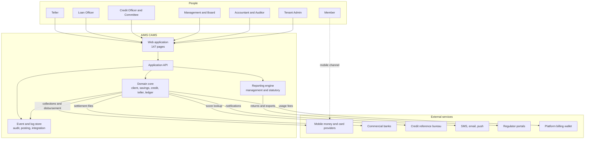

### 8.3 Container view

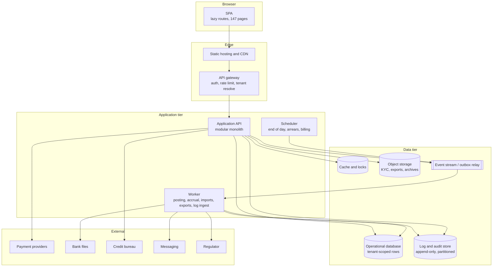

### 8.4 Architectural decisions

| # | Decision | Rationale |
|---|---|---|
| A1 | **Modular monolith first**, one worker process, services extracted only when forced | A disbursement touches credit, savings, charges, ledger and messaging atomically. Distributed transactions across nine services is how these systems die |
| A2 | **One database, tenant-scoped rows**, enforced twice (row-level security + application scoping) | 100+ tenants of a few thousand members. Schema-per-tenant breaks migrations; database-per-tenant triples cost |
| A3 | **Outbox + worker for posting**; operational commit and outbox row in one transaction | No distributed transaction is available, and the imbalance must be *visible*, not silent |
| A4 | **Append-only ledger**; corrections are reversing entries | Auditability and reversibility without mutating history |
| A5 | **Reports are definitions, not screens** | 68 report pages share one query/render pipeline |
| A6 | **Statutory returns are versioned artefacts**, frozen on submit | Regulation changes shape; submitted returns must not mutate |
| A7 | **Products and policies are data** | Interest method, accrual, charges, provisioning, GL mapping, approval stages are configuration |
| A8 | **Events are first-class**, including system logs | Audit, observability and reconciliation come from the same stream |
| A9 | **No business logic in the client** | The SPA validates for feedback; the server enforces |

Rejected alternatives: event-sourcing the whole domain (the append-only ledger already gives
auditability); microservices first; a document store as system of record; stored procedures for
business logic; a generic BPMN engine for a fixed four-stage chain.

### 8.5 Module boundaries

Each module owns its tables. A module may call another module's application service or
subscribe to its events; it may never read another module's tables directly.

| Module | Owns | Publishes |
|---|---|---|
| **Identity & Access** | user, role, permission, user_role, session, pin | `UserCreated`, `RoleChanged` |
| **Tenant & Org** | tenant, branch, branch_hours, holiday, tenant_setting | `BranchCreated`, `PeriodOpened` |
| **Client** | client, group_member, client_user, kyc_document, next_of_kin, income, residence, client_asset, bank_account, mno_account, membership_policy | `ClientActivated`, `KycApproved`, `MemberDormant` |
| **Catalog** | product_loan, product_savings, product_charge, interest_rate, provisioning_rule, credit_policy, policy_version | `PolicyApproved`, `ProductChanged` |
| **Savings** | savings_account, savings_txn, share_account, reservation | `DepositPosted`, `WithdrawalPosted`, `FundsReserved`, `FundsReleased` |
| **Credit** | loan_application, application_stage, approval, loan, schedule_line, repayment, guarantor, collateral, charge, write_off, reschedule | `ApplicationSubmitted`, `LoanApproved`, `LoanDisbursed`, `RepaymentReceived`, `LoanClosed`, `LoanWrittenOff` |
| **Transactions** | transaction, till_session, denomination, reversal, bulk_batch, request | `TransactionSubmitted`, `TransactionApproved`, `TillClosed` |
| **Ledger** | gl_account, gl_group, gl_category, journal_entry, journal_line, period, posting_rule, outbox | `EntryPosted`, `EntryReversed`, `PeriodClosed` |
| **Payments** | payment_intent, provider_txn, recon_case, statement_import | `PaymentMatched`, `PaymentUnmatched` |
| **Reporting** | report_definition, report_run, regulatory_template, return_instance, return_line | `ReportGenerated`, `ReturnSubmitted` |
| **Messaging** | message_template, segment, message_log, credit_balance, campaign | `MessageSent`, `MessageFailed` |
| **Import** | import_batch, import_row, field_mapping | `ImportCommitted` |
| **Billing** | wba_wallet, wba_invoice, wba_settlement, fee_setting | `InvoiceIssued`, `WalletToppedUp` |
| **Audit & Logging** | system_event, posting_attempt, job_run, audit_event | — (append only) |

**Dependency rule.** `Ledger` depends only on Tenant. Everyone may depend on Ledger; Ledger
depends on no business module. Invert that and the ledger becomes a second business layer and
the reporting model rots.

### 8.6 Layering inside a module

```
modules/credit/
  api/            controllers, DTOs, guards        (thin)
  application/    use cases, transaction boundary   (orchestration)
  domain/         entities, value objects, invariants, domain events
  infrastructure/ repositories, adapters, SQL
  readmodels/     query services for list and detail screens
```

| Layer | May do | May not do |
|---|---|---|
| api | Validate shape, map DTO, authorise | Contain business rules |
| application | Coordinate a use case, open a transaction, emit events | Reach into another module's tables |
| domain | Enforce invariants, compute schedules, allocate money | Touch I/O |
| infrastructure | Persist, call providers | Decide business outcomes |
| readmodels | Compose cross-module views | Mutate |

A use case looks like this — note what is absent: no ledger call, no SMS call, no HTTP.

```
disburseLoan(command, context):
  transaction:
    loan = credit.repo.getForUpdate(command.loanId)
    loan.ensureCanDisburse()                    # domain invariant
    schedule = buildSchedule(loan, policyVersion)   # pure
    charges  = chargesOnDisbursement(loan)          # pure
    saveSchedule(loan.id, schedule)
    savings.releaseReservations(loan.id)
    outbox.emit(LoanDisbursed(...))             # posting happens later
  return { loanId, firstDueDate }
```

### 8.7 The posting engine

The highest-risk component. Build it first, test it hardest.

Grains:

```
posting_rule   (event_type, product, debit_account, credit_account,
                amount_selector, priority, active)
journal_entry  (entry_no, entry_date, period_id, entry_type, status,
                source_type, source_id, idempotency_key unique,
                narration, comment, posted_at)
journal_line   (entry_id, line_no, gl_account_id, dr_cr, amount,
                member_id, loan_id)
```

Guarantees the engine must provide:

1. **Idempotency** — replaying an event never creates a second entry.
2. **Balance** — per-entry debits equal credits, enforced at the database level, not by hope.
3. **Period guard** — reject posting into a closed period, with a specific error code.
4. **Account guard** — reject inactive ledgers and control accounts that need a sub-ledger.
5. **Branch guard** — the entry's branch must match the source document's branch, except for
   explicit inter-branch entries.
6. **Atomicity** — header, lines and outbox status committed together.
7. **Reversibility** — full mirror reversal; partial correction is a new adjusting entry.
8. **Observability** — every failure records event type, source id, rule id and reason, and is
   visible on the System Logs posting tab.

Failure path:

```
pending -> posting -> posted
              |
              v
           failed -> retry with backoff -> dead-letter -> manual resubmit
```

`Resubmit` re-emits the event with the **same** idempotency key. If the first attempt actually
succeeded and only the acknowledgement was lost, the second attempt is a no-op.

### 8.8 Deployment shape (stack-neutral)

```
prod
  static SPA on CDN, immutable assets, tenant theming at runtime
  api          N stateless replicas behind WAF and load balancer
  worker       M replicas, queue consumers, no inbound traffic
  scheduler    single leader via advisory lock
  database     primary + synchronous standby, point-in-time recovery
  cache        managed, HA
  object store versioned, private, lifecycle rules
  log store    append-only, partitioned, separate retention policy
  stream       managed broker with dead-letter queue
```

Environments: `dev` → `staging` (anonymised copy, provider sandboxes) → `prod`.
Migrations are expand → migrate → contract, because API and worker are never on the same
version during a rollout.

### 8.9 Non-functional targets

| Dimension | Target |
|---|---|
| Concurrent users | 200 per tenant, 2 000 platform-wide |
| p95 read (list screen) | < 400 ms |
| p95 write (transaction) | < 800 ms |
| Posting latency, event to posted | p95 < 2 s, p99 < 10 s |
| Report, 100k rows | < 5 s interactive; larger goes async |
| Import | 10 000 rows < 60 s, resumable |
| Log search, 12 months | < 2 s |
| Availability | 99.9% monthly |
| RPO / RTO | 15 min / 4 h |
| Retention | financial and audit records 7+ years |

### 8.10 Technology selection — deferred on purpose

You said you will choose the technologies. To keep that choice free, the design states only
**capabilities required**, never products:

| Capability | Requirement the choice must meet |
|---|---|
| Client | Component model that supports 147 lazy routes, complex tables, and a report renderer |
| API | Transactional request handling with an application-service layer and server-side authorisation |
| Data | Strong relational integrity, deferred constraints, row-level security, JSONB for snapshots |
| Async | Durable outbox or queue with retry, dead-letter and idempotent consumers |
| Files | Private object storage with signed URLs |
| Search | Log search over millions of rows in under 2 s (indexed SQL is sufficient; a search engine is optional) |
| Reporting | Declarative report definitions, async export, PDF/XLSX generation |
| Auth | OIDC, MFA for privileged roles, transaction PIN |
| Observability | Traces, metrics and structured logs with a correlation ID surfaced in the UI error |
| Deployment | Blue/green or rolling, with backwards-compatible migrations |

The reference stack used by the original product (Angular SPA, PrimeNG, JSON API) is documented
in `04-architecture.md §17` for comparison — **not** adopted here.

---

## 9. End-to-end flows

Eleven business flows and one new observability flow. Each diagram shows the happy path; the
rules below it are what breaks in production.

### 9.1 The value chain

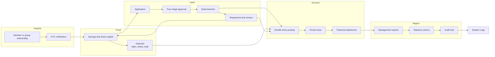

The loop `Repayment → Savings → Application` **is** the business: savings fund loans,
repayments refill savings. Any design that treats savings and credit as separate systems fails
at guarantor blocking and at repayment allocation.

### 9.2 Member onboarding

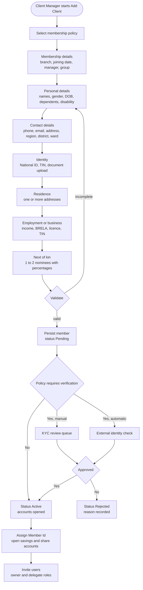

**Rules**

1. Nominee percentages must total **100**; the policy allows 1–2 nominees.
2. Member Id is **generated, never entered**. Observed scheme: members `9532002xxx`,
   loans `95323000xxx`, internal/GL accounts `95329000xxx`.
3. **Dormancy**: 365 days without activity; `Auto Active Upon Deposit` reactivates on the next
   deposit.
4. `Allow Withdraw` controls whether savings can be withdrawn at all, independent of balance.
5. Group members are **not** independent clients — they are roster rows with a
   `Group Member Type` (chairperson, secretary, committee, ordinary).
6. KYC documents are capped at **5 MB**, stored by reference, never in the database.

### 9.3 Group onboarding

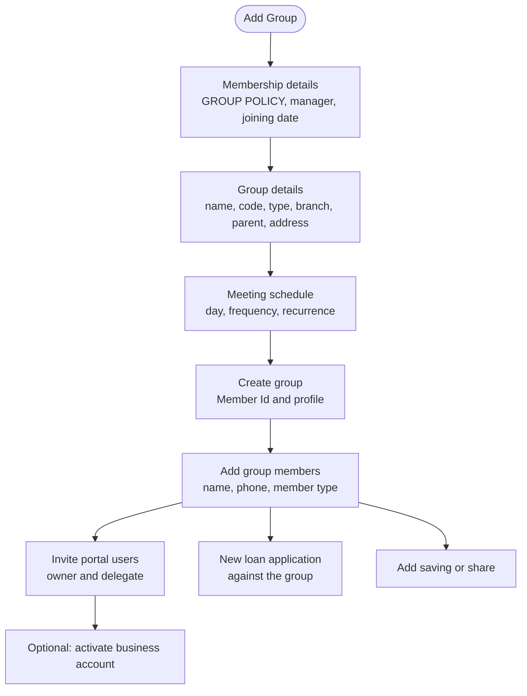

**Rules.** A group is a **single credit counterparty**: loans are booked to the group and the
roster is evidence of membership, not a set of borrowers. Group loans still require guarantors
per product policy. The meeting schedule feeds collection scheduling and reminders.

### 9.4 Savings deposit to ledger

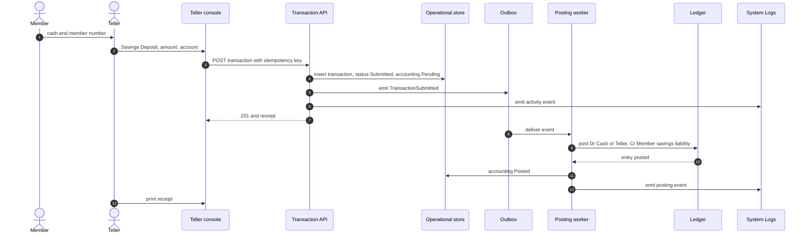

**Rules.** Withdrawal checks available balance minus reserved funds. Blocked funds are not
withdrawable. Receipt numbers are per till per day. A deposit to a dormant member reactivates
them when the policy says so.

### 9.5 Loan lifecycle state machine

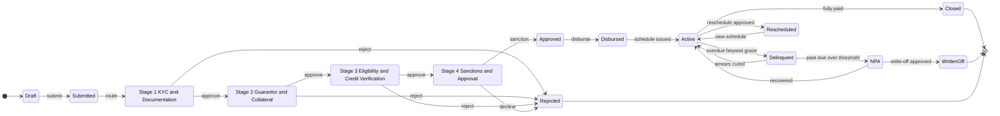

**Rules**

1. Four sequential stages, each with a default role and assignee **copied from the product at
   submission time** — not at approval time, because policies change.
2. Editing is allowed only **before the first approval**. After that, changes require
   resubmission and invalidate prior approvals.
3. Rejection at any stage is terminal for that application; the member reapplies.
4. An optional `Fee and Payments` stage sits between sanction and disbursement for products
   that charge upfront.
5. `Product Policy Version` is stamped on the loan. A later policy edit must never
   retroactively reprice a booked loan.
6. **Disbursement is the accounting event**, not approval. Approval creates intent;
   disbursement moves money and books the entry.
7. Top-up, reschedule, write-off, interest waiver and close are **separate commands**, each
   with its own approval and ledger effect. Never implement them as field edits.

### 9.6 Approval sequence

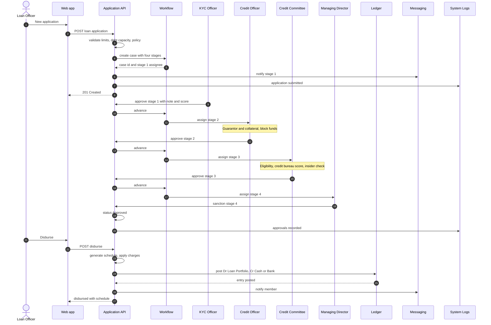

**Rules**

1. Each stage records approver, role, decision, note, score, timestamp and the **policy version
   used**. The UI shows `Pending / Approved`, `Previous Step / Current Step`, approval history,
   notes, score history, audit history and documents.
2. The same user may not approve two consecutive stages of one loan.
3. Guarantor blocking happens at **stage 2**, before sanction — otherwise you sanction a loan
   with no cover.
4. Charges are created at disbursement per `Payment Mode`:
   `Payment Upon Processing And Disbursement` (5% management fee),
   `Payment Upon Loan Repayment`, `Payment Upon Delayed Repayment` (0.5% penalty).
5. Lifecycle notifications exist as templates: disbursed, repayment, repayment admin,
   disbursed with fee.

### 9.7 Guarantor blocking and release

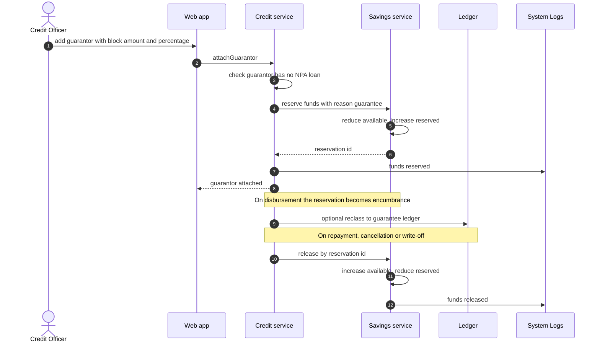

**Rules**

1. Blocked funds are **not a display concept** — they reduce withdrawable balance, and the
   statement shows `Blocked Fund`.
2. Release must be **exactly once**, keyed off the reservation id, never off loan status.
3. A guarantor with an NPA loan cannot guarantee.
4. `Collateral Ratio` (e.g. 150%) constrains total cover; collateral is valued from the member's
   `Assets` tab or the fixed-asset register.
5. `GuarantorsReport` must reconcile reserved amounts back to savings balances.

### 9.8 Repayment and allocation

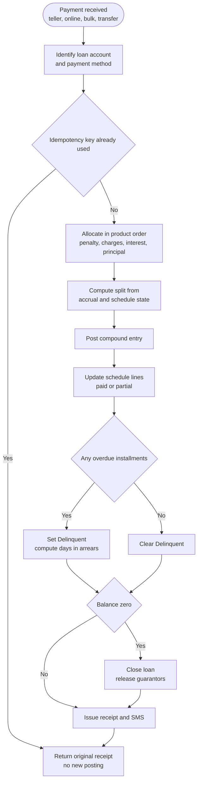

**Rules**

1. Allocation order is **product configuration**; `Charges, Interest and Principal` is the
   observed default. Never hardcode it.
2. Interest is accrued separately from billed. A repayment reverses accrued interest receivable
   (`1505`) and recognises income (`4001` / `4005`) in the same entry.
3. Overpayment is not negative principal — it posts to `2004 Overpayments` and can be refunded
   or offset.
4. Advance payments follow `Advance Payments Adjustment = Adjust Next Installment`.
5. Early settlement uses `Pre-closure Interest Calculation` and must not double-charge.
6. `Recalculate Interest On Repayment` and `On Accrual` are product switches; ignoring them
   makes the schedule drift.
7. The observed bank repayment entry is `Dr 1205 Staff Loan`, `Dr 4005 Interest Income`,
   `Cr 1005 Bank NMB`. Debiting income for a repayment is unusual — **agree your accounting
   policy in writing before copying it**.

### 9.9 Teller transaction with asynchronous posting

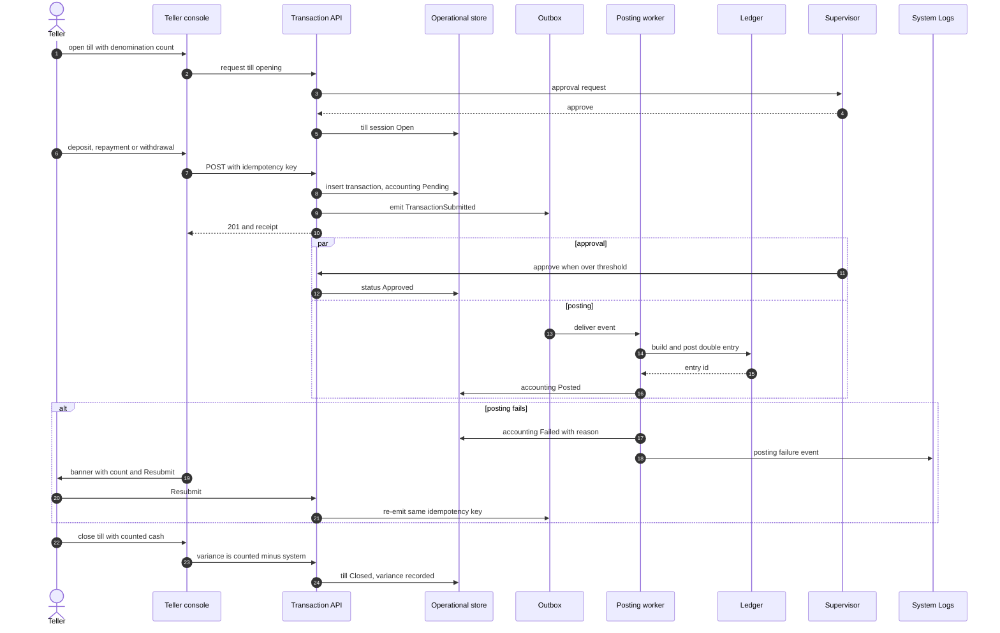

**Rules**

1. Two-phase commit is unavailable across services; use an **outbox**. Operational insert and
   outbox insert happen in one database transaction.
2. Idempotency key is the transaction number or a client-supplied UUID. Resubmission produces
   the same entry, not a second one.
3. Posting is atomic per entry: header and lines, balanced, period open, ledger active.
4. The unposted banner is a **first-class UI element**: it names the count and offers
   `Resubmit`.
5. Till variance is a real accounting difference. Route it to a cash-shortage/overage ledger;
   never silently adjust.
6. Denominations are captured at open and close so a physical count can be audited.

### 9.10 Online collection and reconciliation

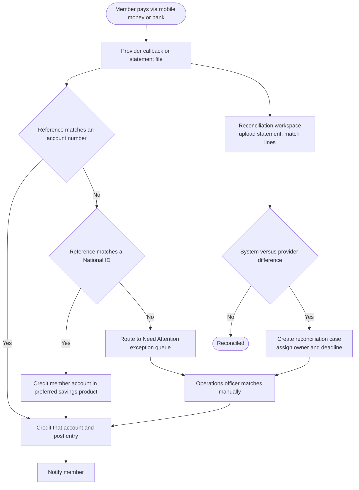

**Rules.** Never guess an account from a partial reference. Unmatched money goes to an explicit
queue, not a suspense account nobody watches. Provider callbacks are at-least-once — deduplicate
on provider transaction id. Statement upload is the fallback when callbacks fail; both paths
converge on the same matcher.

### 9.11 Bulk import

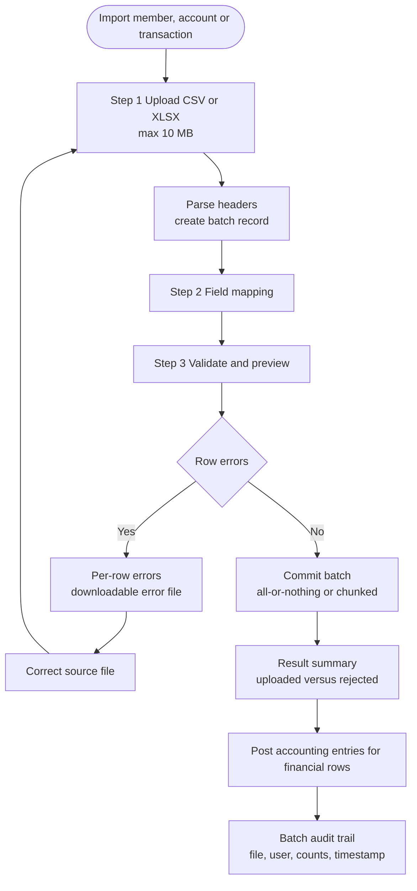

**Rules.** Validate before committing — partial imports corrupt balances. Transaction import
**must** post accounting, or the ledger drifts on day one. A failed batch is retried or rolled
back as a unit. Design for 10 000 rows without a browser timeout.

### 9.12 Period close and statutory return

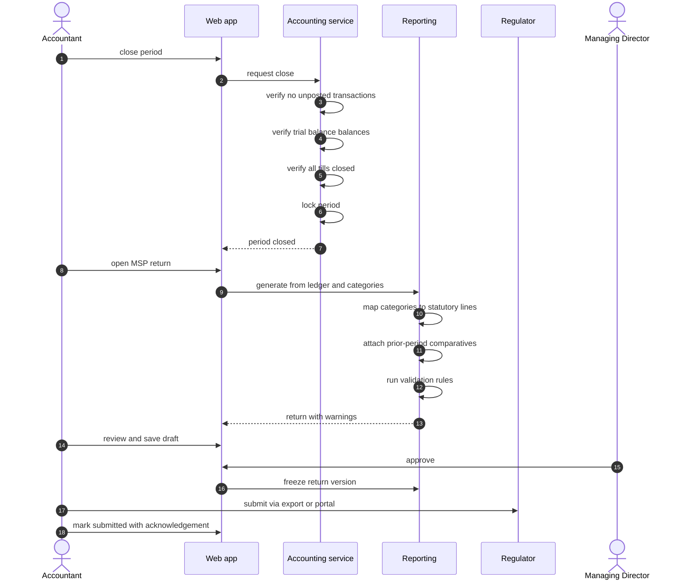

**Rules**

1. Close is **gated on the unposted queue being empty**. That is the whole reason the banner
   exists.
2. Returns are generated then **frozen**. A submitted return keeps its data snapshot and
   template version; later ledger changes do not mutate it.
3. Validation is explicit: totals tie to the trial balance, prior-period columns are populated,
   required schedules are complete.
4. `Saved Reports` implies drafts persist per period, and regenerating does not overwrite a
   submitted version.
5. The regulator differs by module type: TCDC forms for SACCOs, BoT forms for MFIs.

### 9.13 How System Logs is fed (new)

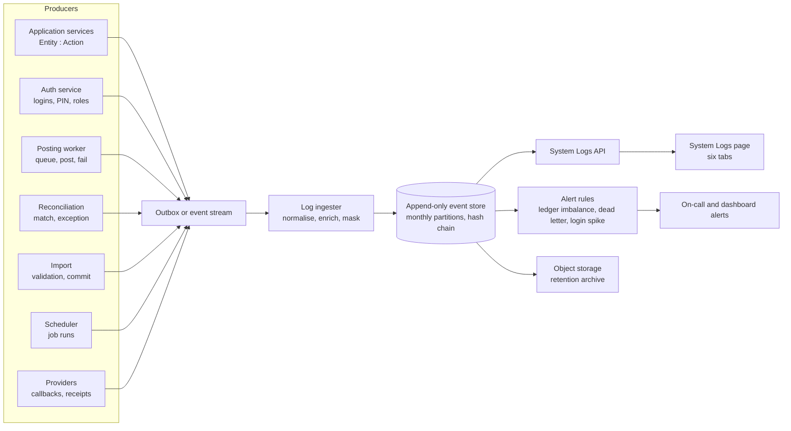

**Rules**

1. **Logging never blocks business.** Emit and continue; the ingester buffers and drains.
2. **One correlation ID per business act** links the UI action, the transaction, the posting
   attempt, the ledger entry and every notification.
3. **Append-only with a hash chain**, verified nightly; a break is a P1.
4. **PII is referenced, not copied.** Snapshots hold changed fields only, masked at read time.
5. **Alerts are derived from the same store** — the page and the pager cannot disagree.

### 9.14 Flow-to-module traceability

| Flow | Primary modules | Key entities |
|---|---|---|
| Member onboarding | Client, Settings / Policies | Client, MembershipPolicy, NextOfKin, Document |
| Group onboarding | Client | Client (group), GroupMember, ClientUser |
| Savings deposit | Transactions, Savings, Ledger | SavingsAccount, SavingsTxn, JournalEntry |
| Loan lifecycle | Accounts / Loans, Requests | LoanApplication, ApplicationStage, Loan |
| Approval sequence | Requests, Messaging, System Logs | Approval, Assignment, Notification, SystemEvent |
| Guarantor blocking | Accounts / Loans, Savings | Guarantor, Reservation, Collateral |
| Repayment allocation | Transactions, Accounting | Transaction, ScheduleLine, JournalEntry |
| Teller and posting | Transactions / Teller, Accounting | TillSession, Transaction, OutboxEvent, PostingRule |
| Online reconciliation | Transactions / Online, Payments | PaymentIntent, ProviderTxn, ReconCase |
| Bulk import | Import | ImportBatch, ImportRow, FieldMapping |
| Period close and return | Accounting, Reports / MSP | Period, ReturnInstance, ReturnLine, ValidationRule |
| System logs | Audit & Logging | SystemEvent, PostingAttempt, JobRun |

---

## 10. Cross-cutting rules

### 10.1 Money

- Store `NUMERIC(18,2)` at rest; transport integer minor units. Never float.
- TZS formatting with grouping and 2 decimals; right-aligned in tables.
- Every balance is derived from the ledger for money, and from operational rows for intent.
  Never derive a balance only from operational rows.
- Every entry has a deterministic idempotency key and `source_type` / `source_id`.
- Reversal is a mirrored entry; deletion of a financial record is never allowed.

### 10.2 Tenancy and branch

- `tenant_id` on every business row, enforced by database policy **and** application scoping.
- `branch_id` is an ambient context shown in the header and applied to every query.
- The branch on a journal entry must match the source document, except explicit inter-branch
  entries which use the inter-branch ledger code.
- Cross-tenant access attempts are a security test, not a code review item.

### 10.3 Security

| Control | Implementation |
|---|---|
| Authentication | OIDC, short-lived access tokens, rotating refresh tokens |
| Privileged actions | MFA for Admin, MD, Accountant; transaction PIN for money movement |
| Authorisation | Checked at the application-service boundary, not only the router |
| Audit | Append-only event store with actor, IP, before/after, correlation id |
| File upload | Type sniffing, size caps (5 MB KYC, 10 MB import), antivirus, private bucket, signed URLs |
| XSS | No HTML bypass in the client; sanitise at source; strict CSP |
| Rate limiting | Per user and per IP on auth and money-moving endpoints |
| Secrets | Managed store, rotated, never in the client bundle |

### 10.4 Data protection (Tanzania)

The Personal Data Protection Act 2022 applies. Practical requirements: lawful basis recorded
per processing purpose; consent captured for marketing (the Transactional / Marketing split is
a legal control); data subject access and erasure workflows that respect statutory retention;
breach notification; data localisation checked with counsel; processor agreements with SMS and
payment providers.

### 10.5 Observability

| Signal | What to instrument |
|---|---|
| Traces | Every request; one span per module hop; trace id echoed in the UI error |
| Metrics | Posting queue depth, failed postings, unposted count per tenant, report duration, provider error rate, till variance |
| Logs | Structured; tenant, user, branch, correlation id; never log PIN or full ID numbers |
| Alerts | Ledger imbalance (P1), dead-letter greater than zero (P1), provider failure spike (P2), report p95 regression (P3) |
| Dashboards | Daily volume, loans disbursed, arrears ratio, wallet balance per tenant |

The single most important alert: **debits not equal to credits, or an entry failing the balance
constraint**. That pages someone at 3 a.m.

### 10.6 Testing (the non-negotiables)

| Layer | Approach |
|---|---|
| Domain | Unit tests for schedule generation, allocation, arrears buckets, provisioning |
| Posting | Golden-file tests: event in, exact double entry out |
| Property-based | Random repayment sequences never produce negative principal or unbalanced entries |
| Integration | Real database; outbox to worker to posted |
| Contract | Schema tests between client and API |
| Regression | Replay a year of anonymised transactions; balances must match |
| Migration | Import a real 1 000-member file and a real statement file |
| E2E | Playwright over the twelve flows above |
| Security | Cross-tenant access, privilege escalation, IDOR on loan and account ids |

---

## 11. Data entities at a glance

Not an ERD — the full model with keys, enums and constraints is in `05-data-model.md`. This is
the entity map so the page inventory has something to point at.

| Domain | Core entities |
|---|---|
| Identity | user, role, permission, user_role, session, pin |
| Org | tenant, branch, branch_hours, holiday, tenant_setting |
| Client | client, group_member, client_user, kyc_document, next_of_kin, income, residence, client_asset, bank_account, mno_account, membership_policy, policy_approval |
| Catalog | product_loan, product_savings, product_charge, interest_rate, provisioning_rule, credit_policy, policy_version |
| Savings | savings_account, savings_txn, share_account, reservation |
| Credit | loan_application, application_stage, approval, loan, schedule_line, repayment, guarantor, collateral, charge, write_off, reschedule |
| Transactions | transaction, till_session, denomination, reversal, bulk_batch, request |
| Ledger | gl_account, gl_group, gl_category, journal_entry, journal_line, period, posting_rule, outbox |
| Payments | payment_intent, provider_txn, recon_case, statement_import |
| Reporting | report_definition, report_run, regulatory_template, return_instance, return_line |
| Messaging | message_template, segment, message_log, credit_balance, campaign |
| Import | import_batch, import_row, field_mapping |
| Billing | wba_wallet, wba_invoice, wba_settlement, fee_setting |
| Logging | system_event, posting_attempt, job_run, audit_event |

---

## 12. Known gaps and open questions

| Gap | Detail | Impact |
|---|---|---|
| Dashboard not captured | Present in navigation, no screenshot | KPIs specified from downstream reports; confirm with you |
| Campaigns | In navigation, no screens | Scope unknown; likely a scheduler over segments and templates |
| Services | Settings screen captured but empty | Assume a provider registry; confirm required providers |
| Member verification report | 3 screenshots produced no OCR text | Columns reconstructed from the KYC tab |
| MSP10 complaint return | No obvious data source in the product | Needs a complaint register, which does not exist |
| MSP11 counterparty register | Not visible in settings | Needs a counterparty entity |
| Provision rate grids | Differ between SACCOS, MFI Type 1, MFI Type 2 | Obtain the current statutory grids |
| Loan detail "Charges" tab | Present but weakly captured | Confirm the column set |
| Teller client types | Earlier notes said 11; only **10** are evidenced in the captured dropdown | Confirm whether an eleventh type exists beyond the captured view |
| Regulator submission channel | Assumed export plus portal upload | Confirm if TCDC or BoT exposes an API |
| Accounting direction | Observed repayment debits an income account | Agree the policy in writing before implementation |

**Open questions for you**

1. Do we build for **both** regulator dialects (TCDC and BoT), or one first?
2. Is the **business account / billing wallet** in scope, or is that platform-only?
3. Do members get a **self-service channel**, or is this back office only?
4. **System Logs** — is it internal-only, or should tenants export a log extract for auditors?
5. Which of the 17 roles actually exist in your first tenant?

---

## 13. Suggested build sequence

Derived from dependency order, not from screen order. Each step is independently demonstrable.

| Phase | Deliverable | Why here |
|---|---|---|
| 0 | Shell, navigation, tenancy, identity, RBAC, audit event store, **System Logs shell** | Everything is scoped by these; logging must exist before the first money movement |
| 1 | Chart of accounts, categories, periods, posting engine, outbox, unposted queue | Hardest to retrofit; every report and every transaction depends on it |
| 2 | Client, KYC, membership policy, member 360 | No product works without a member |
| 3 | Savings, shares, reservations, guarantor blocking | Funds loans |
| 4 | Teller, till, transactions, reversals | Where money physically enters |
| 5 | Loan product, schedule engine, four-stage workflow, disbursement, repayment | The business |
| 6 | Report engine, trial balance, financial statements, statements | The month cannot close without it |
| 7 | Statutory returns MSP01 and MSP02 | The statutory obligation that makes the sale |
| 8 | Import, messaging, requests, reconciliation | Scale and operations |
| 9 | Remaining reports, campaigns, billing | Completeness |

**MVP cut line (recommended):** phases 0–7. That is a system that can onboard a member, take a
deposit, lend, repay, balance the books and file two returns — with a complete audit trail.

---

## Appendix A — Route index (all 145 observed routes)

```
accounting-assets                             accounting-reports-OwnersEquity
accounting-chart-of-accounts                  accounting-reports-Reconciliation
accounting-entries                            accounting-reports-TrialBalanceReport
accounting-fixed-asset                        accounting-reports-notes-of-account
accounting-ledger-entries                     accounting-reports-reconcile-statement
accounting-reports                            accounting-reports-reconcile-statement-settings
accounting-reports-Assets                     clients
accounting-reports-CashBook                   clients-create
accounting-reports-CashFlowStatement          clients-create-group
accounting-reports-ComprehensiveTrialBalance   clients-group-1789
accounting-reports-CorporateTaxStatement      core-wba-business-account
accounting-reports-FinancialPositionReport    import-account
accounting-reports-GeneralLedgerBook          import-account-new
accounting-reports-IncomeStatementReport      import-member
accounting-reports-JournalBook                import-member-new
accounting-reports-LedgerStatementReport      import-transaction
accounting-reports-MonthlyTrialBalance        import-transaction-new
accounting-reports-notes-of-account           messages-message-logs
account-loan                                   messages-recharge-credits
account-loan-application                       messages-segment-list
account-loan-application-create                messages-segment-list-create
account-loan-application-details-124           messages-send-message
account-loan-application-details-39            messages-template-list
account-loan-application-edit-39               messages-template-list-create-3793
account-loan-details-118-documents             messages-users-list
account-loan-details-118-guarantors            requests
account-loan-details-118-repayments            settings-account
account-loan-details-118-schedule              settings-accounting-settings
account-loan-details-118-summary               settings-administrator
account-loan-details-118-transactions          settings-administrator-add
account-saving                                 settings-branch
reports-client-ClientListReport                settings-branch-add
reports-client-MemberVerificationReport        settings-policies-credit-product-policy
reports-loan                                   settings-policies-credit-product-policy-5
reports-loan-AccruedInstallmentsReport         settings-policies-credit-product-policy-5-edit
reports-loan-AccruedInterestReport             settings-policies-holidays
reports-loan-ActiveLoanReport                  settings-policies-membership-policy
reports-loan-AllLoanReport                     settings-policies-membership-policy-1
reports-loan-DeferredInterestReport            settings-policies-membership-policy-1-edit
reports-loan-ExpectedLoanRepaymentsReport      settings-policies-membership-policy-2
reports-loan-ExpectedPaymentByDateReport       settings-policies-membership-policy-2-edit
reports-loan-ExpectedRepaymentReport           settings-policies-membership-policy-create
reports-loan-FeeStatusReport                   settings-products-fee-penalties
reports-loan-GuarantorsReport                  settings-products-interest-rate
reports-loan-IssuedLoansAndArrearsReport       settings-products-interest-rate-create
reports-loan-LoanAgingReport                   settings-products-loan
reports-loan-LoanArrearsReport                 settings-products-loan-5
reports-loan-LoanDisbursementReport            settings-products-loan-provisioning
reports-loan-LoanInsuranceReport               settings-products-loan-provisioning-create
reports-loan-LoanOfficerIncomeReport           settings-products-savings
reports-loan-LoanOutstandingReport             settings-products-savings-create
reports-loan-LoanRepaymentReport               settings-products-savings-edit-1
reports-loan-PaidOffLoansReport                settings-role
reports-loan-PendingLoanApplications           settings-service-provider
reports-loan-PortfolioRiskReport               transaction-all-transaction
reports-loan-RiskClassificationOfAssets        transaction-online-payment-reconciliation
reports-loan-SummarizedPortfolioAtRiskReport   transaction-online-transaction
reports-loan-TransactionReport                 transaction-teller-transaction
reports-loan-WrittenOffLoanReport              transaction-teller-transaction-history
reports-msp-MSP01Report                        transaction-teller-transaction-request
reports-msp-MSP02Report                        dashboard  (in navigation, not captured)
reports-msp-MSP03MFIReport
reports-msp-MSP03Type1Report
reports-msp-MSP03Type2Report
reports-msp-MSP04MFIReport
reports-msp-MSP04Report
reports-msp-MSP05MFIReport
reports-msp-MSP05Report
reports-msp-MSP06Report
reports-msp-MSP07Report
reports-msp-MSP08Report
reports-msp-MSP09MFIReport
reports-msp-MSP09Report
reports-msp-MSP10MFIReport
reports-msp-MSP10Report
reports-msp-MSP11Report
reports-saving-SavingBeyondPolicyLimitsReport
reports-saving-SavingReport
reports-saving-SavingSnapshotReport
reports-statement
reports-statement-AccountStatementReport
reports-statement-MemberStatementReport
reports-transaction-DailyTransactionReport
reports-transaction-ExpenseReport
reports-transaction-FeesIncomeReport
reports-transaction-ReversedTransactionReport
```

---

## Appendix B — Reference measurements used for the visual layer

These come from the UI-polish brief and are recorded here so the blueprint and the visual spec
do not drift apart. They are **targets**, to be re-measured in the browser after any styling
change.

| Element | Target |
|---|---|
| Header | 96px tall, white, 1px `#D4D4D4` bottom border, fixed |
| Sidebar | 300px expanded, 72px collapsed, white, 1px `#D9D9D9` right border |
| Nav row | 44px tall, 8px radius, 12px side margins, icon 22–24px, label 17–18px |
| Nav pitch | fluid: `min(60px, available / nav-count)`, no scrollbar at 860px and above |
| Page background | `#ECEBEC` |
| Card | white, 10px radius, 1px `#EEEEEE`, 30px padding, 21px gaps |
| Content padding | 21px sides, 22px top |
| Brand | `#0F4D3A` (AIMS green, replacing the reference teal) |
| Font | Roboto 400 / 500 / 700, system fallbacks |
| Scroll behaviour | header and sidebar fixed; only content scrolls |

---

*End of blueprint. Page inventory, flows and the System Logs specification are frozen for
review; the technology section is intentionally left open for your decision.*
