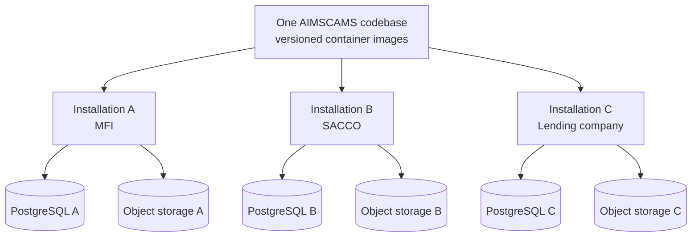
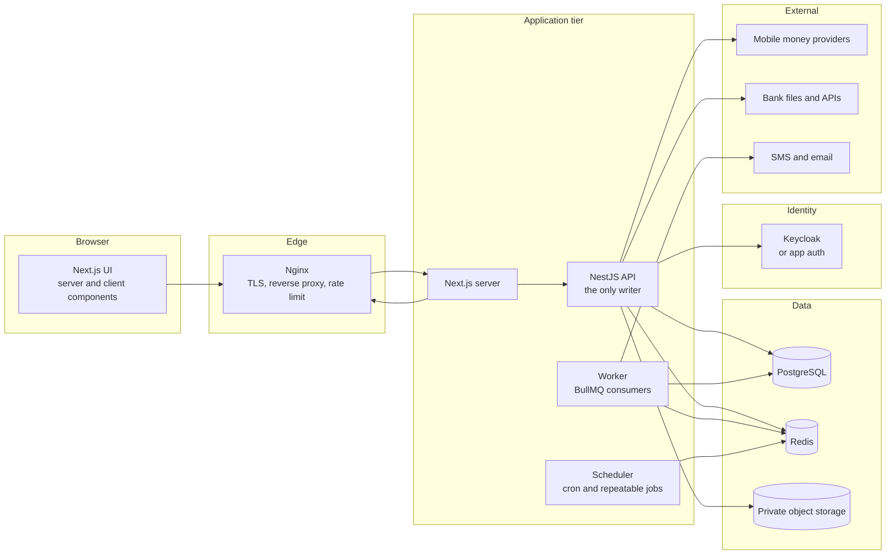
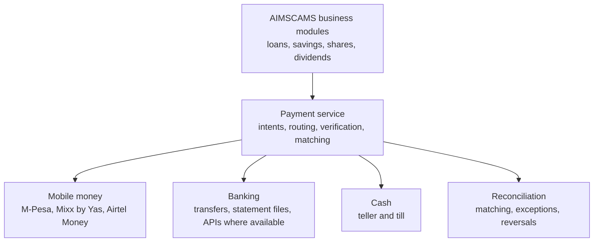

# 10 — Technology Stack, Deployment and Module Map

**Status:** Accepted 2026-10-26 · recorded as D-018 … D-023 in [`DECISIONS.md`](../DECISIONS.md)
**Supersedes:** D-011 (Angular + NestJS) and D-002's *deployment* choice (one shared cluster)

This document is the implementation reference for the chosen stack. It records *what was
decided*, *why*, and *where the plan needs correcting before code is written*. Recommendations
are marked **R-n** and are not decisions until they are moved into `DECISIONS.md`.

---

## 1. Stack at a glance

| Layer | Choice | Role in the system | Notes |
|---|---|---|---|
| Frontend | **Next.js + TypeScript** | All 147 screens, SSR for read-heavy lists, client components for tables and forms | UI only. No business rules, no direct database access |
| UI system | **Tailwind CSS + shadcn/ui** | Design system, primitives, tables, dialogs, forms | Tokens are fixed by `docs/11-ui-contract.md` |
| Backend | **NestJS + TypeScript** | The only writer. Domain services, REST API, authorisation | Modular monolith, module boundaries per `docs/04-architecture.md` |
| Database | **PostgreSQL** | System of record: ledger, members, loans, savings, audit | PostgreSQL 16 or newer |
| Data access | **Prisma** + hand-written SQL migrations | Typed OLTP access, schema management | SQL for triggers, deferred constraints, RLS, views — see §7 |
| Authentication | **Keycloak** *or* application auth | Identity, MFA, sessions | Open: `O-009`. Requirement is MFA + OIDC-shaped boundary either way |
| Authorisation | **RBAC + resource scoping** | 17 roles, `Entity : Action`, branch and organisation scope | Enforced at the service boundary, not the router |
| Background work | **Redis + BullMQ** | Posting, accrual, arrears, imports, exports, notifications, reconciliation | Transport only — the outbox stays the source of truth (`D-022`) |
| Documents | **Private S3-compatible storage** | KYC, loan agreements, exports, backups of generated files | Signed URLs, per-institution bucket or prefix |
| API docs | **Swagger / OpenAPI** | Contract for the web client and integration tests | Generated from NestJS DTOs |
| Testing | **Jest + Playwright** | Unit/integration and end-to-end | Ledger invariants additionally run against PGlite (`D-016`) |
| Deployment | **Linux + OCI containers + Nginx** | One image set, one installation per institution | Docker Engine default; Podman compatible; native systemd fallback |
| Monitoring | **Prometheus + Grafana** | Health, queue depth, posting failures, latency | Add before the pilot, not after |

Versions are **not** pinned here. Pin the current stable major of each at kickoff and record it in
the lockfile; do not copy version numbers out of this document.

---

## 2. Deployment model — one installation per institution

One codebase, many independent installations. Each institution gets its own application
instance, database, credentials, keys and storage scope.



Each installation owns, independently:

| Item | Per installation |
|---|---|
| Application instance | Its own containers, its own release version |
| Database | Its own PostgreSQL database **and** its own credentials |
| Users and roles | Its own identity store or realm |
| Secrets and keys | Its own encryption keys, JWT signing keys, provider credentials |
| Documents | Its own bucket or prefix, private, signed access |
| Backups | Its own schedule, retention, restore test log |
| Configuration | Institution type, chart of accounts, products, policies, branding |

**What this buys.** A breach or a bad migration stops at one institution. A SACCO's auditor can
be shown their own database boundary. Institutions with data-residency or on-premise demands can
be served. One institution's custom report cannot leak into another's install.

**What it costs.** Every release is N releases. Every migration is N migrations. Every backup is
N backups. That is the real price, and it is why §12 R-2 exists.

> Isolation by installation is a strong boundary, but it is not the whole security story.
> Server permissions, network rules, secret management and deployment discipline still decide
> whether one institution can reach another's data.

### 2.1 What "one database" means — and what it must not mean

Three different splits get confused. Only the first is adopted.

| Split | Adopted? | Consequence |
|---|---|---|
| **One database per institution** | **Yes** (D-019) | One restore unit, one upgrade unit, one credential set, one configuration. A breach or bad migration stops at one institution |
| One database for every institution | No | One leaked credential or one wrong RLS policy exposes all of them; per-institution restore is impossible; a large institution degrades the others |
| One database per module inside an institution | No | A disbursement writes loans, savings, charges, the ledger and the outbox **atomically**. Splitting modules across databases turns one ACID transaction into 2PC or a saga, and makes the ledger eventually consistent with the loans it describes |

Inside an institution's database:

- **One schema.** Normal tables live together so foreign keys and joins work. Optional `ledger`
  and `audit` schemas are justified only if a `REVOKE` boundary is actually wanted; otherwise they
  add migration friction for no benefit.
- **Three roles, minimum.** `migrator` owns DDL; `app` has DML and cannot `UPDATE`/`DELETE` posted
  journals; `reporting` is read-only. The API never connects as the owner.
- **RLS on.** It is the seatbelt, not the boundary. The boundary is the installation.

**Physical placement is a separate question.** Database-per-institution on one shared PostgreSQL
server is *logical* isolation: a superuser on that server can still read every database. If an
institution needs stronger separation, give it its own cluster or virtual machine. That is the
hosting decision (`O-013`), not a schema decision.

**The backup unit is the installation** — database, object storage and secrets together. A
database dump alone does not restore a working institution.

### 2.2 Host operating system

| Environment | Host | Notes |
|---|---|---|
| Production | **Linux** — Ubuntu LTS or Debian, an OCI runtime, Nginx | Docker Engine by default; Podman compatible. One installation per institution |
| Staging | Same Linux images, same Compose file | Different secrets and data; never production data |
| Local development | Windows, with PostgreSQL and Redis in containers *or* installed natively in WSL | WSL2 is the container backend, not the application host |
| Not supported | WSL2 or Windows containers as a deployed target | No service SLA; different networking and filesystem behaviour |

The application is host-agnostic **because** it ships in Linux containers. What must not happen is
treating a WSL distro as a server: no uptime guarantee, no proper service management, and Windows
updates reboot it underneath you.

#### Is Docker mandatory?

**No.** Nothing in the stack requires it. Next.js, NestJS, PostgreSQL, Redis and Nginx all run
natively on Linux. Docker is chosen because the deployment unit is repeated N times, and a
reproducible image is the cheapest way to keep N installations identical.

| Option | Verdict |
|---|---|
| **Docker Engine + Compose** | Default. Best balance of reproducibility, upgrade/rollback and operational familiarity |
| **Podman** | Supported alternative. Daemonless and rootless; Docker-compatible CLI and Compose. Use it where a root daemon is not acceptable |
| **Native systemd** (built output + distro PostgreSQL/Redis + Nginx) | Supported fallback for institutions that forbid containers. Simplest on a single small box, but upgrades, rollback and version drift must be handled by hand |
| Kubernetes / K3s | Overkill for one installation per institution. Revisit only if a hosted fleet grows beyond what Compose can manage |
| Managed PaaS | Conflicts with per-institution database control and in-country hosting requirements |

**What containers buy here**
- One tested artefact per release, identical in every institution.
- Pinned Node, PostgreSQL and Redis versions — no drift between installations.
- Upgrade and rollback by image tag instead of by hand.
- Prisma Client and native modules built once, on Linux, where they will run.
- Staging that actually matches production.

**What they cost**
- A root-equivalent daemon, a registry, volume backups, and one more thing to monitor.
- On a small on-premise box, a local administrator may genuinely find systemd easier.

The rule is: standardise on **OCI images**, not on one vendor's runtime. Build once, run with
Docker Engine by default, Podman where rootless is required, or systemd where containers are
refused. Never maintain two code paths.

The environment matrix, release sequence, configuration contract and backup rules live in
[`docs/12-deployment.md`](12-deployment.md).

**On the current workstation.** WSL2 with Ubuntu 24.04 is installed; Docker is not. Two valid
options: install Docker Engine inside that distro (same engine as production), or install
PostgreSQL and Redis with `apt` and skip containers entirely for local work. Only the database and
cache are needed locally; the ledger suite already runs on PGlite.

**Image build rules.**
- Run `prisma generate` and compile native modules (`argon2`, any image library) **inside** the
  Linux image. Platform-specific binaries from a Windows host do not run in the container.
- Build multi-stage: dependencies → build → runtime. The runtime image carries no toolchain.
- Pin the Node LTS major in the image; keep it identical to the version in `engines`.
- One image set serves every institution; configuration comes from environment and secrets,
  never from a per-institution build.

---

## 3. Runtime topology



Three rules about this picture:

1. **The API is the only writer.** The Next.js server may read through the API and may hold a
   session cookie; it must not write business data itself or open a database connection.
2. **The worker shares the codebase with the API, not the process.** Same domain packages, same
   Prisma schema, separate container so a slow import cannot starve the UI.
3. **Redis is never the record.** If Redis is flushed, no posting may be lost — the outbox in
   PostgreSQL is what guarantees that.

---

## 4. Repository layout (target)

```
apps/
  web/          Next.js application (all screens)
  api/          NestJS application (REST, auth, domain services)
  worker/       BullMQ consumers and schedulers (imports the api's domain packages)
packages/
  domain/       pure domain: money, schedule, allocation, arrears        (exists)
  ledger/       schema.sql, posting engine, trial balance              (exists)
  db/           Prisma schema, migrations, seed, tenant bootstrap       (new)
  contracts/    generated OpenAPI types and shared DTOs                 (new)
  ui/           design tokens and shared components, if needed          (new, optional)
tools/
  mermaid-check/                                                        (exists)
```

The existing `apps/web/aimscams-web` (Angular) is **legacy** once the Next.js app exists. See
`O-012` for its retirement; do not extend it with new features in the meantime.

---

## 5. Module map

### 5.1 Shared modules (all three institution types)

Customer and member management · KYC and documents · loan products and eligibility · applications
and credit assessment · approval workflows · disbursement · repayment schedules and collections ·
interest, fees, penalties, arrears · accounting and financial reporting · notifications ·
users, roles and permissions · audit trail · regulatory and management reporting.

### 5.2 Institution-specific modules

| MFI | SACCO / Cooperative | Commercial lending |
|---|---|---|
| Group lending | Member registration | Individual and business lending |
| Loan officer portfolios | Savings and contributions | Credit scoring |
| Field collections | Share capital | Collateral management |
| Group guarantees | Member eligibility | Guarantor management |
| Microloan products | Member dividends | Business cash-flow assessment |
| Delinquency management | Member loan limits | Risk-based pricing |

### 5.3 Modules the stack plan omits but the product requires

Recorded as `D-023`. These are the Tanzania-specific capabilities that the 426-screenshot
evidence base proves are needed, and they are the hardest to retrofit:

| Capability | Why it stays in scope |
|---|---|
| Statutory returns MSP01–MSP11, TCDC and BoT dialects | The reason a Tanzanian institution buys the product |
| Teller and vault cash control (till sessions, denominations, variance) | Every cash movement must reconcile to the ledger |
| Guarantor fund reservations | A guarantee blocks a real savings balance; release must be exactly-once |
| Product policy versioning stamped on each loan | Pricing and approval must be reproducible after a policy edit |
| Unposted-transactions queue with `Resubmit` | Operational and ledger writes are separate; the gap must be visible |
| Maker-checker approvals with segregation of duties | Fraud control and audit requirement |
| Tamper-evident audit trail | Auditors sign off on it; see `docs/09-system-blueprint.md §7` |

### 5.4 Three balance types are not interchangeable

Savings, share capital and dividends each need their own accounts, transaction rules and
accounting treatment. They are separate modules in `D-023`'s sense: a share purchase is not a
savings deposit, and a dividend is not a withdrawal.

---

## 6. Data domains

| Domain | Representative tables |
|---|---|
| Identity | `users`, `roles`, `permissions`, `user_roles` |
| Organisation | `institutions`, `branches`, `branch_hours`, `holidays`, `settings` |
| Members and customers | `customers`, `members`, `member_documents`, `next_of_kin` |
| Savings | `savings_products`, `savings_accounts`, `savings_transactions`, `reservations` |
| Shares | `share_products`, `share_accounts`, `share_transactions` |
| Loans | `loan_products`, `loan_applications`, `loans`, `loan_schedules`, `loan_repayments` |
| Credit risk | `credit_assessments`, `guarantors`, `collateral`, `provisioning_rules` |
| Payments | `payment_transactions`, `payment_allocations`, `payment_reversals`, `provider_events` |
| Accounting | `chart_of_accounts`, `journal_entries`, `journal_entry_lines`, `fiscal_periods` |
| Approvals | `approval_requests`, `approval_history` |
| Security | `audit_logs`, `login_events`, `system_events` |
| Reporting | views and materialized views over the tables above |

The authoritative entity detail, keys and enums remain `docs/05-data-model.md`. Where the two
differ, `05` wins and this table is corrected.

---

## 7. Database invariants and the Prisma boundary

Prisma is the access layer, **not** the owner of correctness. The following must exist as SQL in
migrations, because they are the rules that must survive a buggy service method:

| Invariant | Mechanism |
|---|---|
| A journal entry balances | Deferred constraint trigger at commit; `sum(debit) = sum(credit)` |
| An entry has at least two lines | Constraint trigger |
| A line is debit xor credit, never both, never neither | `CHECK` |
| Posted entries and lines are immutable | Trigger refusing `UPDATE`/`DELETE`; revoke privileges from the app role |
| Posting outside an open period is refused | Period guard trigger |
| A line cannot reference another organisation's entry | Composite foreign keys |
| Branch and organisation scoping | `organisation_id` + `branch_id` on every business row |
| Duplicate postings are impossible | Unique index on `idempotency_key` |
| Money is exact | `bigint` minor units (`D-021`) |

**Prisma rules.**

- Generate the Prisma schema from the SQL, or keep the SQL as a baseline migration and use
  `prisma migrate --create-only` for changes that need hand-written SQL. Do not let
  `prisma migrate dev` drop triggers.
- Row-level security, if enabled, needs `SET LOCAL app.organisation_id` inside the same
  transaction as the query (`$executeRaw` then the query). Prisma does not do this for you, and
  a connection pool makes session-level settings unsafe.
- Use `Prisma.BigInt` for amounts. Never `Int` (overflow) and never `Float`.
- Model `journal_entry_lines` with a `dr_cr` enum plus a positive `amount`, not a signed amount;
  a signed column invites two representations of the same entry.

---

## 8. Payment integration layer

Providers must never be called from loan or savings business logic. One payment service owns
provider communication; business modules ask it to collect or disburse and react to its events.



Required behaviour:

1. Disbursement, repayment, savings deposit, savings withdrawal, share payment, dividend payment.
2. Payment status verification, never trust a browser success screen.
3. Automatic matching and reconciliation, with an explicit exception queue.
4. Failed, pending, reversed and duplicate handling.
5. Receipts and transaction references that can be quoted to a member.
6. Authenticated callbacks, transaction-reference validation, idempotency on provider
   transaction id, and replay protection.

**Commercial reality:** supporting a provider in code is not the same as having live API access.
Each integration needs an agreement, credentials, sandbox testing and provider approval. Bank
statement import is the fallback that always works and must ship first.

---

## 9. Security release gates

These are release blockers, not aspirations.

| Area | Control |
|---|---|
| Login | Password hashing (argon2id), MFA for privileged users and approvers |
| Permissions | RBAC plus resource-level checks at the service boundary |
| Approvals | Maker-checker for disbursement, reversal, write-off, dividend, manual journal |
| Financial records | Balanced ledger, immutable postings, controlled reversals |
| Payments | Idempotency, authenticated callbacks, reconciliation, replay protection |
| Database | Least-privilege roles; the application role cannot `UPDATE` posted journals |
| Documents | Private storage, signed short-lived URLs, type and size validation |
| Encryption | TLS everywhere, encrypted backups, secrets in a managed store |
| Audit | Tamper-evident event store; reading logs is itself logged |
| Backups | Automated, encrypted, restore tested on a schedule |
| Environments | Production and test separated, no production data in test |
| Testing | Unit, integration, permission, and security tests in CI |
| Assessment | OWASP ASVS as the verification checklist before launch |

An administrator must not automatically be able to approve loans or alter posted entries. That
separation is a product feature, not a configuration detail.

---

## 10. Observability

| Signal | What must be visible |
|---|---|
| Metrics | Posting queue depth, unposted count, dead letters, provider error rate, report duration, till variance |
| Traces | Request → service → outbox → worker → posted entry, one correlation id |
| Logs | Structured, organisation-scoped, no PINs and no full ID numbers |
| Alerts | Ledger imbalance (P1), dead letter above zero (P1), failed-login spike (P2), provider outage (P2) |
| Dashboards | Daily volume, disbursements, arrears ratio, queue health, backup age |

The single alert that pages someone is **debits ≠ credits** or a failed balance constraint.

---

## 11. Testing

| Layer | Tool | Scope |
|---|---|---|
| Domain | vitest/Jest | Schedule generation, allocation, arrears, money |
| Ledger | PGlite + real `schema.sql` | Triggers, immutability, period guard, RLS |
| API | Jest + Supertest | Use cases, permissions, validation |
| Contracts | OpenAPI schema tests | Client and API agree |
| End-to-end | Playwright | The 13 flows in `docs/09-system-blueprint.md §9` |
| Visual | Playwright measurements | Every value in `docs/11-ui-contract.md` |
| Security | Targeted tests | Cross-organisation access, privilege escalation, IDOR |

---

## 12. Recommendations before implementation

**R-1 — Keep the outbox, use BullMQ as transport only.** (`D-022`) Enqueue after commit, never
before. BullMQ is at-least-once; the idempotency key makes replay harmless.

**R-2 — Treat per-institution deployment as a productised operation, not a manual act.** One
versioned container image set, one Compose/Helm template, one migration runner, one health
endpoint that reports the schema version, one restore drill. Without this, N installations
become N snowflakes within a year.

**R-3 — Do not let Next.js become a second backend.** Server components may read; only NestJS
writes. Business rules live once, in `packages/domain` and NestJS services.

**R-4 — Money stays integer minor units at rest** (`D-021`). `bigint` TZS×100 satisfies "no
floating point" better than `numeric(18,2)` because the domain and the ledger already agree and
no conversion happens between them. Serialise as a string in JSON; format in the UI.

**R-5 — Reporting is raw SQL, not Prisma.** 68 report pages, many with prior-period columns and
statutory line mappings. Use views and materialized views plus a report-definition registry;
reserve Prisma for transactional access.

**R-6 — Prefer application auth over Keycloak unless SSO is a requirement.** Keycloak is a
stateful service with a realm, theme and upgrade path *per installation*. Argon2id + TOTP + a
clean OIDC-shaped boundary gives MFA with far less to operate, and can be swapped for Keycloak
later. Decide as `O-009`.

**R-7 — Add the statutory returns and cash control to the roadmap now, not in Phase 5.** They
constrain the ledger, the chart of accounts and the branch model; discovering them late forces
schema churn (`D-023`).

**R-8 — Keep RLS as defence in depth even though each installation has its own database.** The
columns and policies cost little and protect against a branch-scoping bug. Isolation by
installation is the boundary; RLS is the seatbelt.

**R-9 — Version the API from day one.** Institutions upgrade on different schedules, so an old
client will talk to a newer API. Expand-migrate-contract, and never break a published field.

**R-10 — Defer the second institution-type module set.** Build MFI or SACCO completely first.
The shared foundation is the same; the differences are configuration plus three modules, and
building all three at once triples the test surface before anything is proven.

**R-11 — Treat shadcn as source, not as a theme.** Components are copied into the repository by
the CLI (or fetched through the shadcn MCP registry), so they are ours to edit. Restyle them
against `docs/11` tokens instead of accepting the default neutral theme; set the sidebar width
variables to the measured 300px expanded and the chosen rail width; override the chart wrapper for
the measured bar geometry. Use shadcn for **behaviour** — dropdown, dialog, table, form, toast —
and hand-build visuals where the reference diverges from shadcn's defaults. Do not fork a
component before checking the registry: `@shadcn/sidebar` and `@shadcn/chart` already solve
problems that are easy to rebuild badly.

---

## 13. Open questions

| ID | Question | Status |
|---|---|---|
| O-009 | Keycloak or application authentication? | **Resolved:** application auth, OIDC-shaped boundary (D-024) |
| O-010 | Literal reference branding, or AIMSCAMS from day one? | **Resolved:** AIMSCAMS with a synthetic demo tenant (D-024) |
| O-011 | The measured 12 items, or the 8-group IA? | **Resolved:** 12 items for parity (D-024) |
| O-012 | When does the Angular app retire? | **Resolved:** freeze now, delete after parity (D-024) |
| O-013 | Where do installations run? | **Open:** default vendor-hosted in-country, on-premise as a variant (D-024) |

---

*Stack accepted 2026-10-26. This document describes the chosen technology, not a second
architecture: functional scope remains `docs/09-system-blueprint.md`, domain rules remain
`DECISIONS.md`, and visual values are fixed by `docs/11-ui-contract.md`.*
