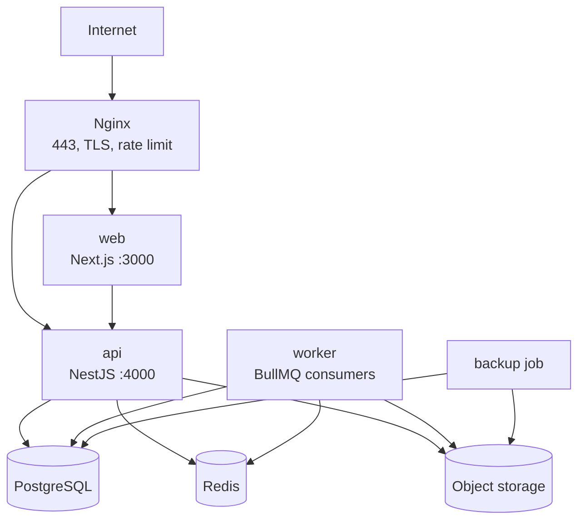

# 12 — Deployment, Environments and Release Runbook

**Status:** Accepted 2026-10-26 · recorded as D-026 in [`DECISIONS.md`](../DECISIONS.md)
**Depends on:** D-018 (stack), D-019 (one installation per institution), D-025 (Linux + OCI
containers)

This is the operational contract. It says which environments exist, what runs in each, which tool
does what, which configuration an installation needs, and how a release reaches an institution
without losing money data.

Nothing in this document is built yet. `deploy/`, the Dockerfiles and the CI workflows are the
next engineering artefacts.

---

## 1. Environments

| Environment | Purpose | Data | Lifetime |
|---|---|---|---|
| **Local** | Development and debugging | Synthetic only | Per developer |
| **CI** | Automated gates on every change | Ephemeral, thrown away | Per pipeline run |
| **Staging** | Acceptance, migration rehearsal, UI verification | Synthetic or anonymised | Persistent |
| **Production** | One per institution | Real institutional data | Persistent |
| **DR** | Restore target for drills and incidents | Restored backups | On demand |

Rules:

1. **One production installation per institution.** Never a shared production database (D-019).
2. **Staging runs the same images as production**, with different secrets and data.
3. **No production data in staging or CI.** Anonymised extracts require a written basis and are a
   last resort, not a convenience.
4. Environments are named by institution code, e.g. `prod-mfsl-001`, so a mistaken command is
   visible before it runs.

---

## 2. Topology of one installation

Only Nginx publishes ports. PostgreSQL, Redis, the API and the web server are reachable only on
the internal Docker network. There is no exception for "temporarily exposing 5432".

| Service | Image | Restart | Health check |
|---|---|---|---|
| `nginx` | `nginx:stable-alpine` | unless-stopped | `GET /healthz` |
| `web` | app image | unless-stopped | `GET /` |
| `api` | app image (different command) | unless-stopped | `GET /health` |
| `worker` | app image (worker command) | unless-stopped | queue heartbeat |
| `postgres` | `postgres:16-alpine` | unless-stopped | `pg_isready` |
| `redis` | `redis:7-alpine` | unless-stopped | `redis-cli ping` |
| `minio` *(optional)* | `minio/minio` | unless-stopped | `/minio/health/live` |

Use MinIO only where an external S3-compatible service is unavailable. Otherwise use the
institution's or the operator's private bucket.

**Sizing.** A single small SACCO runs on 2 vCPU / 4 GB RAM / 80 GB SSD. An MFI with document
volume and daily imports starts at 4 vCPU / 8 GB. Document storage grows faster than the database;
plan it separately.

---

## 3. Toolchain

| Concern | Tool | Notes |
|---|---|---|
| Container runtime | **Docker Engine + Compose v2** | Podman 5 is compatible; native systemd is the documented fallback (D-025) |
| Base images | `node:22-bookworm-slim`, `postgres:16-alpine`, `redis:7-alpine`, `nginx:stable-alpine` | Pin digests in production; Node major must match `engines` |
| Registry | **GHCR**, private | In-country Harbor if images may not leave the country |
| CI | **GitHub Actions**, `ubuntu-latest` | Lint, typecheck, unit, integration, Playwright, migration check, image scan |
| CD | SSH + `deploy/deploy.sh` | No agent to install on the institution's host |
| Migrations | `prisma migrate deploy` + SQL migrations | Dedicated step, never on app boot |
| Reverse proxy / TLS | **Nginx** + certbot (Let's Encrypt) or institution certificate | DNS-01 where the host is behind NAT |
| Secrets | File-based Compose secrets mounted at `/run/secrets` | Encrypted at rest with SOPS + age in the ops repository |
| Backups | `pgBackRest` (PITR) or `pg_dump` for small installs, plus `restic` for documents | Off-host, encrypted, in-country |
| Metrics | Prometheus + Grafana, central per fleet | `node_exporter`, `postgres_exporter`, app `/metrics` |
| Logs | Structured JSON to stdout, Docker rotation | Optional Loki where central log collection is permitted |
| Uptime | External HTTPS check per institution | Alerts on certificate expiry too |
| Image scanning | Trivy + `npm audit`, SBOM per release | Block on critical vulnerabilities |

**No Kubernetes.** One installation per institution is five to seven containers. Compose is the
right size; an orchestrator would add a control plane nobody operates.

---

## 4. Configuration contract

One `.env.example` is committed. Real values are never committed, never baked into images, and
never shared between institutions.

| Group | Variables | Secret |
|---|---|---|
| Core | `NODE_ENV`, `APP_ENV`, `TZ=Africa/Dar_es_Salaam`, `PUBLIC_BASE_URL`, `INSTITUTION_CODE`, `INSTITUTION_DIALECT` (`TCDC` \| `BOT`), `DEFAULT_LOCALE` | No |
| Database | `DATABASE_URL` | Yes |
| Queue | `REDIS_URL` | Yes |
| Auth | `JWT_SECRET`, `JWT_TTL`, `TOTP_ENCRYPTION_KEY`, `SESSION_COOKIE_DOMAIN` | Yes |
| Storage | `S3_ENDPOINT`, `S3_BUCKET`, `S3_REGION`, `S3_ACCESS_KEY`, `S3_SECRET_KEY`, `S3_FORCE_PATH_STYLE` | Mostly yes |
| Mail | `SMTP_HOST`, `SMTP_PORT`, `SMTP_USER`, `SMTP_PASSWORD`, `MAIL_FROM` | Yes |
| SMS | Provider URL, sender ID, API key | Yes |
| Payments | Per-provider keys: M-Pesa, Mixx by Yas, Airtel Money, bank API | Yes |
| Observability | `METRICS_TOKEN`, `LOG_LEVEL` | Token is secret |
| Backups | `BACKUP_S3_*`, `BACKUP_PASSPHRASE` | Yes |

Rules:

- A missing required variable **fails startup loudly**. No silent defaults for secrets or for
  `PUBLIC_BASE_URL`.
- `TZ` is set explicitly. A ledger posting dated by a server in UTC but expected in Dar es Salaam
  is a bug that surfaces at month end.
- Institution identity is configuration, not code: name, code, dialect, logo, chart-of-accounts
  template. No per-institution branches.
- `INSTITUTION_DIALECT` decides which statutory return set is active (D-006).

---

## 5. Release process

1. **PR gates** — lint, typecheck, unit, integration against real PostgreSQL, Playwright, migration
   dry-run, Trivy scan. Merge blocked on failure.
2. **Build** — one Linux image per commit, tagged with the git SHA. Prisma Client and native
   modules are compiled inside the image (D-025).
3. **Tag** — `vX.Y.Z` produces the release image. Immutable; never retag.
4. **Stage** — deploy the release to staging, run the Playwright suite against it, rehearse the
   migration on a production-shaped dump.
5. **Per institution** — in this order:
   - verify the backup completed and is readable;
   - run migrations as the `migrator` role;
   - `docker compose pull && docker compose up -d`;
   - smoke test: login, one read from each module, `/health`, queue heartbeat;
   - watch errors and queue depth for 30 minutes.
6. **Rollback** — redeploy the previous image tag. Migrations are expand/contract, so the previous
   application version still runs against the migrated schema.

A short maintenance window at night is acceptable for this product. Blue/green is not justified
until an institution has staff working across midnight.

---

## 6. Migration rules

- **Forward-only.** Corrections are new migrations, never edits to an applied one.
- **Expand, then contract.** Add nullable columns and new tables first; deploy code that writes
  both; remove the old shape in a later release. This is what makes rollback safe.
- **Backup first.** A migration without a verified backup is not run.
- **Advisory lock.** The migration step takes a lock so two deploys cannot race.
- **Least privilege.** Migrations run as `migrator`, not as the application role.
- **Tested on staging** against a production-shaped database, with the slowest reports timed.

---

## 7. Backup and restore

| Question | Answer |
|---|---|
| What | PostgreSQL, object storage, secrets, release manifest |
| How often | Nightly full; WAL archiving where PITR is enabled |
| Retention | 30 daily, 12 monthly |
| Encryption | At rest and in transit; passphrase held outside the host |
| Location | Off-host, in-country; never only on the institution's server |
| Restore drill | Monthly, timed, into an isolated network |
| Targets | RPO ≤ 15 minutes with WAL; RTO ≤ 4 hours |

A backup that has never been restored is a hypothesis. The drill result is recorded per
institution, with the time it took.

---

## 8. Host hardening checklist

- [ ] Deploy user is non-root, SSH keys only, password login disabled.
- [ ] Firewall allows 22, 80, 443 only. No database or Redis port reachable from outside.
- [ ] Docker socket not exposed; no container runs `--privileged`.
- [ ] Unattended security upgrades enabled; NTP synchronised.
- [ ] TLS only, HSTS, secure and httpOnly cookies, no mixed content.
- [ ] Nginx rate limits on login and payment callbacks; request body limits set.
- [ ] Log rotation configured; disk alerts at 80%.
- [ ] Backups verified; restore drill recorded.
- [ ] Monitoring agent reporting before the institution is handed over.

---

## 9. Bootstrapping a new institution

1. Provision the Linux host and DNS record.
2. Issue the TLS certificate and confirm renewal.
3. Generate secrets; store them encrypted in the ops repository; place them on the host.
4. Start the stack; run migrations.
5. Seed the chart of accounts template, products, approval stages and the statutory return set for
   the dialect.
6. Create the first administrator; enrol MFA; force password change on first login.
7. Import nothing. The institution starts greenfield (D-014).
8. Run the smoke test and record the release version.
9. Hand over with the support contact and the backup schedule.

---

## 10. Still to be built

`deploy/compose.yml`, `deploy/nginx/`, `deploy/scripts/{deploy,migrate,backup,restore,healthcheck}.sh`,
`Dockerfile`, `.github/workflows/ci.yml`, the Prometheus scrape configuration and the Grafana
dashboards. This document is the specification for those files, not a description of them.

**Open:** the hosting provider and domain plan per institution (`O-013`). The design assumes one
public HTTPS hostname per installation; the naming scheme is decided with the provider.

---

## 11. Previewing work during development

The agent and the developer share one machine, so a running dev server is visible in the local
browser. No tunnel or deployment is needed to review a slice.

| Item | Value |
|---|---|
| Web | `npm run dev` in `apps/web` → `http://localhost:3000` |
| API | `npm run start:dev` in `apps/api` → `http://localhost:4000` |
| Database / cache | `localhost:5432` / `localhost:6379`, internal only |
| Hot reload | Next.js Fast Refresh and Nest watch mode; no rebuild between edits |

**Build the shell against fixtures first.** The first UI slice renders the dashboard from typed
synthetic fixtures, so header, sidebar, KPI cards and chart are visible before PostgreSQL, auth or
the API exist. Wiring replaces the fixture source; it does not rewrite the components.

**Auth bypass is local-only.** A dev session may skip login under `APP_ENV=local`. The flag is
refused at startup in staging and production; it is never a runtime toggle.

**Verification is measurement, not impression.** Playwright runs at 1837×1080, reads computed
styles and bounding boxes against `docs/11 §8`, checks the console, and writes screenshots to
`artifacts/ui/` (gitignored). The reported result is the measured values.

**Parity check before calling a slice done.** `npm run build && npm start` must render the same
screen; a dev-only success is not a success.

**Remote demo.** Use a tunnel only for a deliberate demonstration, never with real data and never
as a substitute for staging.
