# 13 — Build sequence, page by page

**Status:** Accepted 2026-10-26
**Depends on:** `docs/09` (what the pages are), `docs/10` (how it is built), `docs/11` (how it must
look), `docs/12` (how it ships), `DECISIONS.md` (D-018…D-026)

This is the execution order. One page at a time, verified in a real browser, committed to GitHub,
then the next. There are **no time estimates** here on purpose: progress is counted in pages closed,
not in days.

---

## 1. Rules of the sequence

1. **A vertical slice, not a screen.** A page is done when its schema, API, UI, permissions, states
   and tests exist. A static mock is a prototype, not a page.
2. **Never start a page whose data does not exist.** Settings and products precede the accounts
   that consume them; the ledger precedes every money movement; audit events precede System Logs.
3. **Templates before instances.** The six page templates in `docs/09 §5` are built once in
   Phase 1 and reused. A new page is configuration of a template, not a new design.
4. **Verify, then commit, then continue.** No page is followed by another page until its gate in §3
   passes.
5. **One page, one commit.** Exceptions are the scaffold and the design system, which land as a
   small series of commits.
6. **The blueprint is the scope, `docs/11` is the look.** When they disagree, `docs/11` wins on
   visual values and the blueprint wins on fields and behaviour.
7. **Statistics must reconcile.** The tracker in this document carries all 147 documented pages.
   If a page is added, removed or split, the totals at the end of each phase are re-derived.

---

## 2. The per-page protocol

1. Read **only** that page's row in `docs/09 §6`, plus the relevant entity in `docs/05`, report spec
   in `docs/06`, or flow in `docs/03`. Grep, do not re-read whole documents.
2. Add or change the schema and migration if the page needs new data. Separate commit.
3. Implement the API endpoint with validation, permission guard, audit event and idempotency where
   it mutates money.
4. Build the page from its template. No one-off layout unless the template genuinely does not fit;
   if it does not, fix the template.
5. Seed deterministic synthetic fixtures so the page renders without hand-entered data.
6. Implement the four states: loading, empty, error, forbidden. A page with only the happy path is
   not done.
7. Write the tests: unit for logic, integration for the endpoint, one Playwright smoke for the
   route.
8. Run the browser gate in §3. Fix what it finds.
9. Commit and push. Tick the page in this document.

---

## 3. The verification gate

Every page is measured at **1837×1080** and **1280×800**, in a real browser, with the console open.

### 3.1 Automated assertions

One reusable script, `tools/ui-audit`, is built in Phase 1 and run per route and per phase. It takes
one authenticated route per invocation (`AUDIT_URL`), runs both viewports and the collapsed state,
and asserts shell, typography, overflow and console checks everywhere. Dashboard content checks
run only when the route ends in `/dashboard`.

| Check | Expected |
|---|---|
| Header height | 68px |
| Tenant logo | image, 28px tall, ≤190px wide, 40px monogram fallback |
| Sidebar width, expanded | 204px |
| Sidebar width, collapsed | 76px |
| Active nav pill | 36px tall, x=8→195.3, radius 6px, background `#057573` |
| Sidebar row / sub-item | 36px (Settings link 34px) / 28px; icon 20px on x=28 |
| Sidebar item count | exactly 12, in the order in `docs/11 §4` |
| Sidebar footer | 73px; collapse control 44px on the rail edge |
| Tab card / tabs | 54px, radius 8px / 154×44, radius 6px |
| KPI grid | 8 cards, fixed 4 per row, 94.8px tall, 12px gap |
| Page background | `#ebe9e9` |
| Card radius / padding | 8px; KPI 14px, chart and portfolio 30px |
| Card border | 1px, `#dee2e6`, no heavy shadow |
| Floating chat button | 60px circle, `#037674`, right 20 / bottom 16 |
| Text | every rendered node is 12.8px |
| Horizontal scrollbar | none at 1837×1080 and none at 1280×800 |
| Console | zero errors, zero warnings, zero unhandled rejections |
| Requests | zero failed same-origin requests, zero HTTP 5xx |
| Fonts | loaded, no fallback flash in the screenshot |

### 3.2 Interaction assertions

- Sidebar collapses and expands; icons stay on the same axis; no clipped labels; tooltips work.
- Every dropdown: opens, closes on outside click and Escape, is keyboard navigable, returns focus to
  the trigger, and is not clipped inside a scrolling container.
- Every modal: traps focus, closes on Escape, restores focus, and cannot double-submit.
- Every table: sorts, paginates, remembers filters in the URL, and exports.
- Every form: inline validation, server-side errors surfaced, unsaved-changes guard where data loss
  is possible.

### 3.3 Domain assertions

- Money renders as TZS with two decimals and grouping; it is never a JS `number` in transit.
- Dates render and post in `Africa/Dar_es_Salaam`.
- A forbidden action returns 403 **and** is hidden in the UI; hiding alone is not a control.
- Every mutation writes an audit event that System Logs can later show.
- A double submit with the same idempotency key produces one posting.

### 3.4 Production parity

`npm run build && npm start` renders the same page. A dev-only success is not a success.

### 3.5 Screenshots

Saved to `artifacts/ui/audit/<route>-<viewport>.png` with `report.json` in the same directory
(gitignored); the scripts resolve this from the repository root regardless of the working directory.
The commit message records the measured values that matter, not a link to an image the reviewer
cannot see.

---

## 4. Commit and branch policy

**Format**

```
feat(<module>): <page name>

Route: /<route>
- what was built
- tests added
- measured: header 68, sidebar 204, pill 36, bg #ebe9e9, no overflow, console clean
```

**Cadence**

- One commit per page, pushed immediately. Main must always build.
- Schema changes land as `feat(db): …` before the page that uses them.
- A phase ends with a tag: `phase-03-ledger`, `phase-07-teller`, and so on.
- The ticked tracker in this file is committed with the last page of the phase.

**Branches**

Direct commits to `main` are fine for ordinary pages because CI gates them. Use a short-lived
branch, a pull request and a review pass for anything that can lose money or lock users out:

| Change | Branch |
|---|---|
| Authentication, sessions, MFA | `feat/auth` |
| Ledger schema, posting engine, migrations | `feat/ledger-core` |
| Teller, disbursement, reversal, write-off | `feat/teller` |
| Statutory return logic | `feat/statutory` |
| Bulk import | `feat/import` |

Merge with a merge commit so the per-page history survives. Never force-push `main`.

**Never commit**

- Real member data, `.env` files, keys, the `ocr/` or `merged/` corpora.
- A failing typecheck, a skipped test, or a disabled lint rule added to get green.
- Generated screenshots or build output.

---

## 5. Working efficiently

The goal is to spend effort on pages, not on process. These rules exist so a small fix does not turn
into a research project.

### 5.1 Skills

Load a skill **at the start of a phase that matches it**, not for every task, and never more than two
at once. A typo, a colour value or a one-line fix gets no skill: fix it, verify it, commit it.

| Phase | Skills |
|---|---|
| 0 Scaffold | `docker`, `github-ci`, `nextjs` |
| 1 Shell and design system | `frontend-ui-engineering`, `tailwind-css`; shadcn MCP for components |
| 2 Identity | `authentication-patterns`, `security-and-hardening`, `prisma-orm` |
| 3 Ledger | `postgres`, `sql-migrations`, `test-driven-development` |
| 4 Configuration | `backend-api`, `prisma-orm` |
| 5 Client | `backend-api`, `security-and-hardening` (uploads), `accessibility` |
| 6 Accounts and loans | `test-driven-development`, `backend-api` |
| 7 Transactions | `test-driven-development`, `security-and-hardening`, `observability` |
| 8 Accounting | `postgres`, `backend-api` |
| 9 Reports | `postgres`, `backend-api`, `accessibility` |
| 10 Import | `security-and-hardening`, `backend-api` |
| 11 Messages | `security-and-hardening`, `backend-api` |
| 12 Business account | `backend-api` |
| 13 System Logs | `observability`, `accessibility` |
| 14 Hardening | `accessibility`, `performance`, `security-hardening`, `code-review`, `repo-audit` |

### 5.2 Reuse

- **One audit script**, parameterised by one authenticated route per run (`AUDIT_URL`). Do not
  rewrite browser checks per page; add route-specific assertions only where the page has content
  beyond the shell.
- **One seed** with deterministic synthetic data, extended as modules land. No hand-typed fixtures.
- **Six templates** (T1–T6). Build the template, then configure it.
- **One report engine.** A report is a definition: parameters, SQL, columns, totals, export. The
  viewer is built once.
- **One settings CRUD factory** for the many list/edit pairs in Settings and Messages.
- **One browser session** for a verification run; do not relaunch Playwright per route.

### 5.3 Batching without skipping

- Pages that share a template may be built in a batch (for example the 17 statutory returns), but
  **every route is loaded and asserted by the audit script**. The first page of a family gets a
  manual visual review; outliers get another.
- A batch is never spread across phases.
- If a page reveals a template defect, fix the template and re-run the audit for every route that
  uses it before continuing.

### 5.4 Questions

Collect ambiguities and ask them at the **start** of a phase, in one batch. Do not stop the build
mid-page for something that can wait, and do not invent a business rule to keep moving — record it
as an assumption row or an open item.

---

## 6. Phase map

```mermaid
flowchart LR
    P0["0 Scaffold"] --> P1["1 Shell + Dashboard"]
    P1 --> P2["2 Identity"]
    P2 --> P3["3 Ledger"]
    P3 --> P4["4 Configuration"]
    P4 --> P5["5 Client"]
    P5 --> P6["6 Accounts"]
    P6 --> P7["7 Transactions"]
    P7 --> P8["8 Accounting"]
    P8 --> P9["9 Reports"]
    P9 --> P10["10 Import"]
    P10 --> P11["11 Messages"]
    P11 --> P12["12 Business account"]
    P12 --> P13["13 System Logs"]
    P13 --> P14["14 Hardening + release"]
```



| Phase | Pages | Cumulative | Nature |
|---|---:|---:|---|
| 0 Scaffold | 0 | 0 | Infrastructure |
| 1 Shell + Dashboard | 1 | 1 | Visual foundation |
| 2 Identity | 3 | 4 | Security foundation |
| 3 Ledger | 4 | 8 | Money foundation |
| 4 Configuration | 23 | 31 | Products, policies, branches |
| 5 Client | 4 | 35 | Master data |
| 6 Accounts | 13 | 48 | Savings and loans |
| 7 Transactions | 7 | 55 | Money movement |
| 8 Accounting | 20 | 75 | Books and financial statements |
| 9 Reports | 55 | 130 | Operational and statutory |
| 10 Import | 6 | 136 | Bulk data |
| 11 Messages | 9 | 145 | Notifications |
| 12 Business account | 1 | 146 | Separate bounded context |
| 13 System Logs | 1 | 147 | Oversight |
| 14 Hardening + release | 0 | 147 | Parity, a11y, DR, v1.0.0 |

`ST-28` (Services) is **deferred by D-015** and is the only documented page not built in the MVP.
`WB-01` is built last because its commercial purpose should be confirmed before effort is spent;
if AIMSCAMS does not bill institutions through the application, it is dropped by decision and the
total becomes 145. Three authentication screens (`/login`, `/login/mfa`, `/forgot-password`) are
required but are **outside the 147-page inventory**; they are listed in Phase 2 for completeness.

---

## 7. Phase 0 — Scaffold and toolchain

**Goal.** A repository that builds, tests, runs and ships before a single business page exists.

**Work**

- npm workspaces: `apps/web` (Next.js + TypeScript), `apps/api` (NestJS), `apps/worker` (BullMQ),
  `packages/contracts` (shared Zod schemas), `packages/domain`, `packages/ledger`.
- TypeScript strict, ESLint, Prettier, path aliases, `engines` pinned to Node 22.
- Prisma initialised against PostgreSQL 16; Redis; MinIO for local S3.
- Tailwind and shadcn/ui initialised; **tokens replaced with `docs/11` values**, not the shadcn
  defaults.
- `Dockerfile` producing one image with three commands (web, api, worker), built on Linux.
- `deploy/compose.yml` for local infrastructure and a production-shaped stack.
- `.env.example` with every variable in `docs/12 §4`; startup fails on a missing required value.
- GitHub Actions: install, lint, typecheck, unit, integration against PostgreSQL, build. Image
  build and Trivy scan on `main`.
- `tools/ui-audit` skeleton and `tools/seed` skeleton.

**Gate**

- `npm ci && npm run build && npm test && npm run typecheck` all pass on a clean clone.
- `docker compose up` starts PostgreSQL, Redis and MinIO; the API health endpoint responds.
- The web app serves a page with the correct background and font, no console errors.
- CI is green on `main`.

**Commit.** `chore: scaffold web, api, worker, contracts and CI`

---

## 8. Phase 1 — Design system, shell and Dashboard

**Goal.** The visual contract becomes real and testable. From here, every page is assembled from
proven parts.

**Pages**

| Done | ID | Route | Page | Template | Risk |
|---|---|---|---|---|---|
| [ ] | DB-01 | `/dashboard` | Dashboard | Custom | M |

**Work**

- Tokens from `docs/11` as CSS custom properties and Tailwind theme values. No hard-coded hex in
  components.
- Primitives: Button, Input, Select, Checkbox, Radio, Textarea, Card, Table, Badge, Tabs, Dropdown,
  Dialog, Sheet, Tooltip, Pagination, EmptyState, StatCard, ChartCard, PageHeader, FilterBar.
- Header (68px), sidebar (204px, 12 items, exact order, chevrons as specified), collapse control,
  footer wordmark, floating chat button (60px), content grid.
- The collapsed sidebar is **76px** and keeps the icon axis at x=28; the value is recorded in
  `docs/11 §4` and enforced by the audit.
- Dashboard from typed fixtures: 8 KPI tiles, funds in/out, portfolio composition, unposted
  transactions banner, branch context.
- Campaigns is a real link with a plain `Soon` note; every sidebar destination resolves to a page
  or the shared `ComingSoon` placeholder (`D-027`).
- `tools/ui-audit` complete; baseline screenshots at both widths, expanded and collapsed.

**Gate**

- Every automated assertion in §3.1 passes on `/dashboard`.
- Collapse, all dropdowns, all modals and the chart tooltip behave per §3.2.
- The 12 items are in the exact order; Campaigns is focusable and resolves to a page.
- Production build renders identically.

**Commit.** One per component group, then `feat(dashboard): dashboard shell with fixtures`

---

## 9. Phase 2 — Identity, tenancy and access

**Goal.** Real users, real sessions, real permissions. Everything after this is gated by them.

**Pages**

| Done | ID | Route | Page | Template | Risk |
|---|---|---|---|---|---|
| [ ] | ST-03 | `/settings-administrator` | User management list | T1 | M |
| [ ] | ST-04 | `/settings-administrator-add` | New / edit user | T6 | M |
| [ ] | ST-05 | `/settings-role` | Roles and permission matrix | T6 | H |

Plus three screens outside the inventory: sign in, MFA challenge/enrolment, password reset.

**Work**

- Prisma models: organisation, branch, user, role, permission, role-permission, session, MFA secret,
  MFA challenge, password reset token, login attempt, audit event.
- Argon2id password hashing; TOTP enrolment and recovery codes; lockout and throttling; secure,
  httpOnly, same-site session cookie; CSRF defence.
- Permission model from `docs/09 §3` — `Entity : Action`, 17 roles, segregation-of-duties rules.
- Server-side guard on every endpoint, UI hides what the user cannot do.
- Branch context in the session; switching branch re-scopes data.
- Audit events for login, logout, failed login, role change, user status change.
- Local-only auth bypass behind `APP_ENV=local`, refused at startup anywhere else.

**Gate**

- Login, MFA, lockout and reset work end to end.
- A role change takes effect on the next request; a revoked session is rejected immediately.
- A user without permission gets 403 from the API and no visible action.
- Segregation-of-duties violations are rejected server-side.
- Auth screens match the shell and pass §3.

**Branch.** `feat/auth` → PR → merge commit.

---

## 10. Phase 3 — Ledger and accounting foundation

**Goal.** The books exist before any money moves.

**Pages**

| Done | ID | Route | Page | Template | Risk |
|---|---|---|---|---|---|
| [x] | GL-01 | `/accounting-chart-of-accounts` | Chart of accounts (read-only list; tree detail deferred, `D-029`) | T1/T3 | H |
| [x] | GL-02 | `/accounting-entries` | Journal entries | T1 | H |
| [x] | GL-03 | `/accounting-ledger-entries` | Ledger entries | T1 | M |
| [x] | ST-02 | `/settings/accounting` | Accounting settings | T6 | H |

`/accounting` is the module hub; it links only to the four pages above.

**Work**

- Bring `packages/ledger/src/schema.sql` into the migration stream without weakening a single
  invariant: balance trigger, immutability, period guard, composite tenant keys, RLS.
- Chart of accounts read-only list, seeded from the ledger chart (18 accounts in the demo). The tree
  grouping, opening balances and bank/cash/reconciliation flags move to the full Accounting phase
  (`D-029`).
- Journal entry create/post/reverse; balanced-line editor; period selection; status `Posted` /
  `Archived`; reversal idempotent per original entry.
- Ledger drilldown with account and date filters, opening/closing/running balance on the account's
  normal side, and an entry link back to the journal detail.
- Financial year, periods, open/close/reopen, tax rates, inter-branch ledger, posting-policy
  versions (edits append a version; never overwrite history).
- Posting service used by every later module; **outbox table** written in the same transaction.
- Worker consumes the outbox into BullMQ with idempotency keys, leases expired claims, copies
  exhausted events to a dead-letter queue, and refuses unregistered event types. Read-only
  `GET /accounting/outbox` exposes counts and the oldest due event.
- Opening-balance import path for a new institution is deferred to the Accounting phase
  (`D-029`); it is an explicit action, never a migration.

**Gate**

- An unbalanced entry is rejected by the database, not only by the service.
- Posted entries and lines cannot be updated or deleted; a reversal posts a new entry.
- A posting outside an open period is refused; closing a period with a draft entry is refused.
- Killing the worker after commit does not lose the event; replay is idempotent, an expired lease
  is recovered, and the dead-letter queue is empty after a clean run.
- Trial balance balances after a scripted sequence of entries.
- Cross-tenant lines are impossible; RLS is exercised by a test.
- `/dashboard`, `/accounting`, `/accounting-chart-of-accounts`, `/accounting-entries`,
  `/accounting-ledger-entries` and `/settings/accounting` pass the route audit at both widths with
  all four states.

**Branch.** `feat/ledger-core` → PR → merge commit. This is the highest-risk phase in the build.

---

## 11. Phase 4 — Configuration: branches, products, policies

**Goal.** The institution can describe itself and its products. Accounts and loans read this
configuration; they never hard-code a rate, a fee or an approval stage.

**Pages**

### 4a — Organisation

| Done | ID | Route | Page | Template | Risk |
|---|---|---|---|---|---|
| [x] | ST-01 | `/settings/general` | General settings | T6 | M |
| [x] | ST-06 | `/settings/branches` | Branches | T1 | L |
| [x] | ST-07 | `/settings/branches/new`, `/settings/branches/[id]` | Add / edit branch | T6 | M |

ST-01 owns the institution profile: legal name, registration number, dialect, IANA time zone,
default branch and logo. ST-06 is the branch network with server-side search and status filter.
ST-07 is a create page and an edit page rather than a modal, so opening hours and the address have
room. Weekly hours are seven integer minute fields per branch (`opensMinute`, `closesMinute`);
public holidays stay in ST-27 under 4c (`D-030`). The tenant logo is stored in the tenant database
as bytes with an optional external URL (`D-031`).

Permissions are `Settings Organisation : View/Edit` for ST-01 and `Settings Branch : View/Create/Edit`
for ST-06/ST-07. A View-only role gets the branch form with every control disabled and no Save
button; a role without Create gets the shared forbidden panel on `/settings/branches/new`.

### 4b — Products

| Done | ID | Route | Page | Template | Risk |
|---|---|---|---|---|---|
| [x] | ST-08 | `/settings-products-loan` | Loan products | T1 | M |
| [x] | ST-09 | `/settings-products-loan-5` | Loan product detail | T3 | H |
| [x] | ST-10 | `/settings-products-savings` | Savings products | T1 | M |
| [x] | ST-11 | `/settings-products-savings-create` | Create savings product | T6 | M |
| [x] | ST-12 | `/settings-products-savings-edit-1` | Edit savings product | T6 | M |
| [x] | ST-13 | `/settings-products-interest-rate` | Interest rates | T1 | L |
| [x] | ST-14 | `/settings-products-interest-rate-create` | Create interest rate | T6 | L |
| [x] | ST-15 | `/settings-products-fee-penalties` | Fees and penalties | T1/T6 | M |
| [x] | ST-16 | `/settings-products-loan-provisioning` | Provisioning rules | T1 | M |
| [x] | ST-17 | `/settings-products-loan-provisioning-create` | Create provisioning rule | T6 | M |

### 4c — Policies and calendar

| Done | ID | Route | Page | Template | Risk |
|---|---|---|---|---|---|
| [x] | ST-18 | `/settings-policies-membership-policy` | Membership policies | T1 | M |
| [x] | ST-19 | `/settings-policies-membership-policy-create` | Create membership policy | T6 | M |
| [x] | ST-20 | `/settings-policies-membership-policy-1` | Membership policy 1 | T3 | M |
| [x] | ST-21 | `/settings-policies-membership-policy-1-edit` | Edit membership policy 1 | T6 | M |
| [x] | ST-22 | `/settings-policies-membership-policy-2` | Membership policy 2 | T3 | M |
| [x] | ST-23 | `/settings-policies-membership-policy-2-edit` | Edit membership policy 2 | T6 | M |
| [x] | ST-24 | `/settings-policies-credit-product-policy` | Credit product policies | T1 | M |
| [x] | ST-25 | `/settings-policies-credit-product-policy-5` | Credit policy 5 | T3 | H |
| [x] | ST-26 | `/settings-policies-credit-product-policy-5-edit` | Edit credit policy 5 | T6 | H |
| [x] | ST-27 | `/settings-policies-holidays` | Holiday calendar | T1/T6 | L |

**Work**

- Branch: address, council type (CC/MC/DC/TC), weekly opening hours and default flag in 4a;
  the holiday calendar is ST-27 in 4c.
- Loan product editor: ~60 fields in seven groups, four workflow stages with default role and
  assignee, six GL mappings to concrete codes.
- Savings product: limits, guarantor/collateral flags, multiple accounts, interest payout.
- Interest rates, fees and penalties, provisioning buckets and rates seeded as `assumption` rows.
- **Policy vs product versioning:** the product is live configuration; the policy is the approved
  snapshot with a signature trail. A loan pins `product_policy_version`.
- Effective dates and four-eyes approval on policy changes.

**Gate (per sub-phase)**

- A product cannot be saved with a GL mapping to a non-existent ledger.
- A policy version cannot be edited after approval; a correction creates a new version.
- A change is visible in the audit trail with the actor and the before/after values.
- Organisation identity, time zone and default branch persist; a View-only role cannot edit them.
- A branch writes all seven weekdays, and promoting a branch to default demotes the previous one.
- The holiday calendar affects due-date calculation in a unit test.
- Every page passes §3.

**Commit.** Per page; tag `phase-04a`, `phase-04b`, `phase-04c`.

---

## 12. Phase 5 — Client / Members

**Goal.** A member or group exists, is verified, and can hold accounts.

**Pages**

| Done | ID | Route | Page | Template | Risk |
|---|---|---|---|---|---|
| [x] | CL-01 | `/clients` | Client list | T1 | M |
| [x] | CL-02 | `/clients-create` | Add client (6 steps) | T2 | H |
| [x] | CL-03 | `/clients-create-group` | Add group (3 steps) | T2 | M |
| [x] | CL-04 | `/clients-group-1789` | Member / group 360 | T3 | H |

**Work**

- Member, group, membership policy binding, reference number, relationship manager.
- Six-step individual wizard with next-of-kin percentages totalling 100.
- Three-step group wizard with meeting schedule.
- 13-tab profile: Details, KYC, Income, Residence, Assets, Bank, Members, Users, Charges, History,
  Statement, Transaction, MNO.
- KYC document upload to private S3 with type, expiry and approval; 5 MB limit; virus and MIME
  checks.
- Duplicate detection on national ID, TIN, phone and name.
- Member activation link; status transitions with audit events.
- Statement and transaction tabs read from the ledger once accounts exist; until then, an honest
  empty state — not fabricated numbers.

**Gate**

- Create an individual and a group end to end; both appear in the list and the profile.
- Next-of-kin percentages that do not total 100 are rejected server-side.
- A duplicate national ID is blocked with a clear message.
- KYC upload rejects oversized and wrong-type files; the document is not publicly reachable.
- All 13 tabs render, including empty and forbidden states.
- Every page passes §3.

---

## 13. Phase 6 — Accounts: savings first, then loans

**Goal.** Savings accounts and the full loan lifecycle, from application to a live account with a
correct schedule.

**Order.** Savings before loans: they are simpler, and guarantor funds and collateral checks depend
on them.

### 6a — Savings

| Done | ID | Route | Page | Template | Risk |
|---|---|---|---|---|---|
| [ ] | AC-13 | `/account-saving` | Savings list + new account | T1 | M |

### 6b — Loan applications

| Done | ID | Route | Page | Template | Risk |
|---|---|---|---|---|---|
| [ ] | AC-01 | `/account-loan-application` | Application list | T1 | M |
| [ ] | AC-02 | `/account-loan-application-create` | New application (5 steps) | T2 | H |
| [ ] | AC-03 | `/account-loan-application-details-39` | Application detail | T3 | H |
| [ ] | AC-04 | `/account-loan-application-details-124` | Application detail (second sample) | T3 | M |
| [ ] | AC-05 | `/account-loan-application-edit-39` | Edit application | T2 | H |

### 6c — Loan accounts

| Done | ID | Route | Page | Template | Risk |
|---|---|---|---|---|---|
| [ ] | AC-06 | `/account-loan` | Loan list (Active / New / Closed) | T1 | M |
| [ ] | AC-07 | `/account-loan-details-118-summary` | Loan summary | T3 | H |
| [ ] | AC-08 | `/account-loan-details-118-schedule` | Repayment schedule | T3 | H |
| [ ] | AC-09 | `/account-loan-details-118-repayments` | Repayment history | T3 | M |
| [ ] | AC-10 | `/account-loan-details-118-guarantors` | Guarantors and collateral | T3 | H |
| [ ] | AC-11 | `/account-loan-details-118-documents` | Documents | T3 | L |
| [ ] | AC-12 | `/account-loan-details-118-transactions` | Loan transactions | T3 | M |

**Work**

- Savings account creation from an eligible product, with limits and multiple-account rules.
- Application wizard with the three-level economic sector (the MSP03 axis), documents, and stage
  timeline; editable only before first approval.
- Credit workflow: stages, roles, assignees, maker-checker, rejection reasons.
- Schedule generation: reducing balance, flat, interest-on-grace, installment start date, holidays.
- Guarantor reservations: block savings and shares, enforce minimum guarantors and percentages.
- Collateral register with valuation and ratio.
- Loan summary with policy version, provisioning status, balances and dates.
- Named commands: online repayment, top-up, reschedule, write-off, interest waiver, close,
  delinquent. Each permission-checked and audited.
- Approval creates the loan account and schedule; **disbursement happens in Phase 7**, through the
  teller, so the money path has one implementation.

**Gate**

- A schedule generated for each interest method matches a hand-computed fixture to the cent.
- Rounding never loses or invents a minor unit; the final installment absorbs the residue.
- Guarantor blocks cannot exceed available funds; releasing a guarantee is audited.
- An application cannot be edited after first approval.
- Approval creates exactly one account and one schedule, even on retry.
- The loan list tabs and every detail tab pass §3.

**Branch.** `feat/loans` if the schedule or allocation logic needs review; otherwise per-page on
main.

---

## 14. Phase 7 — Transactions and the request centre

**Goal.** Money moves correctly, once, with two status axes and a human approval trail.

**Pages**

| Done | ID | Route | Page | Template | Risk |
|---|---|---|---|---|---|
| [ ] | TX-01 | `/transaction-teller-transaction` | Teller console | T5 | H |
| [ ] | RQ-01 | `/requests` | Request centre | T1 | H |
| [ ] | TX-02 | `/transaction-teller-transaction-request` | Teller approval request | T5 | H |
| [ ] | TX-03 | `/transaction-teller-transaction-history` | Teller history | T1 | M |
| [ ] | TX-04 | `/transaction-online-transaction` | Online collections | T5 | H |
| [ ] | TX-05 | `/transaction-online-payment-reconciliation` | Reconciliation workspace | T5/T1 | H |
| [ ] | TX-06 | `/transaction-all-transaction` | All transactions | T1 | M |

**Work**

- Teller console with 23 transaction types across four categories: client (10), general ledger (8),
  till administration (3), bulk (2).
- Till opening with denomination capture, closing with counted-vs-system variance, assignment and
  approval.
- Two status axes stored and displayed separately: operational (`Submitted` / `Approved` /
  `Reversed` / `Cancelled`) and accounting (`Pending` / `Posted` / `Failed`).
- Polymorphic request entity with typed payloads: till, reversal, fee/penalty reversal, GL above
  threshold, write-off, waiver.
- Online collections with provider reference; reconciliation upload, matching, unmatched queue.
- All transactions with the unposted banner and `Resubmit`.
- Every posting through the Phase 3 posting service and outbox; idempotency key on every submit.
- Receipt generation and reprint.

**Gate**

- Deposit, withdrawal, share purchase, loan repayment and disbursement each produce one balanced
  posting and the correct member and GL balances.
- A double-click or retried submit produces one transaction and one posting.
- A rejected request leaves no accounting entry.
- Till close with a variance is blocked until approved, and the variance is recorded.
- Reversal restores balances and never edits the original.
- The unposted banner appears when the worker is stopped, and clears on resubmit.
- Every page passes §3.

**Branch.** `feat/teller` → PR → merge commit. This phase can lose real money if it is wrong.

---

## 15. Phase 8 — Accounting completion

**Goal.** The remaining books: assets, fixed assets, the financial statements and reconciliation.

**Pages**

| Done | ID | Route | Page | Template | Risk |
|---|---|---|---|---|---|
| [ ] | GL-04 | `/accounting-assets` | Asset types | T1 | L |
| [ ] | GL-05 | `/accounting-fixed-asset` | Fixed asset register | T1 | M |
| [ ] | GL-06 | `/accounting-reports` | Financial report hub | Hub | L |
| [ ] | GL-07 | `/accounting-reports-TrialBalanceReport` | Trial balance | T4 | H |
| [ ] | GL-08 | `/accounting-reports-ComprehensiveTrialBalance` | Comprehensive trial balance | T4 | M |
| [ ] | GL-09 | `/accounting-reports-MonthlyTrialBalance` | Monthly trial balance | T4 | M |
| [ ] | GL-10 | `/accounting-reports-FinancialPositionReport` | Financial position | T4 | H |
| [ ] | GL-11 | `/accounting-reports-IncomeStatementReport` | Income statement | T4 | H |
| [ ] | GL-12 | `/accounting-reports-CashFlowStatement` | Cash flow statement | T4 | H |
| [ ] | GL-13 | `/accounting-reports-CashBook` | Cash book | T4 | M |
| [ ] | GL-14 | `/accounting-reports-GeneralLedgerBook` | General ledger book | T4 | M |
| [ ] | GL-15 | `/accounting-reports-LedgerStatementReport` | Ledger statement | T4 | M |
| [ ] | GL-16 | `/accounting-reports-JournalBook` | Journal book | T4 | M |
| [ ] | GL-17 | `/accounting-reports-OwnersEquity` | Owner's equity | T4 | M |
| [ ] | GL-18 | `/accounting-reports-Assets` | Assets | T4 | M |
| [ ] | GL-19 | `/accounting-reports-notes-of-account` | Notes of account | T4 | M |
| [ ] | GL-20 | `/accounting-reports-CorporateTaxStatement` | Corporate tax statement | T4 | M |
| [ ] | GL-21 | `/accounting-reports-Reconciliation` | Reconciliation | T4 | H |
| [ ] | GL-22 | `/accounting-reports-reconcile-statement` | Reconcile statement | T4 | H |
| [ ] | GL-23 | `/accounting-reports-reconcile-statement-settings` | Reconciliation settings | T6 | M |

**Work**

- Fixed asset register: acquisition, valuation, depreciation schedule, disposal; post depreciation
  through the ledger.
- Financial report engine on top of the Phase 3 data: comparatives, drilldown, export.
- Bank reconciliation: statement import, matching, adjustments, sign-off.
- Report definitions produce the same numbers as the trial balance and the ledger drilldown.

**Gate**

- Trial balance debits equal credits for every period.
- Financial position balances; income statement closes to retained earnings.
- Cash flow reconciles to the movement in cash and bank ledgers.
- Drilling from a statement line reaches the underlying entries.
- Reconciliation cannot sign off with unmatched lines unless a reason is recorded.
- Every page passes §3.

---

## 16. Phase 9 — Reports (55 routes)

**Goal.** Every operational and statutory report, from one engine, with exports and validation.

**Order and pages**

### 9a — Engine and hubs (2)

| Done | ID | Route | Page | Risk |
|---|---|---|---|---|
| [ ] | RP-01 | `/reports-loan` | Loan report hub | L |
| [ ] | RP-32 | `/reports-statement` | Statement hub | L |

### 9b — Loan reports (25)

| Done | ID | Route | Report | Risk |
|---|---|---|---|---|
| [ ] | RP-02 | `/reports-loan-ActiveLoanReport` | Active loans | M |
| [ ] | RP-03 | `/reports-loan-AllLoanReport` | All loans | M |
| [ ] | RP-04 | `/reports-loan-PendingLoanApplications` | Pending applications | M |
| [ ] | RP-05 | `/reports-loan-LoanDisbursementReport` | Disbursements | M |
| [ ] | RP-06 | `/reports-loan-LoanRepaymentReport` | Repayments | M |
| [ ] | RP-07 | `/reports-loan-LoanOutstandingReport` | Outstanding | M |
| [ ] | RP-08 | `/reports-loan-LoanArrearsReport` | Arrears | H |
| [ ] | RP-09 | `/reports-loan-LoanAgingReport` | Aging | H |
| [ ] | RP-10 | `/reports-loan-PortfolioRiskReport` | Portfolio risk | H |
| [ ] | RP-11 | `/reports-loan-SummarizedPortfolioAtRiskReport` | Portfolio at risk | H |
| [ ] | RP-12 | `/reports-loan-RiskClassificationOfAssets` | Risk classification | H |
| [ ] | RP-13 | `/reports-loan-IssuedLoansAndArrearsReport` | Issued vs arrears | M |
| [ ] | RP-14 | `/reports-loan-ExpectedLoanRepaymentsReport` | Expected repayments | M |
| [ ] | RP-15 | `/reports-loan-ExpectedRepaymentReport` | Expected by installment | M |
| [ ] | RP-16 | `/reports-loan-ExpectedPaymentByDateReport` | Expected by date | M |
| [ ] | RP-17 | `/reports-loan-AccruedInterestReport` | Accrued interest | H |
| [ ] | RP-18 | `/reports-loan-AccruedInstallmentsReport` | Accrued installments | M |
| [ ] | RP-19 | `/reports-loan-DeferredInterestReport` | Deferred interest | M |
| [ ] | RP-20 | `/reports-loan-FeeStatusReport` | Fee status | M |
| [ ] | RP-21 | `/reports-loan-GuarantorsReport` | Guarantors | M |
| [ ] | RP-22 | `/reports-loan-LoanInsuranceReport` | Loan insurance | L |
| [ ] | RP-23 | `/reports-loan-LoanOfficerIncomeReport` | Officer income | M |
| [ ] | RP-24 | `/reports-loan-PaidOffLoansReport` | Paid-off loans | L |
| [ ] | RP-25 | `/reports-loan-TransactionReport` | Loan transactions | M |
| [ ] | RP-26 | `/reports-loan-WrittenOffLoanReport` | Written-off loans | M |

### 9c — Savings, client and transaction reports (9)

| Done | ID | Route | Report | Risk |
|---|---|---|---|---|
| [ ] | RP-27 | `/reports-saving-SavingReport` | Savings | M |
| [ ] | RP-28 | `/reports-saving-SavingSnapshotReport` | Savings snapshot | M |
| [ ] | RP-29 | `/reports-saving-SavingBeyondPolicyLimitsReport` | Beyond policy limits | M |
| [ ] | RP-30 | `/reports-client-ClientListReport` | Client list | M |
| [ ] | RP-31 | `/reports-client-MemberVerificationReport` | Member verification | M |
| [ ] | RP-35 | `/reports-transaction-DailyTransactionReport` | Daily transactions | M |
| [ ] | RP-36 | `/reports-transaction-ExpenseReport` | Expenses | L |
| [ ] | RP-37 | `/reports-transaction-FeesIncomeReport` | Fee income | L |
| [ ] | RP-38 | `/reports-transaction-ReversedTransactionReport` | Reversals | M |

### 9d — Statements (2)

| Done | ID | Route | Report | Risk |
|---|---|---|---|---|
| [ ] | RP-33 | `/reports-statement-AccountStatementReport` | Account statement | M |
| [ ] | RP-34 | `/reports-statement-MemberStatementReport` | Member statement | M |

### 9e — Statutory returns (17)

| Done | ID | Route | Return | Risk |
|---|---|---|---|---|
| [ ] | RP-39 | `/reports-msp-MSP01Report` | MSP01 | H |
| [ ] | RP-40 | `/reports-msp-MSP02Report` | MSP02 | H |
| [ ] | RP-41 | `/reports-msp-MSP03MFIReport` | MSP03 (MFI) | H |
| [ ] | RP-42 | `/reports-msp-MSP03Type1Report` | MSP03 Type 1 | H |
| [ ] | RP-43 | `/reports-msp-MSP03Type2Report` | MSP03 Type 2 | H |
| [ ] | RP-44 | `/reports-msp-MSP04Report` | MSP04 | H |
| [ ] | RP-45 | `/reports-msp-MSP04MFIReport` | MSP04 (MFI) | H |
| [ ] | RP-46 | `/reports-msp-MSP05Report` | MSP05 (TCDC) | H |
| [ ] | RP-47 | `/reports-msp-MSP05MFIReport` | MSP05 (BoT) | H |
| [ ] | RP-48 | `/reports-msp-MSP06Report` | MSP06 | H |
| [ ] | RP-49 | `/reports-msp-MSP07Report` | MSP07 | H |
| [ ] | RP-50 | `/reports-msp-MSP08Report` | MSP08 | H |
| [ ] | RP-51 | `/reports-msp-MSP09Report` | MSP09 (TCDC) | H |
| [ ] | RP-52 | `/reports-msp-MSP09MFIReport` | MSP09 (BoT) | H |
| [ ] | RP-53 | `/reports-msp-MSP10Report` | MSP10 (TCDC) | H |
| [ ] | RP-54 | `/reports-msp-MSP10MFIReport` | MSP10 (BoT) | H |
| [ ] | RP-55 | `/reports-msp-MSP11Report` | MSP11 | H |

**Work**

- One report engine: parameter schema, SQL, column definitions, totals, export (CSV/XLSX/PDF),
  saved reports, permission per report.
- Every list remembers filters in the URL; date presets resolve in Dar es Salaam.
- Statutory template registry keyed by `(dialect, code, version)`; MSP05, MSP09 and MSP10 differ
  between TCDC and BoT and are separate definitions, not one screen with a flag.
- Validation panel: missing data, unbalanced sections, cross-foot checks. A return cannot be marked
  ready while validation fails.
- Submission record with acknowledgement attachment and status.
- Report totals must reconcile to the ledger or the loan/savings subledger; a report that cannot
  reconcile says so rather than showing a wrong number.

**Gate (per family)**

- Each report returns the same total as its source query on the same fixture; cross-foot checks pass.
- Empty, loading, error and forbidden states render.
- Export opens correctly in Excel and PDF and matches the grid.
- A statutory return fails validation on deliberately incomplete data and passes on complete data.
- Pagination and large-result behaviour are tested with a synthetic volume set.
- Every route passes §3; the first page of each family gets a manual visual review.

**Branch.** `feat/statutory` for 9e only.

---

## 17. Phase 10 — Import

**Goal.** A 1,000-row file imports correctly, or fails per row with a reason.

**Pages**

| Done | ID | Route | Page | Template | Risk |
|---|---|---|---|---|---|
| [ ] | IM-01 | `/import-member` | Member import batches | T1 | M |
| [ ] | IM-02 | `/import-member-new` | Member import wizard | T2 | H |
| [ ] | IM-03 | `/import-account` | Account import batches | T1 | M |
| [ ] | IM-04 | `/import-account-new` | Account import wizard | T2 | H |
| [ ] | IM-05 | `/import-transaction` | Transaction import batches | T1 | M |
| [ ] | IM-06 | `/import-transaction-new` | Transaction import wizard | T2 | H |

**Work**

- Four-step wizard: upload (`.csv`, `.xlsx`, `.xls`, 10 MB) → field mapping → validate and preview →
  result.
- Streaming parse, per-row validation, duplicate handling, partial success with a downloadable error
  file.
- Batch record with reference, file, totals and uploader; idempotency by file hash and reference.
- Transaction import posts through the same service as the teller, never with direct SQL.
- Access to uploaded files is private and expiring.

**Gate**

- A 1,000-row member file imports; a file with 10 bad rows imports 990 and reports 10 with line
  numbers.
- Re-uploading the same file does not duplicate records.
- A transaction import produces a balanced posting or none.
- A malicious file (formula injection, wrong MIME, oversized) is rejected.
- Every page passes §3.

**Branch.** `feat/import` → PR.

---

## 18. Phase 11 — Messages and service providers

**Goal.** Transactional messages work; marketing is consent-gated and separate.

**Pages**

| Done | ID | Route | Page | Template | Risk |
|---|---|---|---|---|---|
| [ ] | MS-01 | `/messages-message-logs` | Delivery logs | T1 | M |
| [ ] | MS-02 | `/messages-template-list` | Templates | T1 | M |
| [ ] | MS-03 | `/messages-template-list-create-3793` | Template editor | T6 | M |
| [ ] | MS-04 | `/messages-segment-list` | Segments | T1 | M |
| [ ] | MS-05 | `/messages-segment-list-create` | Create segment | T2 | M |
| [ ] | MS-06 | `/messages-send-message` | Send message | T6 | M |
| [ ] | MS-07 | `/messages-users-list` | Message users | T1 | M |
| [ ] | MS-08 | `/messages-recharge-credits` | Recharge credits | T6 | M |
| [ ] | ST-28 | `/settings-service-provider` | Service providers | T1 | L |

`ST-28` is **deferred by D-015**; it is listed here so the page is not lost, and is built only if
the SMS/email provider configuration is not handled inside Messages.

**Work**

- Template registry with 70 seeded templates, English and Swahili tabs, SMS character count,
  versioning and enable/disable.
- Transactional vs marketing as a legal control: marketing requires recorded consent and a working
  opt-out; transactional does not.
- Segments with a filter builder, preview count and exclusion list.
- Send via a provider adapter with a local stub; retries, delivery callbacks and per-message status.
- Delivery logs with credits and failure reasons; no message body containing sensitive data in logs.
- Credit balance and recharge record; no card data ever touches the application.

**Gate**

- A test SMS and email reach the stub and appear in the log with the right status.
- A marketing send to a non-consenting member is refused.
- Opt-out takes effect on the next send.
- Template version used for a send is recorded.
- Every page passes §3.

---

## 19. Phase 12 — Business account (scope check first)

**Goal.** The tenant billing wallet, if AIMSCAMS bills institutions through the product.

| Done | ID | Route | Page | Template | Risk |
|---|---|---|---|---|---|
| [ ] | WB-01 | `/core-wba-business-account` | Tenant billing account | Custom | M |

**Before building:** confirm the commercial model. If AIMSCAMS invoices institutions outside the
application, record a decision, drop this page, and re-derive the total as 145 (146 if `ST-28` is
also dropped). Do not build a wallet nobody funds.

**If built:** wallet balances, invoices, top-up, quick loan, fee settings, pending settlement,
statement download. It is a separate bounded context: it does **not** post to the institution's
member ledger, and its three ledger codes (`1001`, `5501`, `2002`) are tenant-billing accounts, not
member accounts.

**Gate.** Wallet movements reconcile; a top-up produces an invoice or a credit, never both; the page
passes §3.

---

## 20. Phase 13 — System Logs

**Goal.** One place to answer "who did this" and "what is broken".

| Done | ID | Route | Page | Template | Risk |
|---|---|---|---|---|---|
| [ ] | SL-01 | `/system-logs` | System Logs | T1/T3 | M |

**Work**

- Append-only event store fed by every mutation since Phase 2: actor, role, branch, IP, user agent,
  entity, entity ID, before/after, correlation ID, timestamp.
- Six tabs per `docs/09 §7`: Activity, Security, Accounting, Integrations, Errors, Data changes.
- Filters by date, actor, module, severity, correlation ID; saved views.
- Retention policy and export; access restricted to auditor and administrator roles.
- No sensitive values in the log: amounts are allowed, passwords, tokens and full account numbers
  are not.

**Gate**

- A scripted action in each earlier module appears with the correct actor and correlation ID.
- An auditor can trace one transaction from UI action to posting to message to log.
- A user without the role cannot read the security tab.
- Retention and export work on a large fixture set.
- The page passes §3.

---

## 21. Phase 14 — Hardening, parity and release

**Goal.** Remove the legacy shell, prove the whole surface, and ship `v1.0.0`.

**Work**

- Delete `apps/web/aimscams-web` (Angular) after a route-by-route parity check against this tracker.
- Full accessibility pass: keyboard, focus order, labels, contrast, screen-reader names on tables and
  charts.
- Performance: bundle budget, route-level code splitting, image and font strategy, slow-report
  indexes.
- Security review: OWASP Top Ten checklist, dependency audit, secret scan, permission matrix
  re-test, rate limits, file-upload review.
- Backup and restore drill on staging, timed and recorded; DR runbook exercised.
- Load test the teller and the heaviest reports with synthetic volume.
- Staging deploy of the release image; smoke test per `docs/12 §5`.
- Documentation: runbook, support matrix, known assumptions, `AGENTS.md` current state.
- Tag `v1.0.0`.

**Gate**

- No Angular code remains; every route in the tracker is served by Next.js.
- Full route audit passes at both widths with a clean console.
- No critical or high vulnerability in the image scan or dependency audit.
- Restore drill meets RPO ≤ 15 min and RTO ≤ 4 h.
- A new institution can be bootstrapped from the runbook without engineering help.
- `v1.0.0` is deployed to staging and smoke-tested.

---

## 22. Phase exit checklist (applies to every phase)

- [ ] Every page in the phase is ticked in this document.
- [ ] The full route audit passes for every page built so far, not only the new ones.
- [ ] `npm run build`, `npm test`, `npm run typecheck` pass on a clean clone.
- [ ] No skipped tests, no new `eslint-disable`, no `@ts-ignore` without a written reason.
- [ ] New environment variables are in `.env.example` and `docs/12`.
- [ ] New permissions are in the role matrix and tested.
- [ ] New audit events are visible in System Logs (from Phase 13) or in the audit table.
- [ ] `AGENTS.md` current state is accurate.
- [ ] Tag pushed.

---

## 23. Tracker totals

| Module | Documented | Built in MVP | Deferred |
|---|---:|---:|---:|
| Dashboard | 1 | 1 | 0 |
| Client | 4 | 4 | 0 |
| Accounts | 13 | 13 | 0 |
| Transactions | 6 | 6 | 0 |
| Accounting | 23 | 23 | 0 |
| Requests | 1 | 1 | 0 |
| Messages | 8 | 8 | 0 |
| Reports | 55 | 55 | 0 |
| Import | 6 | 6 | 0 |
| Business account | 1 | 1 | 0 |
| Settings | 28 | 27 | 1 (`ST-28`) |
| System Logs | 1 | 1 | 0 |
| **Total** | **147** | **146** | **1** |

Plus three authentication screens outside the inventory. If `WB-01` is dropped after the Phase 12
scope check, built becomes 145 and deferred 2.

---

## 24. Start here

Phase 0, in order:

1. Workspaces, TypeScript, lint and format.
2. Next.js app, NestJS app, worker, shared packages.
3. PostgreSQL, Redis and MinIO for local development.
4. Prisma initialised; no business models yet.
5. Tailwind + shadcn with `docs/11` tokens.
6. Dockerfile and local compose.
7. CI pipeline.
8. `tools/ui-audit` and `tools/seed` skeletons.

Phase 1 then delivers the first screen you can open in your browser: the shell and the Dashboard,
measured, at `http://localhost:3000`.
